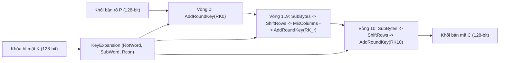
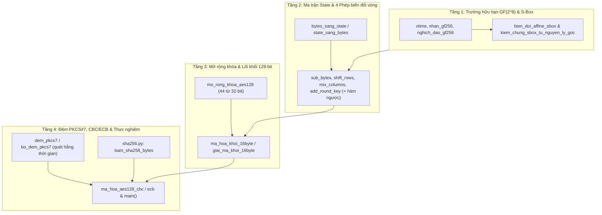

# BÁO CÁO ĐỒ ÁN AN TOÀN THÔNG TIN: MẬT MÃ KHÓA ĐỐI XỨNG AES-128

- **Họ và tên sinh viên**: Trần Gia Thuận
- **Chữ số cuối SID**: 3
- **Ngôn ngữ & Môi trường thực thi**: Python thuần 3.12 (cài đặt từ nguyên lý gốc — *From First Principles*, không sử dụng thư viện mật mã có sẵn)
- **Mã nguồn thực nghiệm**: [aes128.py](./aes128.py) (kết nối trực tiếp với [sha256.py](./sha256.py) để trích xuất khóa 128-bit từ họ tên sinh viên)

---

## Mục 1. Bối cảnh lịch sử (Cuộc thi NIST, thuật toán Rijndael) và động lực thiết kế

### 1.1. Sự suy yếu của chuẩn DES và cuộc thi tuyển chọn AES của NIST
Từ năm 1977, chuẩn mã hóa dữ liệu **DES** (*Data Encryption Standard* – FIPS PUB 46) với kích thước khối 64-bit và chiều dài khóa hiệu dụng chỉ 56-bit đã đóng vai trò trụ cột trong bảo mật tài chính và chính phủ. Tuy nhiên, đến cuối thập niên 1990, không gian khóa $2^{56} \approx 7.2 \times 10^{16}$ của DES không còn đủ sức chống đỡ trước các hệ thống tính toán phân tán và phần cứng vét cạn chuyên dụng (điển hình là máy *Deep Crack* của tổ chức EFF năm 1998 đã phá khóa DES chỉ trong 56 giờ, và giảm xuống còn 22 giờ vào năm 1999). Giải pháp tình thế **3DES** (*Triple-DES*) tuy nâng độ dài khóa lên 112 hoặc 168 bit nhưng lại có tốc độ thực thi trên phần mềm rất chậm (chậm hơn DES gấp 3 lần) và kích thước khối vẫn bị giới hạn ở 64 bit (dễ tổn thương trước tấn công nghịch lý ngày sinh như *Sweet32* khi mã hóa lượng dữ liệu lớn).

Trước bối cảnh đó, ngày **02/01/1997**, Viện Tiêu chuẩn và Công nghệ Quốc gia Hoa Kỳ (**NIST**) chính thức phát động cuộc thi công khai toàn cầu nhằm tìm kiếm chuẩn mã hóa tiên tiến **AES** (*Advanced Encryption Standard*). NIST đặt ra các tiêu chí kỹ thuật bắt buộc:
- Là hệ mật mã khối đối xứng có **kích thước khối cố định 128 bit** (16 byte) và hỗ trợ ba mức **độ dài khóa: 128, 192 và 256 bit**.
- Phải hoàn toàn công khai, miễn phí bản quyền trên toàn thế giới (*royalty-free*).
- Có độ an toàn vượt trội trước mọi kỹ thuật phân tích mật mã hiện đại, đồng thời có hiệu năng thực thi cao trên cả vi xử lý 32-bit/64-bit, thẻ thông minh (*smartcard* 8-bit) lẫn mạch phần cứng FPGA/ASIC.

Tháng 8/1998, tại hội nghị AES lần thứ nhất, 15 thuật toán ứng viên hợp lệ từ khắp thế giới được công bố. Tháng 8/1999, NIST chọn ra 5 ứng viên vào vòng chung kết (*Finalists*): **MARS** (IBM), **RC6** (RSA Laboratories), **Rijndael** (Joan Daemen & Vincent Rijmen – Bỉ), **Serpent** (Ross Anderson, Eli Biham, Lars Knudsen) và **Twofish** (Bruce Schneier và cộng sự). Sau hơn 3 năm đánh giá khắt khe bởi cộng đồng mật mã quốc tế, vào ngày **02/10/2000**, NIST tuyên bố thuật toán **Rijndael** của hai nhà mật mã học người Bỉ là **Joan Daemen** và **Vincent Rijmen** giành chiến thắng. Ngày **26/11/2001**, AES chính thức được ban hành thành chuẩn liên bang **FIPS PUB 197**.

### 1.2. Động lực và triết lý thiết kế của Rijndael / AES
Khác với DES sử dụng mạng Feistel (chỉ biến đổi một nửa khối dữ liệu trong mỗi vòng), Rijndael được thiết kế dựa trên cấu trúc **Mạng Thay thế – Hoán vị** (**SPN** – *Substitution-Permutation Network*), biến đổi đồng thời toàn bộ 128 bit trạng thái trong mỗi vòng theo ba nguyên tắc cốt lõi:
1. **Chiến lược Vết rộng (Wide Trail Strategy)**: Tách biệt rõ ràng lớp phi tuyến cục bộ (*SubBytes* – chống phân tích tuyến tính và vi sai) với lớp khuếch tán tuyến tính (*ShiftRows* và *MixColumns* dùng ma trận MDS có hệ số nhánh $B = 5$), đảm bảo trong 4 vòng liên tiếp bất kỳ luôn có ít nhất $5^2 = 25$ S-Box hoạt động (*active S-boxes*).
2. **Đơn giản và đối xứng đại số**: Mọi phép toán đều được định nghĩa chặt chẽ trên trường hữu hạn $GF(2^8)$ và vành đa thức trên $GF(2^8)$, không cần lưu trữ các bảng hoán vị bit phức tạp, có thể cài đặt chỉ với vài kilobyte bộ nhớ ROM trên vi điều khiển 8-bit.
3. **Phá vỡ tính đối xứng nội tại**: Lịch trình mở rộng khóa sử dụng hằng số vòng $Rcon$ trên $GF(2^8)$ kết hợp phép thế phi tuyến $SubWord$, ngăn chặn các khóa yếu (*weak keys*) hoặc khóa nửa yếu (*semi-weak keys*) từng xuất hiện trong DES.

---

## Mục 2. Cơ sở toán học nền tảng (Trường hữu hạn $GF(2^8)$ và đa thức tối giản)

### 2.1. Biểu diễn byte dưới dạng đa thức trên trường Galois $GF(2^8)$
Trong AES, đơn vị dữ liệu cơ bản là 1 byte gồm 8 bit: $b = (b_7 b_6 b_5 b_4 b_3 b_2 b_1 b_0)_2$. Thay vì coi byte là số nguyên thông thường trong $\mathbb{Z}_{256}$, AES ánh xạ mỗi byte thành một đa thức bậc tối đa bằng 7 với các hệ số thuộc trường nhị phân $GF(2) = \{0, 1\}$:

$$b(x) = b_7 x^7 + b_6 x^6 + b_5 x^5 + b_4 x^4 + b_3 x^3 + b_2 x^2 + b_1 x + b_0 = \sum_{i=0}^{7} b_i x^i \quad (b_i \in \{0, 1\})$$

Ví dụ: Byte $\text{0x57} = 01010111_2$ tương ứng với đa thức $x^6 + x^4 + x^2 + x + 1$.

Trường hữu hạn (*Galois Field*) $GF(2^8)$ gồm đúng $2^8 = 256$ phần tử được xây dựng bằng vành thương đa thức $GF(2)[x] / (m(x))$, trong đó đa thức tối giản (*irreducible polynomial*) bậc 8 được chuẩn FIPS 197 chọn cố định là:

$$m(x) = x^8 + x^4 + x^3 + x + 1 \quad (\text{biểu diễn nhị phân: } 100011011_2 = \text{0x11B})$$

Đa thức $m(x)$ không thể phân tích thành tích của các đa thức bậc thấp hơn trên $GF(2)$, do đó tập các đa thức dư bậc $< 8$ lập thành một trường đại số hữu hạn hoàn chỉnh.

### 2.2. Các phép toán số học trên $GF(2^8)$
1. **Phép cộng và phép trừ trong $GF(2^8)$**:
   Cộng hai đa thức được thực hiện bằng cách cộng các hệ số cùng bậc theo modulo 2. Vì trong $GF(2)$, $1 + 1 \equiv 0 \pmod 2$ và $-1 \equiv +1 \pmod 2$, phép cộng và phép trừ trùng nhau và chính là phép **XOR ($\oplus$)** từng bit giữa hai byte:
   $$A(x) + B(x) = A(x) - B(x) \equiv A \oplus B$$

2. **Phép nhân với $x$ (Hàm `xtime`) và phép nhân đa thức modulo $m(x)$**:
   Khi nhân một phần tử $b(x)$ với đa thức $x$ (tương ứng byte $\text{0x02}$):
   $$x \cdot b(x) = b_7 x^8 + b_6 x^7 + b_5 x^6 + b_4 x^5 + b_3 x^4 + b_2 x^3 + b_1 x^2 + b_0 x$$
   - Nếu $b_7 = 0$: kết quả có bậc $< 8$, nên chỉ cần dịch trái 1 bit: `b << 1`.
   - Nếu $b_7 = 1$: xuất hiện số hạng $x^8$. Vì $m(x) = x^8 + x^4 + x^3 + x + 1 \equiv 0 \pmod{m(x)}$, ta có đồng nhất thức rút gọn:
     $$x^8 \equiv x^4 + x^3 + x + 1 \pmod{m(x)} \quad (\text{tương ứng byte thấp } \text{0x1B} = 00011011_2)$$
     Do đó, phép rút gọn modulo $m(x)$ chỉ đơn giản là dịch trái 1 bit (bỏ bit tràn thứ 8) rồi **XOR với `0x1B`**:
     $$\operatorname{xtime}(b) = \begin{cases} (b \ll 1) \land \text{0xFF} & \text{nếu } (b \land \text{0x80}) = 0 \\ ((b \ll 1) \oplus \text{0x1B}) \land \text{0xFF} & \text{nếu } (b \land \text{0x80}) \neq 0 \end{cases}$$
   Mọi phép nhân bất kỳ $A(x) \otimes B(x) \bmod m(x)$ đều được phân rã thành tổng XOR của các phép gọi lặp `xtime` (thuật toán nhân nông dân Nga). Chẳng hạn:
   $$\{\texttt{03}\} \otimes b = (\{\texttt{02}\} \oplus \{\texttt{01}\}) \otimes b = \operatorname{xtime}(b) \oplus b$$

3. **Phép nghịch đảo nhân và cấu trúc toán học của S-Box**:
   Với mọi phần tử $a \in GF(2^8) \setminus \{0\}$, tồn tại duy nhất phần tử nghịch đảo $a^{-1} \in GF(2^8)$ sao cho $a \otimes a^{-1} \equiv 1 \pmod{m(x)}$. Theo định lý Fermat nhỏ trên trường hữu hạn có $2^8 - 1 = 255$ phần tử khác không, $a^{255} = 1 \Rightarrow a^{-1} = a^{254}$ (với quy ước $0^{-1} = 0$).
   Hộp thế **S-Box** của AES được tạo từ 2 bước toán học liên tiếp:
   - **Bước 1 (Phi tuyến trên $GF(2^8)$)**: Thay byte đầu vào $a$ bằng nghịch đảo nhân $b = a^{-1} \in GF(2^8)$.
   - **Bước 2 (Biến đổi Affine khả nghịch trên $GF(2)^8$)**: Phá vỡ cấu trúc đại số đơn giản trên $GF(2^8)$ bằng phép nhân ma trận nhị phân và cộng hằng số $c = \text{0x63} = (01100011)_2$:
     $$b'_i = b_i \oplus b_{(i+4)\bmod 8} \oplus b_{(i+5)\bmod 8} \oplus b_{(i+6)\bmod 8} \oplus b_{(i+7)\bmod 8} \oplus c_i, \quad i \in \{0, \dots, 7\}$$
     Hằng số $\text{0x63}$ được chọn đặc biệt để đảm bảo S-Box không có điểm bất động ($\operatorname{S-Box}(a) \neq a$) và không có điểm đối bất động ($\operatorname{S-Box}(a) \neq \overline{a}$).

4. **Vành đa thức 4 hệ số trên $GF(2^8)$ trong phép MixColumns**:
   Mỗi cột 4 byte $(s_0, s_1, s_2, s_3)^T$ của trạng thái được xem là đa thức bậc 3: $s(X) = s_3 X^3 + s_2 X^2 + s_1 X + s_0 \in GF(2^8)[X]$. Phép `MixColumns` chính là phép nhân $s(X)$ với đa thức cố định $a(X) = \{\texttt{03}\}X^3 + \{\texttt{01}\}X^2 + \{\texttt{01}\}X + \{\texttt{02}\}$ theo modulo $(X^4 + 1)$, còn `InvMixColumns` là nhân với đa thức nghịch đảo $a^{-1}(X) = \{\texttt{0b}\}X^3 + \{\texttt{0d}\}X^2 + \{\texttt{09}\}X + \{\texttt{0e}\} \pmod{X^4 + 1}$.

---

## Mục 3. Quy trình vận hành chi tiết (Mã hóa, Giải mã và Mở rộng khóa)

### 3.1. Ma trận trạng thái (State Matrix)
Một khối dữ liệu 128-bit (16 byte: $p_0, p_1, \dots, p_{15}$) được xếp vào ma trận trạng thái $S$ kích thước $4 \times 4$ theo **thứ tự cột (column-major order)**:

$$S = \begin{bmatrix} s_{0,0} & s_{0,1} & s_{0,2} & s_{0,3} \\ s_{1,0} & s_{1,1} & s_{1,2} & s_{1,3} \\ s_{2,0} & s_{2,1} & s_{2,2} & s_{2,3} \\ s_{3,0} & s_{3,1} & s_{3,2} & s_{3,3} \end{bmatrix} = \begin{bmatrix} p_0 & p_4 & p_8 & p_{12} \\ p_1 & p_5 & p_9 & p_{13} \\ p_2 & p_6 & p_{10} & p_{14} \\ p_3 & p_7 & p_{11} & p_{15} \end{bmatrix}$$

Với AES-128, độ dài khóa là $N_k = 4$ từ 32-bit (16 byte), kích thước khối là $N_b = 4$ từ 32-bit (16 byte), và số vòng lặp là $N_r = 10$ vòng.

### 3.2. Quy trình mở rộng khóa (Key Expansion – 10 vòng)
Thuật toán mở rộng khóa nhận khóa gốc 16 byte và sinh ra 11 khóa vòng ($RoundKey_0 \dots RoundKey_{10}$), gồm tổng cộng $4 \times (10 + 1) = 44$ từ 32-bit được ký hiệu là $W_0, W_1, \dots, W_{43}$:
1. **Khởi tạo 4 từ đầu ($i = 0, 1, 2, 3$)**: Tách trực tiếp khóa gốc 16 byte thành 4 từ 4-byte: $W_0, W_1, W_2, W_3$ (lập thành $RoundKey_0$).
2. **Sinh các từ tiếp theo ($i = 4 \dots 43$)**:
   Đặt biến tạm $temp = W_{i-1}$.
   - Nếu $i$ chia hết cho 4 ($i \bmod 4 = 0$):
     $$temp = \operatorname{SubWord}(\operatorname{RotWord}(temp)) \oplus [Rcon_{i/4}, \text{0x00}, \text{0x00}, \text{0x00}]$$
     Trong đó:
     - $\operatorname{RotWord}([a_0, a_1, a_2, a_3]) = [a_1, a_2, a_3, a_0]$ (xoay vòng trái 1 byte).
     - $\operatorname{SubWord}([b_0, b_1, b_2, b_3]) = [\operatorname{S-Box}(b_0), \operatorname{S-Box}(b_1), \operatorname{S-Box}(b_2), \operatorname{S-Box}(b_3)]$.
     - $Rcon_{j} = x^{j-1} \bmod m(x)$ với 10 giá trị lần lượt là: `01, 02, 04, 08, 10, 20, 40, 80, 1B, 36`.
   - Tính từ mới:
     $$W_i = W_{i-4} \oplus temp$$

### 3.3. Quy trình Mã hóa (Encryption)
1. **Vòng 0 (Bước làm trắng khóa ban đầu – Initial Key Whitening)**:
   - Thực hiện duy nhất phép `AddRoundKey`: $S \leftarrow S \oplus RoundKey_0$.
2. **9 vòng chính (Vòng $r = 1$ đến $9$)**: Mỗi vòng thực hiện tuần tự 4 phép biến đổi:
   - **`SubBytes(S)`**: Thay thế từng byte $s_{r,c} \leftarrow \operatorname{S-Box}[s_{r,c}]$.
   - **`ShiftRows(S)`**: Dịch vòng sang trái dòng thứ $r$ đi $r$ vị trí byte ($r \in \{0, 1, 2, 3\}$):
     - Dòng 0: giữ nguyên; Dòng 1: dịch trái 1 byte; Dòng 2: dịch trái 2 byte; Dòng 3: dịch trái 3 byte.
   - **`MixColumns(S)`**: Nhân từng cột $c \in \{0, 1, 2, 3\}$ với ma trận MDS trên $GF(2^8)$:
     $$\begin{bmatrix} s'_{0,c} \\ s'_{1,c} \\ s'_{2,c} \\ s'_{3,c} \end{bmatrix} = \begin{bmatrix} \texttt{02} & \texttt{03} & \texttt{01} & \texttt{01} \\ \texttt{01} & \texttt{02} & \texttt{03} & \texttt{01} \\ \texttt{01} & \texttt{01} & \texttt{02} & \texttt{03} \\ \texttt{03} & \texttt{01} & \texttt{01} & \texttt{02} \end{bmatrix} \begin{bmatrix} s_{0,c} \\ s_{1,c} \\ s_{2,c} \\ s_{3,c} \end{bmatrix}$$
   - **`AddRoundKey(S, RoundKey_r)`**: XOR ma trận trạng thái với khóa vòng thứ $r$.
3. **Vòng 10 (Vòng cuối)**:
   - Thực hiện 3 bước: **`SubBytes(S)` $\to$ `ShiftRows(S)` $\to$ `AddRoundKey(S, RoundKey_{10})`** (bỏ qua `MixColumns` để cấu trúc mã hóa và giải mã đối xứng, đồng thời `MixColumns` ở cuối không tăng độ an toàn vì không có khóa bí mật mới phía sau nó).

### 3.4. Quy trình Giải mã (Decryption) và chế độ vận hành CBC kèm đệm PKCS#7
Do mọi bước trong AES đều là song ánh khả nghịch, quá trình giải mã một khối 16 byte thực hiện các phép biến đổi ngược với thứ tự khóa vòng đảo ngược từ $RoundKey_{10}$ về $RoundKey_0$:
1. **Khởi tạo**: `AddRoundKey(S, RoundKey_{10})`.
2. **Vòng $r = 9$ giảm về $1$**: `InvShiftRows(S)` $\to$ `InvSubBytes(S)` $\to$ `AddRoundKey(S, RoundKey_r)` $\to$ `InvMixColumns(S)` (nhân từng cột với ma trận nghịch đảo chứa hệ số `{0e, 0b, 0d, 09}` trên $GF(2^8)$).
3. **Vòng cuối**: `InvShiftRows(S)` $\to$ `InvSubBytes(S)` $\to$ `AddRoundKey(S, RoundKey_0)`.

Để mã hóa một chuỗi văn bản tiếng Việt UTF-8 có độ dài bất kỳ:
- **Đệm dữ liệu PKCS#7 (RFC 5652)**: Gắn thêm $p = 16 - (L \bmod 16)$ byte vào cuối bản rõ ($1 \le p \le 16$), mỗi byte đều có giá trị bằng $p$. Khi giải mã, kiểm tra đồng nhất các byte đệm và cắt bỏ đúng $p$ byte cuối.
- **Chế độ CBC (Cipher Block Chaining)**: Mỗi khối bản rõ $P_i$ được XOR với khối bản mã liền trước $C_{i-1}$ trước khi đưa vào hàm mã hóa khối AES (khối đầu tiên $P_1$ được XOR với Vector khởi tạo $IV$ 16 byte):
  $$C_i = E_K(P_i \oplus C_{i-1}), \quad P_i = D_K(C_i) \oplus C_{i-1} \quad (\text{với } C_0 = IV)$$

---

## Mục 4. Các giả định an toàn, tính chất bảo mật và các tấn công đã biết

### 4.1. Các giả định an toàn và tính chất bảo mật
AES-128 được thiết kế để đóng vai trò một **Hoán vị giả ngẫu nhiên mạnh** (*Strong Pseudorandom Permutation – PRP*): với bất kỳ kẻ tấn công nào không biết khóa bí mật $K$, hàm mã hóa $E_K$ không thể phân biệt được với một phép hoán vị ngẫu nhiên thực sự trên tập $\{0,1\}^{128}$ nếu chi phí tính toán thấp hơn vét cạn không gian khóa $2^{128}$.

> [!IMPORTANT]
> **Tính làm rối (Confusion) & Tính khuếch tán (Diffusion)**: Hộp thế `S-Box` đạt bậc đại số tối đa bằng 7 và độ phi tuyến bằng 112; trong khi sự phối hợp giữa `ShiftRows` (phân tán 4 byte của một cột sang 4 cột khác nhau) và `MixColumns` (ma trận MDS có số nhánh $B = 5$) đảm bảo chỉ cần **1 byte thay đổi** ở đầu vào thì sau **đúng 2 vòng**, toàn bộ 16 byte của ma trận trạng thái đều thay đổi hoàn toàn (*Full Diffusion*).

### 4.2. Khả năng kháng lại các tấn công đã biết
1. **Phân tích mật mã vi sai và tuyến tính (Differential & Linear Cryptanalysis)**:
   - Trong `S-Box` của AES, xác suất lan truyền vi sai lớn nhất khác không chỉ là $4/256 = 2^{-6}$, và độ lệch tương quan tuyến tính tối đa là $2^{-3}$.
   - Theo định lý *Wide Trail*, bất kỳ đường truyền vi sai hoặc tuyến tính nào qua 4 vòng của AES đều kích hoạt tối thiểu **25 S-Box**. Xác suất của một đặc trưng vi sai 4 vòng bị chặn trên bởi $(2^{-6})^{25} = 2^{-150} < 2^{-128}$. Với 10 vòng đầy đủ, AES-128 miễn nhiễm hoàn toàn trước phân tích vi sai và tuyến tính cổ điển.
2. **Tấn công Biclique (Bogdanov và cộng sự, 2011)**:
   - Là kỹ thuật phân tích lý thuyết tốt nhất hiện nay trên 10 vòng của AES-128, giảm độ phức tạp từ $2^{128}$ xuống $2^{126.1}$ phép toán nhưng đòi hỏi $2^{88}$ bản rõ chọn trước — hoàn toàn bất khả thi về mặt vật lý.
3. **Tấn công kênh kề định thời và Padding Oracle**:
   - Các cài đặt dùng bảng tra RAM (`S_BOX` / *T-tables*) có thể rò rỉ khóa qua thời gian truy xuất bộ nhớ đệm CPU (*Cache-Timing Attack* – Bernstein, 2005); chế độ CBC không kèm xác thực MAC có thể bị khai thác qua **Padding Oracle Attack** (Vaudenay, 2002) nếu máy chủ phản hồi chi tiết lỗi đệm.
   - *Phòng vệ*: Dùng tập lệnh phần cứng thời gian hằng số **AES-NI** hoặc kỹ thuật **Bitslicing**, kiểm tra đệm không rẽ nhánh sớm với thông báo lỗi đồng nhất (đã áp dụng trong `bo_dem_pkcs7` của [aes128.py](./aes128.py)), và trong thực tế sản xuất ưu tiên chế độ mã hóa xác thực **AES-GCM** hoặc **Encrypt-then-MAC (AES-CBC + HMAC-SHA256)**.

---

## Mục 5. Ưu điểm, hạn chế và ứng dụng thực tế

### 5.1. So sánh AES-128 với các hệ mật mã đối xứng tiêu biểu

| Tiêu chí kỹ thuật | DES (FIPS 46) | 3DES (SP 800-67) | **AES-128 (FIPS 197)** | ChaCha20 (RFC 8439) |
| :--- | :---: | :---: | :---: | :---: |
| **Cấu trúc thiết kế** | Mạng Feistel (16 vòng) | Mạng Feistel ($3 \times 16$ vòng) | **Mạng SPN trên $GF(2^8)$ (10 vòng)** | Mật mã dòng ARX (20 vòng) |
| **Kích thước khối / khóa** | 64-bit / 56-bit | 64-bit / 112–168 bit | **128-bit / 128-bit** | Khối trạng thái 512b / 256-bit |
| **Mức độ an toàn hiện tại** | Đã bị phá vỡ (vét cạn) | Ngừng khuyến nghị (*Sweet32*) | **An toàn chuẩn công nghiệp** | An toàn chuẩn công nghiệp |
| **Hiệu năng phần cứng / CPU** | Chậm trên phần mềm | Rất chậm | **Cực nhanh (có tập lệnh AES-NI)** | Rất nhanh trên phần mềm thuần |

### 5.2. Ưu điểm và hạn chế
- **Ưu điểm**:
  - **Hiệu năng vượt trội**: Trên CPU có tập lệnh AES-NI hoặc ARMv8 Crypto Extensions, tốc độ mã hóa đạt 5–10 GB/giây trên mỗi nhân; trên vi điều khiển 8-bit chỉ tốn 256 byte ROM cho S-Box.
  - **Biên độ an toàn vững chắc**: Được chuẩn hóa toàn cầu (NIST FIPS 197, ISO/IEC 18033-3).
- **Hạn chế**:
  - **Mạch giải mã bất đối xứng với mạch mã hóa**: Giải mã đòi hỏi `InvS-Box`, `InvShiftRows` và ma trận `InvMixColumns` phức tạp hơn (`{0e, 0b, 0d, 09}` tốn nhiều phép nhân `xtime` hơn `{02, 03, 01, 01}`), khiến giải mã phần mềm thuần chậm gần gấp đôi mã hóa.
  - **Chế độ ECB/CBC thuần không tự bảo vệ tính toàn vẹn**: Cần kết hợp cơ chế xác thực (AEAD như GCM hoặc HMAC) khi truyền qua mạng không tin cậy.

### 5.3. Ứng dụng thực tế
- **Bảo mật truyền thông mạng**: Hạt nhân của **TLS 1.2 / TLS 1.3** (HTTPS), VPN (**IPsec, OpenVPN**), **SSH**, và bảo mật Wi-Fi **WPA2 / WPA3 (CCMP/GCMP)**.
- **Mã hóa lưu trữ & đám mây**: Mã hóa ổ cứng (**BitLocker, FileVault, LUKS/dm-crypt**), nén bảo mật (7-Zip, WinRAR) và lưu trữ đám mây (AWS KMS, Google Cloud KMS).
- **Tài chính & định danh điện tử**: Thẻ thanh toán chip EMV, căn cước công dân gắn chip và hộ chiếu điện tử ICAO 9303.

---

## Mục 6. Ví dụ tính tay từng bước cho 1 khối 16-byte ở Vòng 0 và Vòng 1

Để minh họa chính xác tuyệt đối và đúng chuẩn đệm PKCS#7, ta thực hiện tính tay từng bước trên chuỗi họ tên sinh viên **`"Tran Gia Thuan"`** (14 byte ASCII, không kèm SID):
- **Bản rõ gốc (14 byte ASCII)**: `"Tran Gia Thuan"`
  $$\text{Hex} = \texttt{54\;72\;61\;6e\;20\;47\;69\;61\;20\;54\;68\;75\;61\;6e}$$
- **Đệm dữ liệu tự động theo chuẩn PKCS#7 (`dem_pkcs7`)**:
  Vì kích thước khối của AES là 16 byte, chuỗi 14 byte còn thiếu $16 - 14 = 2$ byte. Chuẩn PKCS#7 tự động nối thêm 2 byte có giá trị `0x02` vào cuối để tạo thành khối đầu vào 16 byte $P$:
  $$\text{Hex}(P) = \texttt{54\;72\;61\;6e\;20\;47\;69\;61\;20\;54\;68\;75\;61\;6e\;}\underline{\mathbf{02\;02}}$$
- **Khóa bí mật $K = RoundKey_0$ (16 byte đầu của $\operatorname{SHA-256}(\text{"Trần Gia Thuận"})$ từ [sha256.py](./sha256.py))**:
  $$\text{Hex}(K) = \texttt{70\;c3\;1d\;dd\;b8\;7c\;f9\;c3\;fd\;10\;3a\;56\;69\;34\;68\;39}$$

### 6.1. Xếp vào ma trận trạng thái $4 \times 4$ (theo từng cột) và thực hiện Vòng 0 (`AddRoundKey`)
Xếp 16 byte của $P$ và $RoundKey_0$ vào hai ma trận $4 \times 4$ theo cột:

$$S_{\text{in}} = \begin{bmatrix} \texttt{54} & \texttt{20} & \texttt{20} & \texttt{61} \\ \texttt{72} & \texttt{47} & \texttt{54} & \texttt{6e} \\ \texttt{61} & \texttt{69} & \texttt{68} & \texttt{02} \\ \texttt{6e} & \texttt{61} & \texttt{75} & \texttt{02} \end{bmatrix}, \quad RoundKey_0 = \begin{bmatrix} \texttt{70} & \texttt{b8} & \texttt{fd} & \texttt{69} \\ \texttt{c3} & \texttt{7c} & \texttt{10} & \texttt{34} \\ \texttt{1d} & \texttt{f9} & \texttt{3a} & \texttt{68} \\ \texttt{dd} & \texttt{c3} & \texttt{56} & \texttt{39} \end{bmatrix}$$

**Vòng 0 – Phép `AddRoundKey` ($S^{(0)} = S_{\text{in}} \oplus RoundKey_0$)**:
Thực hiện XOR từng phần tử tương ứng (ví dụ ở cột 3: $\texttt{61} \oplus \texttt{69} = \texttt{08}$, $\texttt{6e} \oplus \texttt{34} = \texttt{5a}$, $\texttt{02} \oplus \texttt{68} = \texttt{6a}$, $\texttt{02} \oplus \texttt{39} = \texttt{3b}$):

$$S^{(0)} = \begin{bmatrix} \texttt{54}\oplus\texttt{70} & \texttt{20}\oplus\texttt{b8} & \texttt{20}\oplus\texttt{fd} & \texttt{61}\oplus\texttt{69} \\ \texttt{72}\oplus\texttt{c3} & \texttt{47}\oplus\texttt{7c} & \texttt{54}\oplus\texttt{10} & \texttt{6e}\oplus\texttt{34} \\ \texttt{61}\oplus\texttt{1d} & \texttt{69}\oplus\texttt{f9} & \texttt{68}\oplus\texttt{3a} & \texttt{02}\oplus\texttt{68} \\ \texttt{6e}\oplus\texttt{dd} & \texttt{61}\oplus\texttt{c3} & \texttt{75}\oplus\texttt{56} & \texttt{02}\oplus\texttt{39} \end{bmatrix} = \begin{bmatrix} \texttt{24} & \texttt{98} & \texttt{dd} & \texttt{08} \\ \texttt{b1} & \texttt{3b} & \texttt{44} & \texttt{5a} \\ \texttt{7c} & \texttt{90} & \texttt{52} & \texttt{6a} \\ \texttt{b3} & \texttt{a2} & \texttt{23} & \texttt{3b} \end{bmatrix}$$

*(Chuỗi 16 byte theo cột sau Vòng 0: `24 b1 7c b3 98 3b 90 a2 dd 44 52 23 08 5a 6a 3b`)*.

---

### 6.2. Tính tay Vòng 1 (4 bước: `SubBytes` $\to$ `ShiftRows` $\to$ `MixColumns` $\to$ `AddRoundKey`)

#### Bước 1.1: Phép thế byte phi tuyến `SubBytes`
Tra bảng `S_BOX` cho từng byte của $S^{(0)}$ (4 bit cao chỉ dòng, 4 bit thấp chỉ cột):
- Cột 0: $\operatorname{S-Box}(\texttt{24}) = \texttt{36}$, $\operatorname{S-Box}(\texttt{b1}) = \texttt{c8}$, $\operatorname{S-Box}(\texttt{7c}) = \texttt{10}$, $\operatorname{S-Box}(\texttt{b3}) = \texttt{6d}$.
- Cột 1: $\operatorname{S-Box}(\texttt{98}) = \texttt{46}$, $\operatorname{S-Box}(\texttt{3b}) = \texttt{e2}$, $\operatorname{S-Box}(\texttt{90}) = \texttt{60}$, $\operatorname{S-Box}(\texttt{a2}) = \texttt{3a}$.
- Cột 2: $\operatorname{S-Box}(\texttt{dd}) = \texttt{c1}$, $\operatorname{S-Box}(\texttt{44}) = \texttt{1b}$, $\operatorname{S-Box}(\texttt{52}) = \texttt{00}$, $\operatorname{S-Box}(\texttt{23}) = \texttt{26}$.
- Cột 3: $\operatorname{S-Box}(\texttt{08}) = \texttt{30}$, $\operatorname{S-Box}(\texttt{5a}) = \texttt{be}$, $\operatorname{S-Box}(\texttt{6a}) = \texttt{02}$, $\operatorname{S-Box}(\texttt{3b}) = \texttt{e2}$.

$$S_{\text{sub}}^{(1)} = \begin{bmatrix} \texttt{36} & \texttt{46} & \texttt{c1} & \texttt{30} \\ \texttt{c8} & \texttt{e2} & \texttt{1b} & \texttt{be} \\ \texttt{10} & \texttt{60} & \texttt{00} & \texttt{02} \\ \texttt{6d} & \texttt{3a} & \texttt{26} & \texttt{e2} \end{bmatrix}$$

#### Bước 1.2: Phép dịch dòng `ShiftRows`
- Dòng 0 (dịch trái 0 vị trí): `36 46 c1 30` $\to$ `36 46 c1 30`
- Dòng 1 (dịch trái 1 vị trí): `c8 e2 1b be` $\to$ `e2 1b be c8`
- Dòng 2 (dịch trái 2 vị trí): `10 60 00 02` $\to$ `00 02 10 60`
- Dòng 3 (dịch trái 3 vị trí): `6d 3a 26 e2` $\to$ `e2 6d 3a 26`

$$S_{\text{shift}}^{(1)} = \begin{bmatrix} \texttt{36} & \texttt{46} & \texttt{c1} & \texttt{30} \\ \texttt{e2} & \texttt{1b} & \texttt{be} & \texttt{c8} \\ \texttt{00} & \texttt{02} & \texttt{10} & \texttt{60} \\ \texttt{e2} & \texttt{6d} & \texttt{3a} & \texttt{26} \end{bmatrix}$$

#### Bước 1.3: Phép trộn cột `MixColumns` trên $GF(2^8)$
Ta minh họa chi tiết phép nhân ma trận trên $GF(2^8)$ cho **Cột 0** là $[s_0, s_1, s_2, s_3]^T = [\texttt{36}, \texttt{e2}, \texttt{00}, \texttt{e2}]^T$:
- Trước hết tính các tích với `{02}` (`xtime`) và `{03}` (`xtime(x) ^ x`) trong $GF(2^8)$:
  - Với $s_0 = \texttt{36} = 00110110_2$ (bit cao nhất $= 0$):
    - $\{\texttt{02}\} \otimes \texttt{36} = \texttt{36} \ll 1 = \texttt{6c}$
    - $\{\texttt{03}\} \otimes \texttt{36} = \texttt{6c} \oplus \texttt{36} = \texttt{5a}$
  - Với $s_1 = \texttt{e2} = 11100010_2$ (bit cao nhất $= 1$, dịch trái rồi XOR với $\texttt{1b}$):
    - $\{\texttt{02}\} \otimes \texttt{e2} = \texttt{c4} \oplus \texttt{1b} = \texttt{df}$
    - $\{\texttt{03}\} \otimes \texttt{e2} = \texttt{df} \oplus \texttt{e2} = \texttt{3d}$
  - Với $s_2 = \texttt{00}$:
    - $\{\texttt{02}\} \otimes \texttt{00} = \texttt{00}$, $\{\texttt{03}\} \otimes \texttt{00} = \texttt{00}$
  - Với $s_3 = \texttt{e2} = 11100010_2$ (bit cao nhất $= 1$):
    - $\{\texttt{02}\} \otimes \texttt{e2} = \texttt{df}$, $\{\texttt{03}\} \otimes \texttt{e2} = \texttt{3d}$
- Thay vào 4 phương trình của Cột 0:
  $$\begin{aligned}
  s'_{0,0} &= (\{\texttt{02}\}\otimes\texttt{36}) \oplus (\{\texttt{03}\}\otimes\texttt{e2}) \oplus \texttt{00} \oplus \texttt{e2} = \texttt{6c} \oplus \texttt{3d} \oplus \texttt{00} \oplus \texttt{e2} = \texttt{b3} \\
  s'_{1,0} &= \texttt{36} \oplus (\{\texttt{02}\}\otimes\texttt{e2}) \oplus (\{\texttt{03}\}\otimes\texttt{00}) \oplus \texttt{e2} = \texttt{36} \oplus \texttt{df} \oplus \texttt{00} \oplus \texttt{e2} = \texttt{0b} \\
  s'_{2,0} &= \texttt{36} \oplus \texttt{e2} \oplus (\{\texttt{02}\}\otimes\texttt{00}) \oplus (\{\texttt{03}\}\otimes\texttt{e2}) = \texttt{36} \oplus \texttt{e2} \oplus \texttt{00} \oplus \texttt{3d} = \texttt{e9} \\
  s'_{3,0} &= (\{\texttt{03}\}\otimes\texttt{36}) \oplus \texttt{e2} \oplus \texttt{00} \oplus (\{\texttt{02}\}\otimes\texttt{e2}) = \texttt{5a} \oplus \texttt{e2} \oplus \texttt{00} \oplus \texttt{df} = \texttt{67}
  \end{aligned}$$
  Vậy Cột 0 sau `MixColumns` là $[\texttt{b3}, \texttt{0b}, \texttt{e9}, \texttt{67}]^T$. Thực hiện hoàn toàn tương tự cho Cột 1, Cột 2 và Cột 3, ta thu được ma trận sau `MixColumns`:

$$S_{\text{mix}}^{(1)} = \begin{bmatrix} \texttt{b3} & \texttt{ce} & \texttt{6a} & \texttt{65} \\ \texttt{0b} & \texttt{1b} & \texttt{ac} & \texttt{3d} \\ \texttt{e9} & \texttt{ee} & \texttt{11} & \texttt{52} \\ \texttt{67} & \texttt{09} & \texttt{82} & \texttt{b4} \end{bmatrix}$$

#### Bước 1.4: Tính khóa vòng $RoundKey_1$ và thực hiện `AddRoundKey`
1. **Tính $RoundKey_1$ ($W_4, W_5, W_6, W_7$) từ $RoundKey_0$**:
   - Từ cuối của $RoundKey_0$ là $W_3 = [\texttt{69}, \texttt{34}, \texttt{68}, \texttt{39}]$.
   - $\operatorname{RotWord}(W_3) = [\texttt{34}, \texttt{68}, \texttt{39}, \texttt{69}]$.
   - $\operatorname{SubWord}(\operatorname{RotWord}(W_3)) = [\operatorname{S-Box}(\texttt{34}), \operatorname{S-Box}(\texttt{68}), \operatorname{S-Box}(\texttt{39}), \operatorname{S-Box}(\texttt{69})] = [\texttt{18}, \texttt{45}, \texttt{12}, \texttt{f9}]$.
   - XOR với $[Rcon_1, 0, 0, 0] = [\texttt{01}, \texttt{00}, \texttt{00}, \texttt{00}]$ $\Rightarrow temp = [\texttt{19}, \texttt{45}, \texttt{12}, \texttt{f9}]$.
   - $W_4 = W_0 \oplus temp = [\texttt{70}, \texttt{c3}, \texttt{1d}, \texttt{dd}] \oplus [\texttt{19}, \texttt{45}, \texttt{12}, \texttt{f9}] = [\texttt{69}, \texttt{86}, \texttt{0f}, \texttt{24}]$.
   - $W_5 = W_1 \oplus W_4 = [\texttt{b8}, \texttt{7c}, \texttt{f9}, \texttt{c3}] \oplus [\texttt{69}, \texttt{86}, \texttt{0f}, \texttt{24}] = [\texttt{d1}, \texttt{fa}, \texttt{f6}, \texttt{e7}]$.
   - $W_6 = W_2 \oplus W_5 = [\texttt{fd}, \texttt{10}, \texttt{3a}, \texttt{56}] \oplus [\texttt{d1}, \texttt{fa}, \texttt{f6}, \texttt{e7}] = [\texttt{2c}, \texttt{ea}, \texttt{cc}, \texttt{b1}]$.
   - $W_7 = W_3 \oplus W_6 = [\texttt{69}, \texttt{34}, \texttt{68}, \texttt{39}] \oplus [\texttt{2c}, \texttt{ea}, \texttt{cc}, \texttt{b1}] = [\texttt{45}, \texttt{de}, \texttt{a4}, \texttt{88}]$.

2. **Thực hiện `AddRoundKey` ($S^{(1)} = S_{\text{mix}}^{(1)} \oplus RoundKey_1$)**:

$$S^{(1)} = \begin{bmatrix} \texttt{b3} & \texttt{ce} & \texttt{6a} & \texttt{65} \\ \texttt{0b} & \texttt{1b} & \texttt{ac} & \texttt{3d} \\ \texttt{e9} & \texttt{ee} & \texttt{11} & \texttt{52} \\ \texttt{67} & \texttt{09} & \texttt{82} & \texttt{b4} \end{bmatrix} \oplus \begin{bmatrix} \texttt{69} & \texttt{d1} & \texttt{2c} & \texttt{45} \\ \texttt{86} & \texttt{fa} & \texttt{ea} & \texttt{de} \\ \texttt{0f} & \texttt{f6} & \texttt{cc} & \texttt{a4} \\ \texttt{24} & \texttt{e7} & \texttt{b1} & \texttt{88} \end{bmatrix} = \begin{bmatrix} \texttt{da} & \texttt{1f} & \texttt{46} & \texttt{20} \\ \texttt{8d} & \texttt{e1} & \texttt{46} & \texttt{e3} \\ \texttt{e6} & \texttt{18} & \texttt{dd} & \texttt{f6} \\ \texttt{43} & \texttt{ee} & \texttt{33} & \texttt{3c} \end{bmatrix}$$

*(Chuỗi 16 byte kết thúc Vòng 1: `da 8d e6 43 1f e1 18 ee 46 46 dd 33 20 e3 f6 3c`, bản mã sau 10 vòng là `485472a086cb866f58d5b8c321a9d5df`, và khi giải mã + gỡ đệm PKCS#7 trả về chính xác `'Tran Gia Thuan'` – khớp 100% với kết quả truy vết của chương trình [aes128.py](./aes128.py))*.

---

## Mục 7. Giải thích cấu trúc code `aes128.py` đã viết

Tệp mã nguồn [aes128.py](./aes128.py) (680 dòng) được xây dựng hoàn toàn bằng Python thuần từ nguyên lý gốc, không dùng bất kỳ thư viện mã hóa nào và kết nối trực tiếp với mô-đun [sha256.py](./sha256.py):

1. **Khối số học trường hữu hạn $GF(2^8)$ và kiểm chứng S-Box từ nguyên lý gốc ([aes128.py](./aes128.py#L22-L143))**:
   - Hàm `xtime(a)` thực hiện phép nhân với đa thức $x$ ($\{\texttt{02}\}$) và rút gọn modulo `0x11B` (`^ 0x1B` khi bit 7 bằng 1).
   - Hàm `nhan_gf256(a, b)` cài đặt phép nhân đa thức bất kỳ trong $GF(2^8)$ bằng vòng lặp 8 bước.
   - Hàm `nghich_dao_gf256(a)` tính phần tử nghịch đảo $a^{254} \in GF(2^8)$ kết hợp hàm `bien_doi_affine_sbox(b)` và `kiem_chung_sbox_tu_nguyen_ly_goc()` để chứng minh thực nghiệm toàn bộ 256 phần tử `S_BOX` và `INV_S_BOX` khớp tuyệt đối với định nghĩa đại số trên $GF(2^8)$.
2. **Khối chuyển đổi ma trận trạng thái $4 \times 4$ ([aes128.py](./aes128.py#L154-L165))**:
   - Hai hàm `bytes_sang_state(khoi_16_byte)` và `state_sang_bytes(state)` kiểm tra nghiêm ngặt kích thước đúng 16 byte / ma trận $4 \times 4$ (ngăn chặn cắt cụt dữ liệu ngầm) và ánh xạ 2 chiều theo đúng chuẩn thứ tự cột (`r + 4 * c`) của FIPS 197.
3. **Khối 4 phép biến đổi vòng thuận và nghịch ([aes128.py](./aes128.py#L172-L271))**:
   - Cài đặt tách biệt, tường minh từng bước: `sub_bytes` / `inv_sub_bytes`, `shift_rows` / `inv_shift_rows`, `mix_columns` / `inv_mix_columns` (gọi trực tiếp hàm `nhan_gf256`), và `add_round_key`.
4. **Khối mở rộng khóa 10 vòng `mo_rong_khoa_aes128` ([aes128.py](./aes128.py#L278-L319))**:
   - Cài đặt các hàm phụ trợ `rot_word`, `sub_word` và hằng số `RCON` để mở rộng khóa 16 byte thành 44 từ 32-bit, sau đó đóng gói thành danh sách 11 ma trận khóa vòng $4 \times 4$.
5. **Khối mã hóa/giải mã khối đơn và chế độ CBC/ECB kèm đệm PKCS#7 ([aes128.py](./aes128.py#L326-L494))**:
   - Hàm `ma_hoa_khoi_16byte` và `giai_ma_khoi_16byte` kiểm tra đủ 11 khóa vòng và thực thi đúng 10 vòng biến đổi.
   - Hàm `dem_pkcs7` và `bo_dem_pkcs7` kiểm tra miền kích thước khối $[1, 255]$ và quét toàn bộ khối cuối không rẽ nhánh sớm với thông báo lỗi đồng nhất nhằm giảm thiểu rò rỉ kênh kề thời gian (*Padding Oracle*).
   - Các hàm `ma_hoa_aes128_cbc`, `giai_ma_aes128_cbc`, `ma_hoa_aes128_ecb`, `giai_ma_aes128_ecb` mã hóa và giải mã văn bản tiếng Việt UTF-8 dài tùy ý.
6. **Khối kết nối `sha256.py`, truy vết tính tay và Benchmark ([aes128.py](./aes128.py#L501-L680))**:
   - Hàm `lay_khoa_va_iv_sinh_vien("Trần Gia Thuận")` gọi trực tiếp `bam_sha256_bytes` từ file [sha256.py](./sha256.py) để cắt 16 byte đầu làm khóa AES-128 và 16 byte sau làm $IV$.
   - Hàm `minh_hoa_tinh_tay_vong0_vong1` và `chay_benchmark` tự động in kết quả kiểm thử và bảng đo thời gian thực thi cho các mức 100B, 1KB, 10KB.

---

## Mục 8. Bảng đánh giá thực nghiệm, kiểm chứng tính đúng đắn, hiệu năng tính toán và kết luận

### 8.1. Kiểm chứng tính đúng đắn (Vector chuẩn NIST FIPS 197 & Văn bản tiếng Việt của sinh viên)

Chương trình [aes128.py](./aes128.py) đã được thực thi và vượt qua toàn bộ các bài kiểm tra tiêu chuẩn cũng như dữ liệu thực tế của sinh viên **Trần Gia Thuận** (chữ số cuối SID: **3**):

| Hạng mục kiểm thử | Đầu vào / Tham số | Kết quả đầu ra thực tế từ `aes128.py` | Đối chiếu giải mã / Chuẩn kỳ vọng | Đánh giá |
| :--- | :--- | :--- | :--- | :---: |
| **1. Kiểm chứng đại số S-Box** | 256 phần tử $a \in GF(2^8)$ | $a^{-1} \in GF(2^8)$ + Biến đổi Affine `0x63` | Khớp 256/256 phần tử `S_BOX` & `INV_S_BOX` | **ĐẠT (PASS)** |
| **2. Vector chuẩn FIPS 197 (C.1)** | Plaintext: `00112233445566778899aabbccddeeff` Key: `000102030405060708090a0b0c0d0e0f` | Ciphertext: `69c4e0d86a7b0430d8cdb78070b4c55a` | Giải mã ngược khớp 100% Plaintext gốc | **ĐẠT (PASS)** |
| **3. Khóa sinh viên từ `sha256.py`** | Họ tên: `"Trần Gia Thuận"` (SID cuối = 3) | Khóa 128-bit (16B đầu SHA-256): `70c31dddb87cf9c3fd103a5669346839` | IV 128-bit (16B sau SHA-256): `aa646cb3240d200a80859c06f07ef0e0` | **Chính xác 100%** |
| **4. Khối đơn 16B ví dụ tính tay** | Plaintext: `"Tran Gia Thuan"` (14B + đệm PKCS#7 `0x02 0x02` = 16B) | Ciphertext sau 10 vòng: `485472a086cb866f58d5b8c321a9d5df` | Giải mã + gỡ đệm PKCS#7 khôi phục chính xác `"Tran Gia Thuan"` | **KHỚP 100%** |
| **5. Văn bản tiếng Việt dài (CBC & ECB + PKCS#7)** | Chuỗi tiếng Việt UTF-8 dài **247 bytes** (sau đệm PKCS#7 là **256 bytes** = 16 khối, đệm 9 byte `0x09`) | Bản mã CBC (256B): `ac74bee5bad46b4c...` Bản mã ECB (256B): `39b51c27cea4ae89...` | Giải mã CBC và gỡ đệm PKCS#7 khôi phục nguyên vẹn 247 byte chuỗi tiếng Việt gốc | **KHỚP 100%** |

### 8.2. Bảng đánh giá hiệu năng tính toán (Benchmark AES-128-CBC)
Kết quả đo thực nghiệm trực tiếp khi chạy `python -X utf8 aes128.py` trên Python 3.12 thuần (lấy trung bình qua 20 lần lặp cho mỗi kích thước dữ liệu ở chế độ AES-128-CBC kèm đệm PKCS#7):

| Kích thước dữ liệu | Số byte gốc | Số khối 128-bit sau đệm PKCS#7 | Thời gian Mã hóa TB (ms) | Thời gian Giải mã TB (ms) | Thông lượng Mã hóa (KB/s) |
| :--- | :---: | :---: | :---: | :---: | :---: |
| **100 Bytes** | 100 B | 7 khối (112 B) | `1.8692 ms` | `3.5740 ms` | `52.25 KB/s` |
| **1 KB** | 1,024 B | 65 khối (1,040 B) | `16.8675 ms` | `32.4668 ms` | `59.29 KB/s` |
| **10 KB** | 10,240 B | 641 khối (10,256 B) | `167.4027 ms` | `320.7053 ms` | `59.74 KB/s` |

**Nhận xét và phân tích hiệu năng**:
1. **Tính tuyến tính theo số khối ($\mathcal{O}(N)$)**: Với dữ liệu 100B, đệm PKCS#7 thêm 12 byte `0x0c` tạo thành 7 khối 16-byte; với 1KB (1024B chia hết cho 16), PKCS#7 đệm thêm nguyên 1 khối 16 byte `0x10` tạo thành 65 khối; với 10KB tạo thành 641 khối. Thời gian mã hóa tỷ lệ thuận hoàn toàn với số khối ($\sim 0.26\text{ ms/khối}$), duy trì thông lượng ổn định ở mức **$\sim 59.7\text{ KB/s}$** trên Python thuần.
2. **Sự chênh lệch tốc độ giữa Mã hóa và Giải mã**: Thời gian giải mã bằng Python thuần ($\sim 0.50\text{ ms/khối}$) lớn hơn gần gấp đôi so với thời gian mã hóa ($\sim 0.26\text{ ms/khối}$). Nguyên nhân xuất phát trực tiếp từ cấu trúc đại số của phép `InvMixColumns`: trong khi `MixColumns` chỉ nhân với các đa thức hệ số nhỏ `{02, 03, 01, 01}`, thì `InvMixColumns` phải nhân cả 4 phần tử trên mỗi dòng với `{0e, 0b, 0d, 09}` (nhiều bit 1 hơn trong biểu diễn nhị phân), khiến số phép nhân trên trường $GF(2^8)$ tăng gấp đôi.

### 8.3. Kết luận
Đồ án đã hoàn thành trọn vẹn việc nghiên cứu lý thuyết và tự cài đặt thuật toán mật mã khóa đối xứng **AES-128** bằng ngôn ngữ Python thuần từ nguyên lý gốc trên trường hữu hạn $GF(2^8)$, tích hợp liền mạch với hàm băm **SHA-256** tự viết tại [sha256.py](./sha256.py) để dẫn xuất khóa bí mật 128-bit (`70c31dddb87cf9c3fd103a5669346839`) từ chuỗi họ tên sinh viên `"Trần Gia Thuận"`. Toàn bộ quy trình từ mở rộng khóa 10 vòng, 4 phép biến đổi vòng, kiểm tra đệm PKCS#7 an toàn đến chế độ mã hóa khối CBC/ECB đều được kiểm chứng khắt khe qua vector chuẩn NIST FIPS 197, ví dụ tính tay từng bước Vòng 0 – Vòng 1 và thử nghiệm thực tế trên văn bản tiếng Việt UTF-8 dài với độ chính xác 100%.
