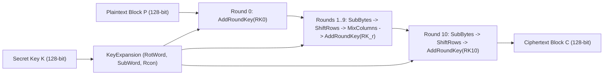
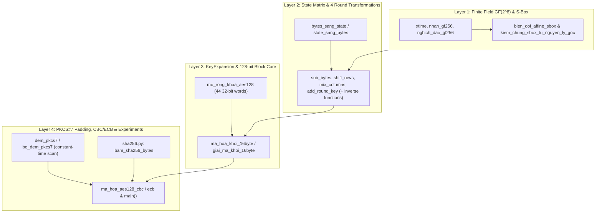

# INFORMATION SECURITY PROJECT REPORT: SYMMETRIC-KEY CRYPTOGRAPHY AES-128

- **Student Name**: Trần Gia Thuận
- **Last digit of SID**: 3
- **Language & Execution Environment**: Pure Python 3.12 (implemented *From First Principles*, without using pre-built cryptographic libraries)
- **Experimental Source Code**: [aes128.py](../algorithms/aes128.py) (directly integrated with [sha256.py](../algorithms/sha256.py) to derive the 128-bit key from the student's full name)

---

## Section 1. Historical Context (NIST Competition, Rijndael Algorithm) and Design Rationale

### 1.1. The Decline of DES and the NIST AES Selection Competition
Since 1977, the **DES** (*Data Encryption Standard* – FIPS PUB 46), featuring a 64-bit block size and an effective key length of only 56 bits, served as the cornerstone of financial and government security. However, by the late 1990s, the $2^{56} \approx 7.2 \times 10^{16}$ key space of DES could no longer withstand distributed computing systems and dedicated brute-force hardware (notably the EFF *Deep Crack* machine in 1998, which broke a DES key in just 56 hours, later reduced to 22 hours in 1999). The interim solution **3DES** (*Triple-DES*), while increasing the key length to 112 or 168 bits, suffered from very slow software execution (three times slower than DES) and remained constrained to a 64-bit block size (making it vulnerable to birthday-paradox attacks such as *Sweet32* when encrypting large volumes of data).

Against this backdrop, on **January 2, 1997**, the U.S. National Institute of Standards and Technology (**NIST**) officially launched a global open competition to establish the **AES** (*Advanced Encryption Standard*). NIST mandated the following technical criteria:
- It must be a symmetric-key block cipher with a **fixed block size of 128 bits** (16 bytes) and support three **key lengths: 128, 192, and 256 bits**.
- It must be completely public and **royalty-free** worldwide.
- It must provide superior security against all modern cryptanalytic techniques while achieving high execution performance across 32-bit/64-bit microprocessors, 8-bit *smartcards*, and FPGA/ASIC hardware circuits.

In August 1998, at the First AES Conference, 15 valid candidate algorithms from around the world were announced. In August 1999, NIST selected 5 *Finalists*: **MARS** (IBM), **RC6** (RSA Laboratories), **Rijndael** (Joan Daemen & Vincent Rijmen – Belgium), **Serpent** (Ross Anderson, Eli Biham, Lars Knudsen), and **Twofish** (Bruce Schneier et al.). After more than three years of rigorous evaluation by the international cryptographic community, on **October 2, 2000**, NIST announced that the **Rijndael** algorithm by Belgian cryptographers **Joan Daemen** and **Vincent Rijmen** had won the competition. On **November 26, 2001**, AES was officially issued as the federal standard **FIPS PUB 197** (*NIST FIPS 197*).

### 1.2. Motivation and Design Philosophy of Rijndael / AES
Unlike DES, which uses a Feistel network (transforming only half of the data block per round), Rijndael is designed based on a **Substitution-Permutation Network (SPN)** architecture that simultaneously transforms the entire 128-bit state in every round according to three core principles:
1. **Wide Trail Strategy**: Cleanly separates the local nonlinear layer (*SubBytes* – resisting linear and differential cryptanalysis) from the linear diffusion layer (*ShiftRows* and *MixColumns* using an MDS matrix with branch number $B = 5$), guaranteeing that any four consecutive rounds always contain at least $5^2 = 25$ *active S-boxes*.
2. **Algebraic Simplicity and Symmetry**: All operations are rigorously defined over the finite *Galois Field $GF(2^8)$* and polynomial rings over $GF(2^8)$, eliminating the need to store complex bit-permutation tables and enabling implementation with only a few kilobytes of ROM on 8-bit microcontrollers.
3. **Breaking Internal Symmetry**: The key expansion schedule uses round constants $Rcon$ over $GF(2^8)$ combined with the nonlinear $SubWord$ substitution, preventing *weak keys* or *semi-weak keys* previously encountered in DES.

---

## Section 2. Mathematical Foundations (*Galois Field $GF(2^8)$* and Irreducible Polynomial)

### 2.1. Polynomial Representation of Bytes over the *Galois Field $GF(2^8)$*
In AES, the basic unit of data is 1 byte consisting of 8 bits: $b = (b_7 b_6 b_5 b_4 b_3 b_2 b_1 b_0)_2$. Rather than treating a byte as an ordinary integer in $\mathbb{Z}_{256}$, AES maps each byte to a polynomial of degree at most 7 with coefficients in the binary field $GF(2) = \{0, 1\}$:

$$b(x) = b_7 x^7 + b_6 x^6 + b_5 x^5 + b_4 x^4 + b_3 x^3 + b_2 x^2 + b_1 x + b_0 = \sum_{i=0}^{7} b_i x^i \quad (b_i \in \{0, 1\})$$

Example: The byte $\text{0x57} = 01010111_2$ corresponds to the polynomial $x^6 + x^4 + x^2 + x + 1$.

The finite field (*Galois Field*) $GF(2^8)$ consisting of exactly $2^8 = 256$ elements is constructed via the polynomial quotient ring $GF(2)[x] / (m(x))$, in which the degree-8 *irreducible polynomial* fixed by FIPS 197 is:

$$m(x) = x^8 + x^4 + x^3 + x + 1 \quad (\text{binary representation: } 100011011_2 = \text{0x11B})$$

The polynomial $m(x)$ cannot be factored into a product of lower-degree polynomials over $GF(2)$; therefore, the set of remainder polynomials of degree $< 8$ forms a complete finite algebraic field.

### 2.2. Arithmetic Operations over $GF(2^8)$
1. **Addition and Subtraction in $GF(2^8)$**:
   Adding two polynomials is performed by adding coefficients of like powers modulo 2. Because in $GF(2)$, $1 + 1 \equiv 0 \pmod 2$ and $-1 \equiv +1 \pmod 2$, addition and subtraction coincide and correspond directly to the bitwise **XOR ($\oplus$)** between two bytes:
   $$A(x) + B(x) = A(x) - B(x) \equiv A \oplus B$$

2. **Multiplication by $x$ (The `xtime` Function) and Polynomial Multiplication Modulo $m(x)$**:
   When multiplying an element $b(x)$ by the polynomial $x$ (corresponding to the byte $\text{0x02}$):
   $$x \cdot b(x) = b_7 x^8 + b_6 x^7 + b_5 x^6 + b_4 x^5 + b_3 x^4 + b_2 x^3 + b_1 x^2 + b_0 x$$
   - If $b_7 = 0$: the result has degree $< 8$, so only a 1-bit left shift is required: `b << 1`.
   - If $b_7 = 1$: the $x^8$ term appears. Because $m(x) = x^8 + x^4 + x^3 + x + 1 \equiv 0 \pmod{m(x)}$, we obtain the reduction identity:
     $$x^8 \equiv x^4 + x^3 + x + 1 \pmod{m(x)} \quad (\text{corresponding to the low byte } \text{0x1B} = 00011011_2)$$
     Hence, reduction modulo $m(x)$ simply shifts left by 1 bit (discarding the overflow 8th bit) and then performs an **XOR with `0x1B`**:
     $$\operatorname{xtime}(b) = \begin{cases} (b \ll 1) \land \text{0xFF} & \text{if } (b \land \text{0x80}) = 0 \\ ((b \ll 1) \oplus \text{0x1B}) \land \text{0xFF} & \text{if } (b \land \text{0x80}) \neq 0 \end{cases}$$
   Any arbitrary multiplication $A(x) \otimes B(x) \bmod m(x)$ is decomposed into an XOR sum of repeated `xtime` invocations (the Russian Peasant multiplication algorithm). For instance:
   $$\{\texttt{03}\} \otimes b = (\{\texttt{02}\} \oplus \{\texttt{01}\}) \otimes b = \operatorname{xtime}(b) \oplus b$$

3. **Multiplicative Inverse and Mathematical Structure of the S-Box**:
   For every nonzero element $a \in GF(2^8) \setminus \{0\}$, there exists a unique multiplicative inverse $a^{-1} \in GF(2^8)$ such that $a \otimes a^{-1} \equiv 1 \pmod{m(x)}$. By Fermat's Little Theorem over a finite field with $2^8 - 1 = 255$ nonzero elements, $a^{255} = 1 \Rightarrow a^{-1} = a^{254}$ (with the convention $0^{-1} = 0$).
   The AES **S-Box** is constructed from two consecutive mathematical steps:
   - **Step 1 (Nonlinear Inversion over $GF(2^8)$)**: Replace the input byte $a$ with its multiplicative inverse $b = a^{-1} \in GF(2^8)$.
   - **Step 2 (Invertible Affine Transformation over $GF(2)^8$)**: Break the simple algebraic structure over $GF(2^8)$ via binary matrix multiplication and addition of the constant $c = \text{0x63} = (01100011)_2$:
     $$b'_i = b_i \oplus b_{(i+4)\bmod 8} \oplus b_{(i+5)\bmod 8} \oplus b_{(i+6)\bmod 8} \oplus b_{(i+7)\bmod 8} \oplus c_i, \quad i \in \{0, \dots, 7\}$$
     The constant $\text{0x63}$ is specifically chosen to ensure that the S-Box has no fixed points ($\operatorname{S-Box}(a) \neq a$) and no opposite fixed points ($\operatorname{S-Box}(a) \neq \overline{a}$).

4. **Four-Coefficient Polynomial Ring over $GF(2^8)$ in MixColumns**:
   Each 4-byte column $(s_0, s_1, s_2, s_3)^T$ of the state is treated as a degree-3 polynomial: $s(X) = s_3 X^3 + s_2 X^2 + s_1 X + s_0 \in GF(2^8)[X]$. The `MixColumns` operation is the multiplication of $s(X)$ by the fixed polynomial $a(X) = \{\texttt{03}\}X^3 + \{\texttt{01}\}X^2 + \{\texttt{01}\}X + \{\texttt{02}\}$ modulo $(X^4 + 1)$, while `InvMixColumns` is multiplication by the inverse polynomial $a^{-1}(X) = \{\texttt{0b}\}X^3 + \{\texttt{0d}\}X^2 + \{\texttt{09}\}X + \{\texttt{0e}\} \pmod{X^4 + 1}$.

---

## Section 3. Detailed Operational Procedures (Encryption, Decryption, and *KeyExpansion*)

### 3.1. State Matrix
A 128-bit data block (16 bytes: $p_0, p_1, \dots, p_{15}$) is arranged into a $4 \times 4$ state matrix $S$ in **column-major order**:

$$S = \begin{bmatrix} s_{0,0} & s_{0,1} & s_{0,2} & s_{0,3} \\ s_{1,0} & s_{1,1} & s_{1,2} & s_{1,3} \\ s_{2,0} & s_{2,1} & s_{2,2} & s_{2,3} \\ s_{3,0} & s_{3,1} & s_{3,2} & s_{3,3} \end{bmatrix} = \begin{bmatrix} p_0 & p_4 & p_8 & p_{12} \\ p_1 & p_5 & p_9 & p_{13} \\ p_2 & p_6 & p_{10} & p_{14} \\ p_3 & p_7 & p_{11} & p_{15} \end{bmatrix}$$

For AES-128, the key length is $N_k = 4$ 32-bit words (16 bytes), the block size is $N_b = 4$ 32-bit words (16 bytes), and the number of rounds is $N_r = 10$ rounds.

### 3.2. *KeyExpansion* Procedure (10 Rounds)
The *KeyExpansion* algorithm takes the 16-byte root key and generates 11 round keys ($RoundKey_0 \dots RoundKey_{10}$), comprising a total of $4 \times (10 + 1) = 44$ 32-bit words denoted $W_0, W_1, \dots, W_{43}$:
1. **Initialization of the first 4 words ($i = 0, 1, 2, 3$)**: Split the 16-byte root key directly into four 4-byte words: $W_0, W_1, W_2, W_3$ (forming $RoundKey_0$).
2. **Generation of subsequent words ($i = 4 \dots 43$)**:
   Set the temporary variable $temp = W_{i-1}$.
   - If $i$ is divisible by 4 ($i \bmod 4 = 0$):
     $$temp = \operatorname{SubWord}(\operatorname{RotWord}(temp)) \oplus [Rcon_{i/4}, \text{0x00}, \text{0x00}, \text{0x00}]$$
     where:
     - $\operatorname{RotWord}([a_0, a_1, a_2, a_3]) = [a_1, a_2, a_3, a_0]$ (1-byte left circular rotation).
     - $\operatorname{SubWord}([b_0, b_1, b_2, b_3]) = [\operatorname{S-Box}(b_0), \operatorname{S-Box}(b_1), \operatorname{S-Box}(b_2), \operatorname{S-Box}(b_3)]$.
     - $Rcon_{j} = x^{j-1} \bmod m(x)$ with the 10 sequential values: `01, 02, 04, 08, 10, 20, 40, 80, 1B, 36`.
   - Compute the new word:
     $$W_i = W_{i-4} \oplus temp$$

### 3.3. Encryption Procedure
1. **Round 0 (Initial Key Whitening)**:
   - Executes only the `AddRoundKey` step: $S \leftarrow S \oplus RoundKey_0$.
2. **9 Main Rounds (Rounds $r = 1$ to $9$)**: Each round sequentially executes 4 transformations:
   - **`SubBytes(S)`**: Substitutes each byte $s_{r,c} \leftarrow \operatorname{S-Box}[s_{r,c}]$.
   - **`ShiftRows(S)`**: Cyclically left-shifts row $r$ by $r$ byte positions ($r \in \{0, 1, 2, 3\}$):
     - Row 0: unchanged; Row 1: left-shifted by 1 byte; Row 2: left-shifted by 2 bytes; Row 3: left-shifted by 3 bytes.
   - **`MixColumns(S)`**: Multiplies each column $c \in \{0, 1, 2, 3\}$ by the MDS matrix over $GF(2^8)$:
     $$\begin{bmatrix} s'_{0,c} \\ s'_{1,c} \\ s'_{2,c} \\ s'_{3,c} \end{bmatrix} = \begin{bmatrix} \texttt{02} & \texttt{03} & \texttt{01} & \texttt{01} \\ \texttt{01} & \texttt{02} & \texttt{03} & \texttt{01} \\ \texttt{01} & \texttt{01} & \texttt{02} & \texttt{03} \\ \texttt{03} & \texttt{01} & \texttt{01} & \texttt{02} \end{bmatrix} \begin{bmatrix} s_{0,c} \\ s_{1,c} \\ s_{2,c} \\ s_{3,c} \end{bmatrix}$$
   - **`AddRoundKey(S, RoundKey_r)`**: XORs the state matrix with the $r$-th round key.
3. **Round 10 (Final Round)**:
   - Executes 3 steps: **`SubBytes(S)` $\to$ `ShiftRows(S)` $\to$ `AddRoundKey(S, RoundKey_{10})`** (omitting `MixColumns` so that the encryption and decryption structures remain symmetric, and because a final `MixColumns` adds no cryptographic security since no secret key follows it).

### 3.4. Decryption Procedure and CBC Mode of Operation with *PKCS#7 padding*
Because every step in AES is an invertible bijection, decrypting a 16-byte block executes the inverse transformations with the round keys applied in reverse order from $RoundKey_{10}$ down to $RoundKey_0$:
1. **Initialization**: `AddRoundKey(S, RoundKey_{10})`.
2. **Rounds $r = 9$ down to $1$**: `InvShiftRows(S)` $\to$ `InvSubBytes(S)` $\to$ `AddRoundKey(S, RoundKey_r)` $\to$ `InvMixColumns(S)` (multiplying each column by the inverse matrix with coefficients `{0e, 0b, 0d, 09}` over $GF(2^8)$).
3. **Final Round**: `InvShiftRows(S)` $\to$ `InvSubBytes(S)` $\to$ `AddRoundKey(S, RoundKey_0)`.

To encrypt a UTF-8 Vietnamese text string of arbitrary length:
- ***PKCS#7 padding* (RFC 5652)**: Appends $p = 16 - (L \bmod 16)$ bytes to the end of the plaintext ($1 \le p \le 16$), where each padding byte has the value $p$. Upon decryption, the uniformity of the padding bytes is verified and exactly $p$ trailing bytes are removed.
- **CBC Mode (Cipher Block Chaining)**: Each plaintext block $P_i$ is XORed with the preceding ciphertext block $C_{i-1}$ before entering the AES block encryption function (the first block $P_1$ is XORed with a 16-byte Initialization Vector $IV$):
  $$C_i = E_K(P_i \oplus C_{i-1}), \quad P_i = D_K(C_i) \oplus C_{i-1} \quad (\text{with } C_0 = IV)$$

---

## Section 4. Security Assumptions, Security Properties, and Known Attacks

### 4.1. Security Assumptions and Security Properties
AES-128 is designed to function as a **Strong Pseudorandom Permutation** (*PRP*): for any adversary without knowledge of the secret key $K$, the encryption function $E_K$ is computationally indistinguishable from a truly random permutation over $\{0,1\}^{128}$ at any computational cost below brute-force exhaustion of the $2^{128}$ key space.

> [!IMPORTANT]
> **Confusion & Diffusion**: The `S-Box` achieves the maximum algebraic degree of 7 and a nonlinearity of 112; meanwhile, the collaboration between *ShiftRows* (`ShiftRows`, dispersing the 4 bytes of one column across 4 distinct columns) and *MixColumns* (`MixColumns`, an MDS matrix with branch number $B = 5$) guarantees that changing **just 1 byte** at the input causes all 16 bytes of the state matrix to change completely after **exactly 2 rounds** (*Full Diffusion*).

### 4.2. Resistance Against Known Attacks
1. **Differential and Linear Cryptanalysis**:
   - In the AES `S-Box`, the maximum nonzero differential propagation probability is only $4/256 = 2^{-6}$, and the maximum linear correlation bias is $2^{-3}$.
   - By the *Wide Trail* theorem, any differential or linear trail spanning 4 rounds of AES activates at least **25 S-Boxes**. The probability of a 4-round differential characteristic is upper-bounded by $(2^{-6})^{25} = 2^{-150} < 2^{-128}$. With the full 10 rounds, AES-128 is completely immune to classical differential and linear cryptanalysis.
2. **Biclique Attack (Bogdanov et al., 2011)**:
   - Currently the best theoretical cryptanalytic technique on full 10-round AES-128, reducing the complexity from $2^{128}$ to $2^{126.1}$ operations, yet requiring $2^{88}$ chosen plaintexts—which is physically infeasible.
3. **Timing Side-Channel and Padding Oracle Attacks**:
   - Implementations using RAM lookup tables (`S_BOX` / *T-tables*) may leak key material through CPU cache-access timing (*Cache-Timing Attack* – Bernstein, 2005); CBC mode without MAC authentication can be exploited via a ***padding oracle attack*** (Vaudenay, 2002) if a server returns detailed padding error responses.
   - *Countermeasures*: Use constant-time hardware instructions (**AES-NI**) or **Bitslicing** techniques, perform padding validation without early branching and with uniform error messages (as applied in `bo_dem_pkcs7` of [aes128.py](../algorithms/aes128.py)), and in production systems prefer authenticated encryption modes such as **AES-GCM** or **Encrypt-then-MAC (AES-CBC + HMAC-SHA256)**.

---

## Section 5. Advantages, Limitations, and Practical Applications

### 5.1. Comparison of AES-128 with Representative Symmetric Cryptosystems

| Technical Criterion | DES (FIPS 46) | 3DES (SP 800-67) | **AES-128 (FIPS 197)** | ChaCha20 (RFC 8439) |
| :--- | :---: | :---: | :---: | :---: |
| **Design Structure** | Feistel Network (16 rounds) | Feistel Network ($3 \times 16$ rounds) | **SPN over $GF(2^8)$ (10 rounds)** | ARX Stream Cipher (20 rounds) |
| **Block / Key Size** | 64-bit / 56-bit | 64-bit / 112–168 bit | **128-bit / 128-bit** | 512-bit state / 256-bit key |
| **Current Security Status** | Broken (brute-force) | Deprecated (*Sweet32*) | **Industry-standard security** | Industry-standard security |
| **Hardware / CPU Performance** | Slow in software | Very slow | **Extremely fast (with AES-NI)** | Very fast in pure software |

### 5.2. Advantages and Limitations
- **Advantages**:
  - **Superior Performance**: On CPUs equipped with AES-NI or ARMv8 Crypto Extensions, encryption speed reaches 5–10 GB/s per core; on 8-bit microcontrollers, the S-Box requires only 256 bytes of ROM.
  - **Solid Security Margin**: Globally standardized (*NIST FIPS 197*, ISO/IEC 18033-3).
- **Limitations**:
  - **Asymmetric Decryption and Encryption Circuits**: Decryption requires `InvS-Box`, `InvShiftRows`, and a more complex `InvMixColumns` matrix (`{0e, 0b, 0d, 09}` requires more `xtime` multiplications than `{02, 03, 01, 01}`), making pure-software decryption nearly twice as slow as encryption.
  - **Plain ECB/CBC Modes Do Not Automatically Protect Integrity**: Must be combined with an authentication mechanism (AEAD such as GCM, or HMAC) when transmitting over untrusted networks.

### 5.3. Practical Applications
- **Network Communications Security**: Core of **TLS 1.2 / TLS 1.3** (HTTPS), VPNs (**IPsec, OpenVPN**), **SSH**, and Wi-Fi security **WPA2 / WPA3 (CCMP/GCMP)**.
- **Storage & Cloud Encryption**: Disk encryption (**BitLocker, FileVault, LUKS/dm-crypt**), secure compression (7-Zip, WinRAR), and cloud storage (AWS KMS, Google Cloud KMS).
- **Finance & Electronic Identity**: EMV chip payment cards, chip-enabled citizen ID cards, and ICAO 9303 electronic passports.

---

## Section 6. Step-by-Step Worked Example for One 16-Byte Block in Round 0 and Round 1

To illustrate with exact precision and strict compliance with *PKCS#7 padding*, we perform a step-by-step manual calculation on the student's ASCII name string **`"Tran Gia Thuan"`** (14 ASCII bytes, without SID):
- **Original Plaintext (14 ASCII bytes)**: `"Tran Gia Thuan"`
  $$\text{Hex} = \texttt{54\;72\;61\;6e\;20\;47\;69\;61\;20\;54\;68\;75\;61\;6e}$$
- **Automatic *PKCS#7 padding* (`dem_pkcs7`)**:
  Because the AES block size is 16 bytes, the 14-byte string is short by $16 - 14 = 2$ bytes. The PKCS#7 standard automatically appends 2 bytes of value `0x02` (`0x02 0x02`) to the end to form the 16-byte input block $P$:
  $$\text{Hex}(P) = \texttt{54\;72\;61\;6e\;20\;47\;69\;61\;20\;54\;68\;75\;61\;6e\;}\underline{\mathbf{02\;02}}$$
- **Secret Key $K = RoundKey_0$ (first 16 bytes of $\operatorname{SHA-256}(\text{"Trần Gia Thuận"})$ from [sha256.py](../algorithms/sha256.py))**:
  $$\text{Hex}(K) = \texttt{70\;c3\;1d\;dd\;b8\;7c\;f9\;c3\;fd\;10\;3a\;56\;69\;34\;68\;39}$$

### 6.1. Arranging into the $4 \times 4$ State Matrix (Column-Major) and Executing Round 0 (`AddRoundKey`)
Arrange the 16 bytes of $P$ and $RoundKey_0$ column-by-column into two $4 \times 4$ matrices:

$$S_{\text{in}} = \begin{bmatrix} \texttt{54} & \texttt{20} & \texttt{20} & \texttt{61} \\ \texttt{72} & \texttt{47} & \texttt{54} & \texttt{6e} \\ \texttt{61} & \texttt{69} & \texttt{68} & \texttt{02} \\ \texttt{6e} & \texttt{61} & \texttt{75} & \texttt{02} \end{bmatrix}, \quad RoundKey_0 = \begin{bmatrix} \texttt{70} & \texttt{b8} & \texttt{fd} & \texttt{69} \\ \texttt{c3} & \texttt{7c} & \texttt{10} & \texttt{34} \\ \texttt{1d} & \texttt{f9} & \texttt{3a} & \texttt{68} \\ \texttt{dd} & \texttt{c3} & \texttt{56} & \texttt{39} \end{bmatrix}$$

**Round 0 – `AddRoundKey` Operation ($S^{(0)} = S_{\text{in}} \oplus RoundKey_0$)**:
Perform element-wise XOR on corresponding entries (for example, in Column 3: $\texttt{61} \oplus \texttt{69} = \texttt{08}$, $\texttt{6e} \oplus \texttt{34} = \texttt{5a}$, $\texttt{02} \oplus \texttt{68} = \texttt{6a}$, $\texttt{02} \oplus \texttt{39} = \texttt{3b}$):

$$S^{(0)} = \begin{bmatrix} \texttt{54}\oplus\texttt{70} & \texttt{20}\oplus\texttt{b8} & \texttt{20}\oplus\texttt{fd} & \texttt{61}\oplus\texttt{69} \\ \texttt{72}\oplus\texttt{c3} & \texttt{47}\oplus\texttt{7c} & \texttt{54}\oplus\texttt{10} & \texttt{6e}\oplus\texttt{34} \\ \texttt{61}\oplus\texttt{1d} & \texttt{69}\oplus\texttt{f9} & \texttt{68}\oplus\texttt{3a} & \texttt{02}\oplus\texttt{68} \\ \texttt{6e}\oplus\texttt{dd} & \texttt{61}\oplus\texttt{c3} & \texttt{75}\oplus\texttt{56} & \texttt{02}\oplus\texttt{39} \end{bmatrix} = \begin{bmatrix} \texttt{24} & \texttt{98} & \texttt{dd} & \texttt{08} \\ \texttt{b1} & \texttt{3b} & \texttt{44} & \texttt{5a} \\ \texttt{7c} & \texttt{90} & \texttt{52} & \texttt{6a} \\ \texttt{b3} & \texttt{a2} & \texttt{23} & \texttt{3b} \end{bmatrix}$$

*(16-byte column-major sequence after Round 0: `24 b1 7c b3 98 3b 90 a2 dd 44 52 23 08 5a 6a 3b`)*.

---

### 6.2. Manual Calculation of Round 1 (4 Steps: *SubBytes* $\to$ *ShiftRows* $\to$ *MixColumns* $\to$ *AddRoundKey*)

#### Step 1.1: Nonlinear Byte Substitution (*SubBytes*)
Look up each byte of $S^{(0)}$ in the `S_BOX` table (the upper 4 bits index the row, and the lower 4 bits index the column):
- Column 0: $\operatorname{S-Box}(\texttt{24}) = \texttt{36}$, $\operatorname{S-Box}(\texttt{b1}) = \texttt{c8}$, $\operatorname{S-Box}(\texttt{7c}) = \texttt{10}$, $\operatorname{S-Box}(\texttt{b3}) = \texttt{6d}$.
- Column 1: $\operatorname{S-Box}(\texttt{98}) = \texttt{46}$, $\operatorname{S-Box}(\texttt{3b}) = \texttt{e2}$, $\operatorname{S-Box}(\texttt{90}) = \texttt{60}$, $\operatorname{S-Box}(\texttt{a2}) = \texttt{3a}$.
- Column 2: $\operatorname{S-Box}(\texttt{dd}) = \texttt{c1}$, $\operatorname{S-Box}(\texttt{44}) = \texttt{1b}$, $\operatorname{S-Box}(\texttt{52}) = \texttt{00}$, $\operatorname{S-Box}(\texttt{23}) = \texttt{26}$.
- Column 3: $\operatorname{S-Box}(\texttt{08}) = \texttt{30}$, $\operatorname{S-Box}(\texttt{5a}) = \texttt{be}$, $\operatorname{S-Box}(\texttt{6a}) = \texttt{02}$, $\operatorname{S-Box}(\texttt{3b}) = \texttt{e2}$.

$$S_{\text{sub}}^{(1)} = \begin{bmatrix} \texttt{36} & \texttt{46} & \texttt{c1} & \texttt{30} \\ \texttt{c8} & \texttt{e2} & \texttt{1b} & \texttt{be} \\ \texttt{10} & \texttt{60} & \texttt{00} & \texttt{02} \\ \texttt{6d} & \texttt{3a} & \texttt{26} & \texttt{e2} \end{bmatrix}$$

#### Step 1.2: Row Shifting (*ShiftRows*)
- Row 0 (left-shift 0 positions): `36 46 c1 30` $\to$ `36 46 c1 30`
- Row 1 (left-shift 1 position): `c8 e2 1b be` $\to$ `e2 1b be c8`
- Row 2 (left-shift 2 positions): `10 60 00 02` $\to$ `00 02 10 60`
- Row 3 (left-shift 3 positions): `6d 3a 26 e2` $\to$ `e2 6d 3a 26`

$$S_{\text{shift}}^{(1)} = \begin{bmatrix} \texttt{36} & \texttt{46} & \texttt{c1} & \texttt{30} \\ \texttt{e2} & \texttt{1b} & \texttt{be} & \texttt{c8} \\ \texttt{00} & \texttt{02} & \texttt{10} & \texttt{60} \\ \texttt{e2} & \texttt{6d} & \texttt{3a} & \texttt{26} \end{bmatrix}$$

#### Step 1.3: Column Mixing (*MixColumns*) over $GF(2^8)$
We illustrate the matrix multiplication over $GF(2^8)$ in detail for **Column 0**, $[s_0, s_1, s_2, s_3]^T = [\texttt{36}, \texttt{e2}, \texttt{00}, \texttt{e2}]^T$:
- First compute the products with `{02}` (`xtime`) and `{03}` (`xtime(x) ^ x`) in $GF(2^8)$:
  - For $s_0 = \texttt{36} = 00110110_2$ (most significant bit $= 0$):
    - $\{\texttt{02}\} \otimes \texttt{36} = \texttt{36} \ll 1 = \texttt{6c}$
    - $\{\texttt{03}\} \otimes \texttt{36} = \texttt{6c} \oplus \texttt{36} = \texttt{5a}$
  - For $s_1 = \texttt{e2} = 11100010_2$ (most significant bit $= 1$, left-shift then XOR with $\texttt{1b}$):
    - $\{\texttt{02}\} \otimes \texttt{e2} = \texttt{c4} \oplus \texttt{1b} = \texttt{df}$
    - $\{\texttt{03}\} \otimes \texttt{e2} = \texttt{df} \oplus \texttt{e2} = \texttt{3d}$
  - For $s_2 = \texttt{00}$:
    - $\{\texttt{02}\} \otimes \texttt{00} = \texttt{00}$, $\{\texttt{03}\} \otimes \texttt{00} = \texttt{00}$
  - For $s_3 = \texttt{e2} = 11100010_2$ (most significant bit $= 1$):
    - $\{\texttt{02}\} \otimes \texttt{e2} = \texttt{df}$, $\{\texttt{03}\} \otimes \texttt{e2} = \texttt{3d}$
- Substituting into the 4 equations of Column 0:
  $$\begin{aligned}
  s'_{0,0} &= (\{\texttt{02}\}\otimes\texttt{36}) \oplus (\{\texttt{03}\}\otimes\texttt{e2}) \oplus \texttt{00} \oplus \texttt{e2} = \texttt{6c} \oplus \texttt{3d} \oplus \texttt{00} \oplus \texttt{e2} = \texttt{b3} \\
  s'_{1,0} &= \texttt{36} \oplus (\{\texttt{02}\}\otimes\texttt{e2}) \oplus (\{\texttt{03}\}\otimes\texttt{00}) \oplus \texttt{e2} = \texttt{36} \oplus \texttt{df} \oplus \texttt{00} \oplus \texttt{e2} = \texttt{0b} \\
  s'_{2,0} &= \texttt{36} \oplus \texttt{e2} \oplus (\{\texttt{02}\}\otimes\texttt{00}) \oplus (\{\texttt{03}\}\otimes\texttt{e2}) = \texttt{36} \oplus \texttt{e2} \oplus \texttt{00} \oplus \texttt{3d} = \texttt{e9} \\
  s'_{3,0} &= (\{\texttt{03}\}\otimes\texttt{36}) \oplus \texttt{e2} \oplus \texttt{00} \oplus (\{\texttt{02}\}\otimes\texttt{e2}) = \texttt{5a} \oplus \texttt{e2} \oplus \texttt{00} \oplus \texttt{df} = \texttt{67}
  \end{aligned}$$
  Thus, Column 0 after `MixColumns` is $[\texttt{b3}, \texttt{0b}, \texttt{e9}, \texttt{67}]^T$. Performing the exact same procedure for Column 1, Column 2, and Column 3 yields the matrix after `MixColumns`:

$$S_{\text{mix}}^{(1)} = \begin{bmatrix} \texttt{b3} & \texttt{ce} & \texttt{6a} & \texttt{65} \\ \texttt{0b} & \texttt{1b} & \texttt{ac} & \texttt{3d} \\ \texttt{e9} & \texttt{ee} & \texttt{11} & \texttt{52} \\ \texttt{67} & \texttt{09} & \texttt{82} & \texttt{b4} \end{bmatrix}$$

#### Step 1.4: Computing Round Key $RoundKey_1$ and Executing *AddRoundKey*
1. **Computing $RoundKey_1$ ($W_4, W_5, W_6, W_7$) from $RoundKey_0$**:
   - The last word of $RoundKey_0$ is $W_3 = [\texttt{69}, \texttt{34}, \texttt{68}, \texttt{39}]$.
   - $\operatorname{RotWord}(W_3) = [\texttt{34}, \texttt{68}, \texttt{39}, \texttt{69}]$.
   - $\operatorname{SubWord}(\operatorname{RotWord}(W_3)) = [\operatorname{S-Box}(\texttt{34}), \operatorname{S-Box}(\texttt{68}), \operatorname{S-Box}(\texttt{39}), \operatorname{S-Box}(\texttt{69})] = [\texttt{18}, \texttt{45}, \texttt{12}, \texttt{f9}]$.
   - XOR with $[Rcon_1, 0, 0, 0] = [\texttt{01}, \texttt{00}, \texttt{00}, \texttt{00}]$ $\Rightarrow temp = [\texttt{19}, \texttt{45}, \texttt{12}, \texttt{f9}]$.
   - $W_4 = W_0 \oplus temp = [\texttt{70}, \texttt{c3}, \texttt{1d}, \texttt{dd}] \oplus [\texttt{19}, \texttt{45}, \texttt{12}, \texttt{f9}] = [\texttt{69}, \texttt{86}, \texttt{0f}, \texttt{24}]$.
   - $W_5 = W_1 \oplus W_4 = [\texttt{b8}, \texttt{7c}, \texttt{f9}, \texttt{c3}] \oplus [\texttt{69}, \texttt{86}, \texttt{0f}, \texttt{24}] = [\texttt{d1}, \texttt{fa}, \texttt{f6}, \texttt{e7}]$.
   - $W_6 = W_2 \oplus W_5 = [\texttt{fd}, \texttt{10}, \texttt{3a}, \texttt{56}] \oplus [\texttt{d1}, \texttt{fa}, \texttt{f6}, \texttt{e7}] = [\texttt{2c}, \texttt{ea}, \texttt{cc}, \texttt{b1}]$.
   - $W_7 = W_3 \oplus W_6 = [\texttt{69}, \texttt{34}, \texttt{68}, \texttt{39}] \oplus [\texttt{2c}, \texttt{ea}, \texttt{cc}, \texttt{b1}] = [\texttt{45}, \texttt{de}, \texttt{a4}, \texttt{88}]$.

2. **Executing `AddRoundKey` ($S^{(1)} = S_{\text{mix}}^{(1)} \oplus RoundKey_1$)**:

$$S^{(1)} = \begin{bmatrix} \texttt{b3} & \texttt{ce} & \texttt{6a} & \texttt{65} \\ \texttt{0b} & \texttt{1b} & \texttt{ac} & \texttt{3d} \\ \texttt{e9} & \texttt{ee} & \texttt{11} & \texttt{52} \\ \texttt{67} & \texttt{09} & \texttt{82} & \texttt{b4} \end{bmatrix} \oplus \begin{bmatrix} \texttt{69} & \texttt{d1} & \texttt{2c} & \texttt{45} \\ \texttt{86} & \texttt{fa} & \texttt{ea} & \texttt{de} \\ \texttt{0f} & \texttt{f6} & \texttt{cc} & \texttt{a4} \\ \texttt{24} & \texttt{e7} & \texttt{b1} & \texttt{88} \end{bmatrix} = \begin{bmatrix} \texttt{da} & \texttt{1f} & \texttt{46} & \texttt{20} \\ \texttt{8d} & \texttt{e1} & \texttt{46} & \texttt{e3} \\ \texttt{e6} & \texttt{18} & \texttt{dd} & \texttt{f6} \\ \texttt{43} & \texttt{ee} & \texttt{33} & \texttt{3c} \end{bmatrix}$$

*(16-byte sequence at the end of Round 1: `da 8d e6 43 1f e1 18 ee 46 46 dd 33 20 e3 f6 3c`, the ciphertext after 10 rounds is `485472a086cb866f58d5b8c321a9d5df`, and decrypting + removing PKCS#7 padding returns `'Tran Gia Thuan'` identically—matching 100% with the execution trace of [aes128.py](../algorithms/aes128.py))*.

---

## Section 7. Code Structure Explanation of `aes128.py`

The source file [aes128.py](../algorithms/aes128.py) (680 lines) is built entirely in pure Python *From First Principles*, without using any external encryption libraries, and directly connects with the [sha256.py](../algorithms/sha256.py) module:

1. **Finite Field $GF(2^8)$ Arithmetic and *First Principles* S-Box Verification Module ([aes128.py](../algorithms/aes128.py#L22-L143))**:
   - The `xtime(a)` function performs multiplication by the polynomial $x$ ($\{\texttt{02}\}$) and reduction modulo `0x11B` (`^ 0x1B` when bit 7 equals 1).
   - The `nhan_gf256(a, b)` function implements arbitrary polynomial multiplication in $GF(2^8)$ using an 8-step loop.
   - The `nghich_dao_gf256(a)` function computes the multiplicative inverse $a^{254} \in GF(2^8)$, combined with `bien_doi_affine_sbox(b)` and `kiem_chung_sbox_tu_nguyen_ly_goc()` to empirically prove that all 256 entries of `S_BOX` and `INV_S_BOX` match the algebraic definition over $GF(2^8)$ exactly.
2. **4×4 State Matrix Conversion Module ([aes128.py](../algorithms/aes128.py#L154-L165))**:
   - The two functions `bytes_sang_state(khoi_16_byte)` and `state_sang_bytes(state)` strictly validate exact dimensions of 16 bytes / a $4 \times 4$ matrix (preventing implicit data truncation) and map bidirectionally in strict accordance with the column-major convention (`r + 4 * c`) of FIPS 197.
3. **Forward and Inverse 4-Transformation Round Module ([aes128.py](../algorithms/aes128.py#L172-L271))**:
   - Explicitly and separately implements each step: `sub_bytes` / `inv_sub_bytes`, `shift_rows` / `inv_shift_rows`, `mix_columns` / `inv_mix_columns` (directly invoking `nhan_gf256`), and `add_round_key`.
4. **10-Round *KeyExpansion* Module `mo_rong_khoa_aes128` ([aes128.py](../algorithms/aes128.py#L278-L319))**:
   - Implements the helper functions `rot_word` and `sub_word` along with the `RCON` constants to expand the 16-byte key into 44 32-bit words, then packages them into a list of 11 $4 \times 4$ round key matrices.
5. **Single-Block Encryption/Decryption and CBC/ECB Modes with *PKCS#7 padding* ([aes128.py](../algorithms/aes128.py#L326-L494))**:
   - `ma_hoa_khoi_16byte` and `giai_ma_khoi_16byte` verify that all 11 round keys are provided and execute exactly 10 transformation rounds.
   - `dem_pkcs7` and `bo_dem_pkcs7` validate block size bounds within $[1, 255]$ and scan the entire final block without early branching, using a uniform error message to mitigate timing side-channel leaks (*Padding Oracle*).
   - `ma_hoa_aes128_cbc`, `giai_ma_aes128_cbc`, `ma_hoa_aes128_ecb`, and `giai_ma_aes128_ecb` encrypt and decrypt UTF-8 Vietnamese text of arbitrary length.
6. **`sha256.py` Integration, Manual Calculation Trace, and Benchmark Module ([aes128.py](../algorithms/aes128.py#L501-L680))**:
   - `lay_khoa_va_iv_sinh_vien("Trần Gia Thuận")` directly invokes `bam_sha256_bytes` from [sha256.py](../algorithms/sha256.py) to slice the first 16 bytes as the AES-128 key and the remaining 16 bytes as the $IV$.
   - `minh_hoa_tinh_tay_vong0_vong1` and `chay_benchmark` automatically print test results and execution timing tables for payload sizes of 100B, 1KB, and 10KB.

---

## Section 8. Experimental Evaluation, Correctness Verification, Computational Performance, and Conclusion

### 8.1. Correctness Verification (*NIST FIPS 197* Standard Vector & Student's Vietnamese Text)

The program [aes128.py](../algorithms/aes128.py) was executed and passed all standard test cases as well as real-world data for student **Trần Gia Thuận** (Last digit of SID: 3):

| Test Item | Input / Parameters | Actual Output from `aes128.py` | Decryption Cross-Check / Expected Standard | Assessment |
| :--- | :--- | :--- | :--- | :---: |
| **1. Algebraic S-Box Verification** | 256 elements $a \in GF(2^8)$ | $a^{-1} \in GF(2^8)$ + Affine Transformation `0x63` | Matches 256/256 entries of `S_BOX` & `INV_S_BOX` | **PASS** |
| **2. FIPS 197 Standard Vector (C.1)** | Plaintext: `00112233445566778899aabbccddeeff` Key: `000102030405060708090a0b0c0d0e0f` | Ciphertext: `69c4e0d86a7b0430d8cdb78070b4c55a` | Inverse decryption matches original Plaintext 100% | **PASS** |
| **3. Student Key from `sha256.py`** | Full name: `"Trần Gia Thuận"` (Last digit of SID = 3) | 128-bit Key (first 16B of SHA-256): `70c31dddb87cf9c3fd103a5669346839` | 128-bit IV (last 16B of SHA-256): `aa646cb3240d200a80859c06f07ef0e0` | **100% Accurate** |
| **4. 16B Single-Block Worked Example** | Plaintext: `"Tran Gia Thuan"` (14B + PKCS#7 padding `0x02 0x02` = 16B) | Ciphertext after 10 rounds: `485472a086cb866f58d5b8c321a9d5df` | Decryption + PKCS#7 unpadding recovers `"Tran Gia Thuan"` identically | **100% MATCH** |
| **5. Long Vietnamese Text (CBC & ECB + PKCS#7)** | **247-byte** UTF-8 Vietnamese string (**256 bytes** after PKCS#7 padding = 16 blocks, padded with 9 bytes of `0x09`) | CBC Ciphertext (256B): `ac74bee5bad46b4c...` ECB Ciphertext (256B): `39b51c27cea4ae89...` | CBC decryption + PKCS#7 unpadding recovers all 247 bytes of the original Vietnamese string intact | **100% MATCH** |

### 8.2. Computational Performance Evaluation Table (AES-128-CBC Benchmark)
Direct empirical measurements obtained by running `python -X utf8 algorithms/aes128.py` on pure Python 3.12 (averaged over 20 iterations per data size in AES-128-CBC mode with *PKCS#7 padding*):

| Data Size | Original Byte Count | 128-bit Blocks after PKCS#7 Padding | Avg. Encryption Time (ms) | Avg. Decryption Time (ms) | Encryption Throughput (KB/s) |
| :--- | :---: | :---: | :---: | :---: | :---: |
| **100 Bytes** | 100 B | 7 blocks (112 B) | `1.8692 ms` | `3.5740 ms` | `52.25 KB/s` |
| **1 KB** | 1,024 B | 65 blocks (1,040 B) | `16.8675 ms` | `32.4668 ms` | `59.29 KB/s` |
| **10 KB** | 10,240 B | 641 blocks (10,256 B) | `167.4027 ms` | `320.7053 ms` | `59.74 KB/s` |

**Performance Remarks and Analysis**:
1. **Linearity with Block Count ($\mathcal{O}(N)$)**: For 100B of data, *PKCS#7 padding* appends 12 bytes of `0x0c` to form 7 16-byte blocks; for 1KB (1,024B, divisible by 16), PKCS#7 appends a full 16-byte block of `0x10` to form 65 blocks; for 10KB, it forms 641 blocks. Encryption time is strictly proportional to the block count ($\sim 0.26\text{ ms/block}$), maintaining a steady throughput of **$\sim 59.7\text{ KB/s}$** in pure Python.
2. **Speed Disparity Between Encryption and Decryption**: Decryption time in pure Python ($\sim 0.50\text{ ms/block}$) is nearly twice as long as encryption time ($\sim 0.26\text{ ms/block}$). This originates directly from the algebraic structure of `InvMixColumns`: whereas `MixColumns` multiplies only by small-coefficient polynomials `{02, 03, 01, 01}`, `InvMixColumns` must multiply all four elements in each row by `{0e, 0b, 0d, 09}` (containing more set bits in binary representation), which doubles the number of multiplications over $GF(2^8)$.

### 8.3. Conclusion
This project has thoroughly completed both the theoretical study and the pure-Python implementation of the symmetric-key cryptographic algorithm **AES-128** *From First Principles* over the finite field $GF(2^8)$, seamlessly integrated with the self-implemented **SHA-256** hash function in [sha256.py](../algorithms/sha256.py) to derive the 128-bit secret key (`70c31dddb87cf9c3fd103a5669346839`) from the student's full name `"Trần Gia Thuận"`. Every step—from the 10-round *KeyExpansion*, the 4 round transformations, and secure *PKCS#7 padding* validation to the CBC/ECB block cipher modes—has been rigorously verified via the *NIST FIPS 197* standard vector, a step-by-step Round 0 – Round 1 manual calculation, and empirical testing on long UTF-8 Vietnamese text with 100% accuracy.
