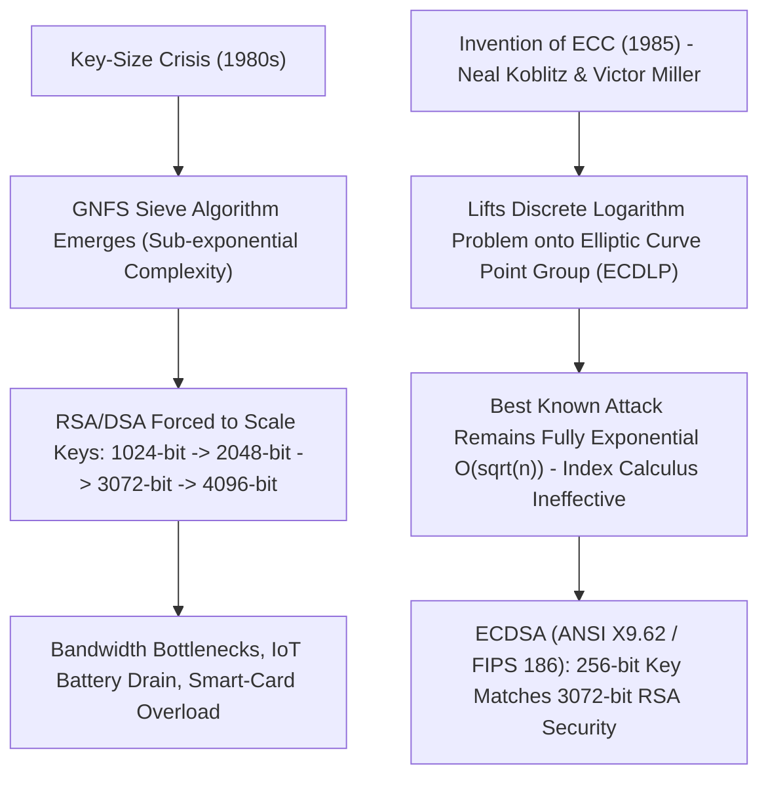
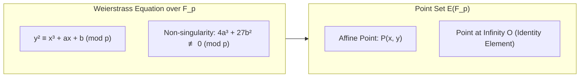
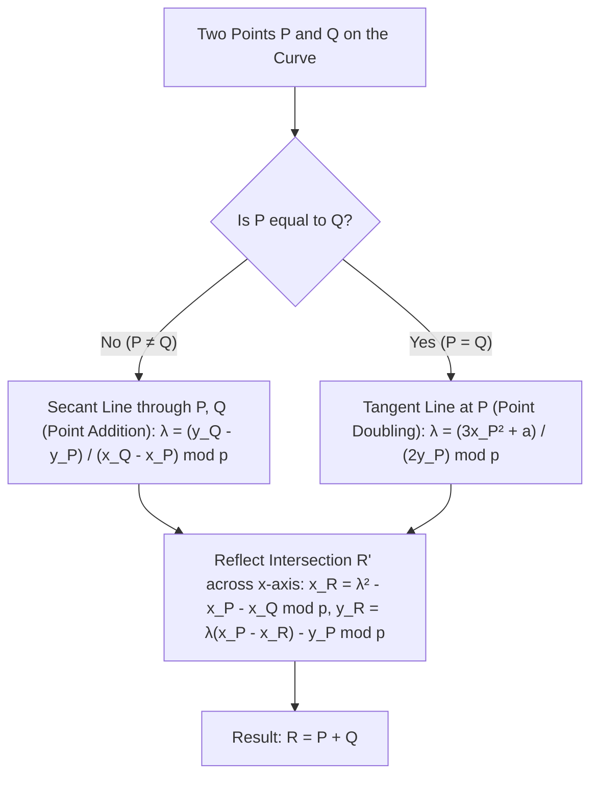
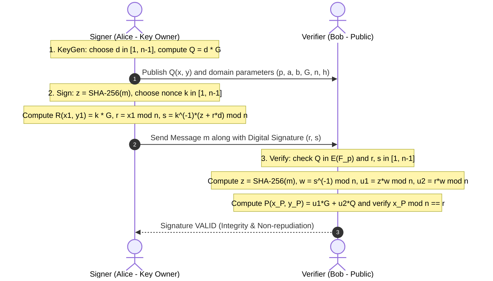
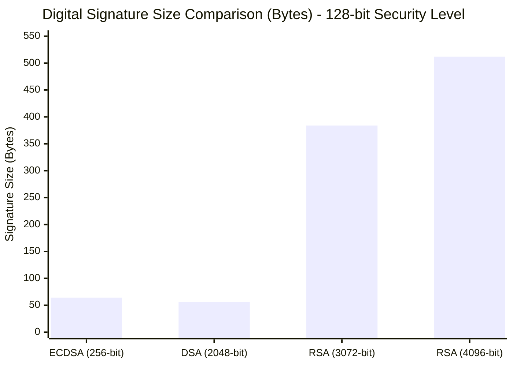
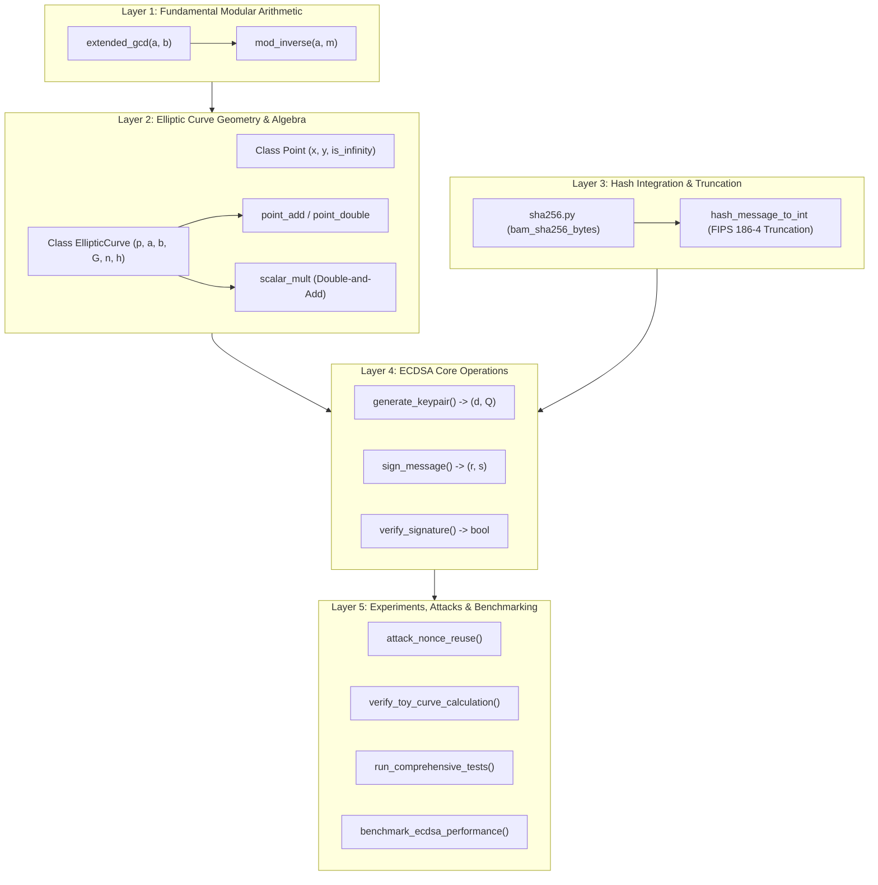

# INFORMATION SECURITY PROJECT REPORT: ELLIPTIC CURVE DIGITAL SIGNATURE ALGORITHM (ECDSA)

- **Student Name**: Trần Gia Thuận
- **Last Digit of SID**: 3 (SID: 3; $3 \bmod 4 = 3 \rightarrow$ Assigned Topic: **Digital Signature: ECDSA – Elliptic Curve Digital Signature Algorithm**)
- **Implementation Language & Runtime Environment**: Pure Python 3.12 (implemented *From First Principles*, without using third-party cryptographic libraries)
- **Experimental Source Code**: [ecdsa.py](../algorithms/ecdsa.py) (directly integrated with [sha256.py](../algorithms/sha256.py), and compared alongside [rsa.py](../algorithms/rsa.py) and [aes128.py](../algorithms/aes128.py))

---

## Section 1. Historical Background, Evolution, and Design Motivation of Elliptic Curve Digital Signatures

### 1.1. The Key-Size Crisis of RSA/DSA and the Birth of ECC (1985)
In the late 1970s and early 1980s, the asymmetric cryptosystem RSA (1977) and the Digital Signature Algorithm (DSA, 1991) laid the foundations for e-commerce and network security. Both cryptosystems rely on the computational hardness of classical number-theoretic problems over the multiplicative group of integers or finite fields:
- **RSA**: Based on the Integer Factorization Problem (IFP).
- **DSA / Diffie-Hellman**: Based on the classical Discrete Logarithm Problem (DLP) over the multiplicative group $\mathbb{Z}_p^*$.

However, by the late 1980s, rapid advances in **Number Field Sieve** (NFS) attacks—most notably the *General Number Field Sieve* (GNFS) and *Index Calculus* algorithms—severely eroded the practical security margins of RSA and DSA. These algorithms achieve **sub-exponential** time complexity:
$$\mathcal{O}\left( \exp \left( \left( C + o(1) \right) (\ln n)^{1/3} (\ln \ln n)^{2/3} \right) \right)$$

Consequently, to maintain an equivalent security level against steady increases in computing power, RSA and DSA key lengths had to escalate dramatically: from 512-bit to 1024-bit, 2048-bit, 3072-bit, and even 4096-bit. Oversized keys introduced three severe operational drawbacks:
1. **High Communication Bandwidth Overhead**: An RSA-3072 or RSA-4096 signature requires 384 to 512 bytes per packet.
2. **Memory and Energy Exhaustion**: On resource-constrained embedded devices—such as smart cards, EMV banking chip cards, IoT sensors, and wearable medical devices—storing and performing modular exponentiation on 4096-bit integers rapidly drains batteries and exhausts RAM/ROM.
3. **High Network Handshake Latency**: SSL/TLS handshakes between servers and millions of mobile clients suffer bottlenecks due to slow asymmetric computations.

In 1985, two mathematicians working independently—
- **Neal Koblitz** (University of Washington), and
- **Victor S. Miller** (IBM Thomas J. Watson Research Center)

—proposed a revolutionary paradigm: **constructing public-key cryptosystems over the Abelian group of points on an elliptic curve defined over a finite field**, known as **ECC** (*Elliptic Curve Cryptography*).



### 1.2. International Standardization of ECDSA (1998 – 2005)
Recognizing the superior efficiency of ECC, mathematician Scott Vanstone and his colleagues at Certicom (Canada) refined the elliptic curve digital signature scheme and named it **ECDSA** (*Elliptic Curve Digital Signature Algorithm*), serving as the elliptic curve analog of DSA.

The international standardization of ECDSA progressed through several key milestones:
- **1998 – 1999**: The American National Standards Institute (ANSI) published **ANSI X9.62**, establishing the formal specification of ECDSA for the banking and financial industry.
- **2000**: The Institute of Electrical and Electronics Engineers standardized the scheme in **IEEE 1363-2000** (*Standard Specifications for Public-Key Cryptography*).
- **2000 – 2005**: The U.S. National Institute of Standards and Technology (NIST) formally incorporated ECDSA into the Federal Information Processing Standard **FIPS 186-2** (2000) and subsequent revisions **FIPS 186-3** and **FIPS 186-4**, while publishing the standardized NIST Curves (P-192, P-224, P-256, P-384, P-521).
- **2005**: The U.S. National Security Agency (NSA) adopted ECDSA into its **Suite B Cryptography** cryptographic suite, recommending curves P-256 and P-384 for protecting classified national security communications.
- **2008 – 2009**: Satoshi Nakamoto selected the **secp256k1** curve paired with ECDSA as the foundational mechanism for wallet address ownership and decentralized transaction authentication in Bitcoin, igniting the global era of Blockchain technology.

### 1.3. Design Motivation and Core Philosophy of ECDSA
The design philosophy of ECDSA centers on three core motivations:
1. **Maximizing the "Cryptographic Security per Key Bit" Ratio**:
   On properly standardized non-singular elliptic curves, number-field algebraic attacks (*Index Calculus*) are completely ineffective. The strongest known generic attack on classical computers is Pollard's $\rho$ algorithm, which requires **fully exponential time**:
   $$\mathcal{O}(\sqrt{n})$$
   Consequently, a 256-bit ECDSA private key provides **128-bit security**, equivalent to a 3072-bit RSA key.
2. **Drastic Reduction in Signature Size and Transmission Bandwidth**:
   A 256-bit ECDSA signature consists solely of a pair of integers $(r, s)$ totaling exactly $32 + 32 = 64$ bytes—nearly **6 times smaller** than an RSA 3072-bit signature (384 bytes) and **8 times smaller** than an RSA 4096-bit signature (512 bytes).
3. **Optimized Computational Throughput and Energy Efficiency**:
   Scalar multiplication on a 256-bit elliptic curve consumes orders of magnitude fewer CPU clock cycles and less energy than modular exponentiation over 3072-bit or 4096-bit integers, making it ideally suited for 8-bit/32-bit microcontrollers and Edge Computing environments.

---

## Section 2. Mathematical Foundations

### 2.1. Elliptic Curve Equation over a Finite Field $\mathbb{F}_p$
In algebraic geometry, an elliptic curve over the real numbers $\mathbb{R}$ is the locus of solutions to a cubic equation in two variables. In cryptographic applications, to eliminate floating-point rounding errors and ensure discrete algebraic structure, the elliptic curve is defined over a **finite prime field** (*Galois Field*) $\mathbb{F}_p$, where $p$ is a large prime ($p > 3$).

In the **short Weierstrass form**, an elliptic curve $E$ over $\mathbb{F}_p$ is given by:
$$y^2 \equiv x^3 + a \cdot x + b \pmod p$$
where $a, b \in \mathbb{F}_p$.

> [!IMPORTANT]
> **Non-Singularity Condition**:
> The curve is smooth (free of self-intersections/nodes or cusps) if and only if its discriminant $\Delta$ is non-zero modulo $p$:
> $$\Delta = -16(4a^3 + 27b^2) \not\equiv 0 \pmod p \iff 4a^3 + 27b^2 \not\equiv 0 \pmod p$$
> If $\Delta \equiv 0 \pmod p$, the curve degenerates into a singular cubic (equivalent to a line or conic structure), allowing the discrete logarithm problem to be solved efficiently.

The set of points on the elliptic curve $E(\mathbb{F}_p)$ comprises all affine coordinate pairs $(x, y) \in \mathbb{F}_p \times \mathbb{F}_p$ satisfying the Weierstrass congruence, together with a distinguished identity element called the **point at infinity**, denoted $\mathcal{O}$:
$$E(\mathbb{F}_p) = \left\{ (x, y) \in \mathbb{F}_p^2 \mid y^2 \equiv x^3 + ax + b \pmod p \right\} \cup \{ \mathcal{O} \}$$



### 2.2. The Abelian Group Structure $(E(\mathbb{F}_p), +)$
The point set $E(\mathbb{F}_p)$ equipped with the geometric point addition operation forms a **Finite Abelian Group**.

#### 2.2.1. The Chord-and-Tangent Group Law
Geometrically, over the continuous plane, the sum of two points $P$ and $Q$ is defined by the **chord-and-tangent group law**:
1. Construct the line $L$ passing through $P$ and $Q$ (when $P \neq Q$), or the tangent line to the curve at $P$ (when $P = Q$).
2. By Bézout's theorem, the line $L$ intersects the cubic curve at a unique third point $R'$.
3. Reflect $R'$ across the horizontal $x$-axis to obtain the sum point $R = P + Q$.



#### 2.2.2. Explicit Algebraic Formulas over the Finite Field $\mathbb{F}_p$
Let $P = (x_1, y_1)$ and $Q = (x_2, y_2)$ be two points in $E(\mathbb{F}_p)$:

1. **Identity Element**:
   The point at infinity $\mathcal{O}$ serves as the additive identity of the group:
   $$P + \mathcal{O} = \mathcal{O} + P = P \quad \forall P \in E(\mathbb{F}_p)$$

2. **Point Negation (Additive Inverse)**:
   The inverse of $P(x_1, y_1)$ is its reflection across the $x$-axis:
   $$-P = (x_1, -y_1 \bmod p) = (x_1, p - y_1)$$
   satisfying $P + (-P) = \mathcal{O}$.
   A vertical line passing through $P(x_1, y_1)$ and $Q(x_1, -y_1)$ intersects the curve at the point at infinity $\mathcal{O}$.

3. **Addition of Two Distinct Points ($P \neq Q$ and $x_1 \neq x_2$) — Point Addition**:
   Slope of the secant line through $P$ and $Q$:
   $$\lambda = \frac{y_2 - y_1}{x_2 - x_1} \equiv (y_2 - y_1) \cdot (x_2 - x_1)^{-1} \pmod p$$
   Coordinates of the sum point $R(x_3, y_3) = P + Q$:
   $$\begin{cases}
   x_3 = \lambda^2 - x_1 - x_2 \pmod p \\
   y_3 = \lambda(x_1 - x_3) - y_1 \pmod p
   \end{cases}$$

4. **Point Doubling ($P = Q$)**:
   If $y_1 = 0$, the tangent line to the curve is vertical, so $2P = \mathcal{O}$.
   If $y_1 \neq 0$, the slope of the tangent at $P$ (derived via implicit differentiation $2y \frac{dy}{dx} = 3x^2 + a$) is:
   $$\lambda = \frac{3x_1^2 + a}{2y_1} \equiv (3x_1^2 + a) \cdot (2y_1)^{-1} \pmod p$$
   Coordinates of the doubled point $R(x_3, y_3) = 2P$:
   $$\begin{cases}
   x_3 = \lambda^2 - 2x_1 \pmod p \\
   y_3 = \lambda(x_1 - x_3) - y_1 \pmod p
   \end{cases}$$

#### 2.2.3. Verification of the Abelian Group Axioms
The algebraic structure $(E(\mathbb{F}_p), +)$ satisfies all five axioms of a commutative (Abelian) additive group:
- **Closure**: $\forall P, Q \in E(\mathbb{F}_p) \implies P + Q \in E(\mathbb{F}_p)$.
- **Associativity**: $\forall P, Q, R \in E(\mathbb{F}_p) \implies (P + Q) + R = P + (Q + R)$.
- **Identity Element**: There exists $\mathcal{O}$ such that $P + \mathcal{O} = P$.
- **Inverse Element**: $\forall P \in E(\mathbb{F}_p)$, there exists $-P \in E(\mathbb{F}_p)$ such that $P + (-P) = \mathcal{O}$.
- **Commutativity**: $\forall P, Q \in E(\mathbb{F}_p) \implies P + Q = Q + P$.

### 2.3. Curve Order and Hasse's Theorem
The total number of points on the elliptic curve $E(\mathbb{F}_p)$ (including the point at infinity $\mathcal{O}$) is called the **order of the curve**, denoted $\#E(\mathbb{F}_p)$.

In 1934, mathematician Helmut Hasse proved the fundamental bound:
> [!NOTE]
> **Hasse's Theorem on Elliptic Curves**:
> The number of points on an elliptic curve over the finite field $\mathbb{F}_p$ is approximately $p + 1$, with the deviation tightly bounded by:
> $$\left| \#E(\mathbb{F}_p) - (p + 1) \right| \le 2\sqrt{p}$$
> The quantity $t = p + 1 - \#E(\mathbb{F}_p)$ is called the **Frobenius trace**, satisfying $|t| \le 2\sqrt{p}$.

In cryptography, a base generator point $G \in E(\mathbb{F}_p)$ is chosen such that the cyclic subgroup generated by $G$:
$$\langle G \rangle = \{ \mathcal{O}, G, 2G, 3G, \dots, (n - 1)G \}$$
has a large prime order $n$ (meaning $n \cdot G = \mathcal{O}$). By Lagrange's theorem, the order of the subgroup must divide the full group order:
$$\#E(\mathbb{F}_p) = n \cdot h$$
where $h$ is the **cofactor**. In high-security standardized curves such as `secp256k1` and `NIST P-256`, domain parameters are carefully chosen so that $h = 1$, ensuring that the entire group of points on the curve is a prime-order cyclic group generated by $G$ with $n = \#E(\mathbb{F}_p)$ (eliminating vulnerability to any **cofactor subgroup attack**).

### 2.4. Scalar Multiplication and the Double-and-Add Algorithm
The central operation of elliptic curve cryptography is **Double-and-Add scalar multiplication**, multiplying an integer scalar $k$ by a curve point $P$:
$$k \cdot P = \underbrace{P + P + \dots + P}_{k \text{ times}}$$

Computing this via naive repeated addition requires $\mathcal{O}(k)$ operations—completely infeasible when $k$ is a 256-bit integer ($k \approx 2^{256}$). Instead, we employ **Double-and-Add scalar multiplication** (the elliptic-curve counterpart of Square-and-Multiply in RSA):
- Decompose $k$ into its binary representation: $k = \sum_{i=0}^{m-1} b_i 2^i$ with $b_i \in \{0, 1\}$.
- Iterate across the bits of $k$: at every step, double the current point ($2 \cdot P_{\text{curr}}$); whenever bit $b_i = 1$, add the current point into the accumulator.
- Time complexity drops from $\mathcal{O}(k)$ down to $\mathcal{O}(\log_2 k)$ point operations (approximately 256 point doublings and an average of 128 point additions for a 256-bit scalar).

```python
# Double-and-Add Algorithm (Right-to-Left)
def scalar_mult(k: int, P: Point) -> Point:
    result = INFINITY_POINT
    current = P
    while k > 0:
        if k & 1:  # If the least significant bit is 1 -> Add
            result = point_add(result, current)
        current = point_double(current)  # Always Double
        k >>= 1
    return result
```

### 2.5. The Elliptic Curve Discrete Logarithm Problem (ECDLP)
The security of the entire ECDSA scheme rests on the computational intractability of the following problem:
> **Elliptic Curve Discrete Logarithm Problem (ECDLP)**:
> Given an elliptic curve $E(\mathbb{F}_p)$, a base point $G$ of prime order $n$, and a target point $Q \in \langle G \rangle$,
> find the secret integer $d \in [1, n - 1]$ such that:
> $$Q = d \cdot G$$

The decisive asymmetry that gives ECDLP its advantage over IFP (RSA) and classical DLP ($\mathbb{Z}_p^*$) is:
- **Forward Scalar Multiplication ($d, G \to Q = d \cdot G$)**: Extremely fast and efficient via Double-and-Add ($\mathcal{O}(\log n)$).
- **Inverse Problem ($Q, G \to d$)**: For properly chosen non-anomalous curves, cryptographers have established that **no known algebraic structure permits applying Index Calculus sieve methods**. The best known classical algorithm for solving the general ECDLP is **Pollard's $\rho$ algorithm**, which exhibits fully exponential time complexity:
  $$\mathcal{T}_{\text{classical}} = \mathcal{O}(\sqrt{n}) = \mathcal{O}(2^{b/2}) \text{ curve operations}$$
  where $b = \log_2 n$.
- For a 256-bit curve ($b = 256$), $\sqrt{n} \approx 2^{128} \approx 3.4 \times 10^{38}$ operations—utterly intractable even if all supercomputers on Earth ran continuously for billions of years.

---

## Section 3. Detailed Operational Workflow (Key Generation, Signature Generation, Signature Verification)



### 3.1. Domain Parameters Setup
Prior to communication, both parties agree upon a 6-tuple of standardized domain parameters:
$$D = (p, a, b, G, n, h)$$

In this project, we adopt the industry-standard curve **secp256k1**, specified by the *Standards for Efficient Cryptography Group* (SECG):
- **Prime Field Modulus $p$**:
  $$p = 2^{256} - 2^{32} - 977 = \text{0xFFFFFFFFFFFFFFFFFFFFFFFFFFFFFFFFFFFFFFFFFFFFFFFFFFFFFFFEFFFFFC2F}$$
  *(A specialized pseudo-Mersenne / Crandall–Solinas prime for the `secp256k1` prime-field Koblitz curve, enabling fast division-free modular reduction on 32-bit and 64-bit architectures).*
- **Weierstrass Curve Coefficients**:
  $$a = 0, \quad b = 7 \implies y^2 \equiv x^3 + 7 \pmod p$$
- **Base Generator Point Coordinates $G = (G_x, G_y)$**:
  $$G_x = \text{0x79BE667EF9DCBBAC55A06295CE870B07029BFCDB2DCE28D959F2815B16F81798}$$
  $$G_y = \text{0x483ADA7726A3C4655DA4FBFC0E1108A8FD17B448A68554199C47D08FFB10D4B8}$$
- **Prime Order of the Subgroup $n$**:
  $$n = \text{0xFFFFFFFFFFFFFFFFFFFFFFFFFFFFFFFEBAAEDCE6AF48A03BBFD25E8CD0364141}$$
- **Cofactor $h$**:
  $$h = 1$$

### 3.2. Key Generation Procedure
1. **Generate the Private Key ($d$)**:
   - Invoke the operating system's cryptographically secure pseudorandom number generator (`secrets.randbelow`, drawing entropy from `/dev/urandom` or `CryptGenRandom`).
   - Sample a uniform random integer $d$ in the range:
     $$1 \le d \le n - 1$$
   - The private key $d$ must remain strictly confidential inside a secure boundary (e.g., Hardware Security Module — HSM or Secure Enclave).
2. **Compute the Public Key ($Q$)**:
   - Apply Double-and-Add scalar multiplication to the base point $G$ using $d$:
     $$Q = d \cdot G$$
   - The resulting point $Q = (Q_x, Q_y)$ is an affine point on $E(\mathbb{F}_p)$.
   - The public key $Q$ is openly distributed over networks, embedded in X.509 digital certificates, or hashed into cryptocurrency wallet addresses.

### 3.3. Signature Generation Procedure
Input: Message $m$ to sign, private key $d$, curve domain parameters.  
Output: Digital signature pair $(r, s)$.

Detailed steps:
1. **Hash the Message**:
   - Pass $m$ through the SHA-256 hash function (implemented from scratch in `sha256.py`):
     $$e = \text{SHA-256}(m)$$
   - Convert the 32-byte digest into a large integer $z$. If the digest bit-length exceeds the bit-length of $n$, truncate by retaining the $L_n$ leftmost (most significant) bits ($L_n = \lceil \log_2 n \rceil$). For `secp256k1` and SHA-256, both are 256 bits, so $z = e$.
2. **Select an Ephemeral Random Nonce ($k$)**:
   - Choose a secret random integer $k$ satisfying $1 \le k \le n - 1$.
   - **Critical Security Requirement**: $k$ must be freshly generated, uniformly random, unpredictable, and never reused across signatures.
3. **Compute the Ephemeral Curve Point**:
   - Perform scalar multiplication:
     $$R = (x_1, y_1) = k \cdot G$$
4. **Compute the First Signature Component ($r$)**:
   - Reduce the $x$-coordinate $x_1$ modulo the subgroup order $n$:
     $$r = x_1 \bmod n$$
   - If $r = 0$, discard $k$ and return to Step 2 to select a new nonce (since $r = 0$ causes the signature to carry no dependence on the private key).
5. **Compute the Second Signature Component ($s$)**:
   - Compute the modular multiplicative inverse of $k$ modulo $n$, $k^{-1} \pmod n$, via the Extended Euclidean Algorithm.
   - Compute $s$:
     $$s = k^{-1} \cdot (z + r \cdot d) \pmod n$$
   - If $s = 0$, discard $k$ and return to Step 2 to select a new nonce (since $s = 0$ would prevent the verifier from computing $s^{-1} \pmod n$).
6. **Output the Signature**:
   - Return the integer pair $(r, s)$ as the digital signature for message $m$.

### 3.4. Signature Verification Procedure
Input: Received message $m$, signature pair $(r, s)$, signer's public key $Q$.  
Output: Boolean verdict (`True` to accept or `False` to reject).

Verification checks and calculations:
1. **Validate the Public Key $Q$**:
   - Confirm $Q \neq \mathcal{O}$ (not the point at infinity).
   - Confirm $Q$ lies on the curve: $Q_y^2 \equiv Q_x^3 + a Q_x + b \pmod p$ with canonical field coordinates $0 \le Q_x, Q_y < p$.
   - Confirm $n \cdot Q = \mathcal{O}$ (verifying that $Q$ lies in the prime-order subgroup generated by $G$, mitigating any **cofactor subgroup attack**).
   - If any check fails, reject the signature immediately.
2. **Validate Signature Component Ranges $(r, s)$**:
   - Enforce strict bounds:
     $$1 \le r \le n - 1 \quad \text{and} \quad 1 \le s \le n - 1$$
   - If violated, declare the signature invalid and abort.
3. **Hash the Received Message**:
   - Compute $z = \text{SHA-256}(m)$ identically to the signing step.
4. **Compute the Modular Inverse of $s$**:
   - Use the Extended Euclidean Algorithm to find $w$:
     $$w = s^{-1} \pmod n$$
5. **Compute Linear Combination Weights ($u_1, u_2$)**:
   $$u_1 = (z \cdot w) \pmod n$$
   $$u_2 = (r \cdot w) \pmod n$$
6. **Reconstruct the Verification Point $P$ on the Curve**:
   - Perform two scalar multiplications and one point addition:
     $$P = (x_P, y_P) = u_1 \cdot G + u_2 \cdot Q$$
7. **Final Verification Decision**:
   - If $P = \mathcal{O}$ $\implies$ The signature is **INVALID**.
   - Otherwise, compare the $x$-coordinate $x_P \bmod n$ against $r$:
     $$\text{Signature VALID} \iff x_P \equiv r \pmod n$$
     $$\text{Signature FORGED} \iff x_P \not\equiv r \pmod n$$

### 3.5. Rigorous Mathematical Proof of Verification Correctness
To prove that any validly generated signature always passes the verification check ($x_P \equiv r \pmod n$), we proceed via algebraic substitution over the group:

From the signing equation for $s$:
$$s \equiv k^{-1}(z + r \cdot d) \pmod n$$

Multiplying both sides by $k$ and by $s^{-1} = w \pmod n$:
$$k \equiv s^{-1}(z + r \cdot d) \equiv w(z + r \cdot d) \pmod n$$
$$k \equiv (z \cdot w) + (r \cdot w) \cdot d \equiv u_1 + u_2 \cdot d \pmod n$$

Performing scalar multiplication of the base point $G$ on both sides of the congruence:
$$k \cdot G = (u_1 + u_2 \cdot d) \cdot G$$

Since $\langle G \rangle$ has order $n$ ($n \cdot G = \mathcal{O}$), scalar multiplication is well-defined modulo $n$. Distributing across point addition in the Abelian group yields:
$$k \cdot G = u_1 \cdot G + u_2 \cdot (d \cdot G)$$

By definition, we know:
- $k \cdot G = R = (x_1, y_1)$ (the ephemeral signing point, where $x_1 \bmod n = r$).
- $d \cdot G = Q$ (the signer's public key).

Substituting these into the equation gives:
$$R = u_1 \cdot G + u_2 \cdot Q$$

Meanwhile, during verification, the verifier computes:
$$P = u_1 \cdot G + u_2 \cdot Q$$

Hence, the two points are geometrically identical:
$$P = R = (x_1, y_1)$$

Therefore, the $x$-coordinate $x_P$ matches $x_1$:
$$x_P \equiv x_1 \equiv r \pmod n \quad (\text{Q.E.D.})$$

---

## Section 4. Security Assumptions, Security Properties, and Known Attacks

### 4.1. Foundational Cryptographic Security Assumptions
ECDSA security relies on two core mathematical assumptions:
1. **The ECDLP Hardness Assumption**: No classical polynomial-time algorithm exists to solve the Elliptic Curve Discrete Logarithm Problem on the chosen curve (best generic bound remains $\mathcal{O}(\sqrt{n})$).
2. **Hash Function Preimage and Collision Resistance (SHA-256)**: An adversary cannot find two distinct messages $m_1 \neq m_2$ such that $\text{SHA-256}(m_1) = \text{SHA-256}(m_2)$ to substitute signed payloads.

### 4.2. Fatal Implementation Vulnerability: Nonce-Reuse Attack ($k$ Reuse)
The **nonce-reuse attack** is the most catastrophic and historically prevalent implementation flaw in ECDSA deployments. If a signer uses the **exact same nonce $k$** to sign **two different messages** $m_1$ and $m_2$, an attacker can **immediately recover the secret private key $d$ using elementary modular arithmetic**.

#### 4.2.1. Mathematical Proof of Key Recovery
Suppose a signer uses the same private key $d$ and the same ephemeral nonce $k$ to generate two signatures:
- Signature 1 for message $m_1$ (digest $z_1$): Pair $(r, s_1)$
- Signature 2 for message $m_2$ (digest $z_2$): Pair $(r, s_2)$

> [!CAUTION]
> Observable indicator in network traffic or on-chain data: Both signatures share the **exact same $r$ value** because $r = (k \cdot G)_x \bmod n$.

From the ECDSA signing equation:
$$s_1 \equiv k^{-1}(z_1 + r \cdot d) \pmod n \iff k \cdot s_1 \equiv z_1 + r \cdot d \pmod n \quad (1)$$
$$s_2 \equiv k^{-1}(z_2 + r \cdot d) \pmod n \iff k \cdot s_2 \equiv z_2 + r \cdot d \pmod n \quad (2)$$

Subtracting equation (2) from equation (1) eliminates the private key term $r \cdot d$:
$$k \cdot s_1 - k \cdot s_2 \equiv (z_1 + r \cdot d) - (z_2 + r \cdot d) \pmod n$$
$$k \cdot (s_1 - s_2) \equiv z_1 - z_2 \pmod n$$

Because $m_1 \neq m_2 \implies z_1 \not\equiv z_2 \implies s_1 \not\equiv s_2 \pmod n$, the difference $(s_1 - s_2)$ is invertible in $\mathbb{Z}_n$. The attacker immediately recovers the nonce $k$:
$$k \equiv (z_1 - z_2) \cdot (s_1 - s_2)^{-1} \pmod n$$

Once $k$ is recovered, the attacker substitutes $k$ back into equation (1):
$$k \cdot s_1 - z_1 \equiv r \cdot d \pmod n$$
$$d \equiv (s_1 \cdot k - z_1) \cdot r^{-1} \pmod n$$

The private key $d$ is 100% compromised! From that point forward, the attacker can forge valid signatures for any document or financial transaction on behalf of the victim.

#### 4.2.2. Catastrophic Real-World Security Incidents
1. **The Sony PlayStation 3 Compromise (2010)**:
   At the 27th Chaos Communication Congress (27C3) in December 2010, the hacker group *fail0verflow* publicly disclosed a complete break of the Sony PlayStation 3 code-signing architecture. The root cause shocked the security community: Sony's engineers had implemented ECDSA using a **single hardcoded constant $k$** for signing firmware updates. By inspecting two distinct signed firmware binaries and applying the equations above, the researchers recovered Sony's Master Private Key, enabling arbitrary custom firmware and unauthorized software execution.
2. **The Android Bitcoin Wallet Heist (August 2013)**:
   Multiple Android Bitcoin wallet applications (including Bitcoin Wallet and the blockchain.info app) suffered thefts totaling millions of USD. The vulnerability stemmed from a critical flaw in the Android kernel's `java.security.SecureRandom` implementation, which caused different sessions or devices to output duplicate or predictable $k$ values. Attackers scanned the public Bitcoin blockchain for transactions sharing identical $r$ values, recovered the corresponding private keys algebraically, and drained the victims' wallets.

### 4.3. Biased Nonce Attacks (Bleichenbacher / Lattice Attack)
Even worse, an attacker **does not even require an exact repetition of $k$**. If the random number generator exhibits subtle bias (for instance, a few most-significant or least-significant bits of $k$ are fixed to 0 due to a coding flaw), collecting several dozen to a few hundred signatures allows the adversary to formulate a **Hidden Number Problem (HNP)** instance. By reducing HNP to the **Shortest Vector Problem (SVP)** on a lattice and applying the **Lenstra–Lenstra–Lovász (LLL)** lattice-basis reduction algorithm, the attacker can still recover the exact private key $d$ within seconds.

### 4.4. The Standard Mitigation: Deterministic ECDSA (RFC 6979)
To permanently eliminate dependence on faulty hardware or software random number generators during signing, Thomas Pornin published **RFC 6979** in August 2013 (*Deterministic Usage of the Digital Signature Algorithm and Elliptic Curve Digital Signature Algorithm*).

Core design of RFC 6979:
- Rather than sampling $k$ from an external RNG, $k$ is derived **deterministically** via **HMAC_DRBG** (based on HMAC-SHA256) seeded with the private key $d$ and the message digest $H(m)$:
  $$k = \operatorname{HMAC\_DRBG}_{\text{SHA-256}}\left(d, H(m)\right) \in [1, n - 1]$$
- **Security Properties**:
  - Signing the same message $m$ with the same key always produces a unique deterministic signature.
  - For distinct messages $m_1 \neq m_2$, the derived nonces $k_1$ and $k_2$ are pseudorandom, statistically independent, and uniformly distributed over $[1, n - 1]$.
  - An adversary cannot predict $k$ without already possessing $d$.
  - Completely eliminates both nonce-reuse attacks and partial nonce-bit leakage.

### 4.5. Signature Malleability (BIP-62 Low-S Canonicalization)
For any valid ECDSA signature $(r, s)$ of message $m$, the complementary pair $(r, n - s)$ is also mathematically valid for the exact same message:
- Proof: Since $s^{-1} \equiv -(n - s)^{-1} \pmod n$, we obtain $u_1' \equiv -u_1$ and $u_2' \equiv -u_2$. The verification point becomes $P' = -u_1 G - u_2 Q = -(u_1 G + u_2 Q) = -P = (x_P, -y_P \pmod p)$. Its $x$-coordinate $x_{P'} = x_P \equiv r \pmod n$ remains unchanged!
- This mathematical property enables a man-in-the-middle relay to mutate a signature from $(r, s)$ into $(r, n - s)$, altering the Transaction ID (hash) on networks like Bitcoin without knowing the private key.
- **Mitigation**: The **BIP-62 Low-S canonicalization** rule mandates that a signature is canonical only if $s \le \frac{n - 1}{2}$. Whenever $s > \frac{n - 1}{2}$, the signer must replace $s$ with $s' = n - s$.

### 4.6. Side-Channel Attacks and the Quantum Computing Threat
1. **Timing Side-Channel Attacks**:
   A naive Double-and-Add scalar multiplication loop executes point additions only when bits of $k$ are `1`, making execution time dependent on the Hamming weight of $k$. An attacker measuring signing latency over a network or local bus can gradually reconstruct bits of $k$ and $d$.
   - **Mitigation**: Employ the **Montgomery Ladder** or **constant-time arithmetic** so that execution timing and memory access patterns are independent of secret scalars.
2. **The Quantum Computing Threat**:
   On a sufficiently large fault-tolerant quantum computer, **Shor's Algorithm (1994)** can solve the ECDLP in polynomial time:
   $$\mathcal{O}((\log_2 n)^3)$$
   This implies that ECDSA (along with RSA and DSA) will be completely broken once quantum computers with thousands of logical qubits become practical. Accordingly, NIST has actively standardized **Post-Quantum Cryptography (PQC)** digital signature schemes, such as lattice-based ML-DSA (Dilithium) and stateless hash-based SLH-DSA (SPHINCS+).

---

## Section 5. Advantages, Limitations, and Practical Applications

### 5.1. Comprehensive Comparison Between ECDSA, RSA, and DSA
The table below summarizes the comparison according to NIST SP 800-57 Part 1 Rev. 5 security-strength guidelines:

| Comparison Metric | ECDSA (secp256k1 / P-256) | RSA (2048-bit / 3072-bit) | DSA (2048-bit, q=224-bit) |
| :--- | :--- | :--- | :--- |
| **Mathematical Foundation** | Elliptic Curve Discrete Logarithm Problem (ECDLP) | Integer Factorization Problem (IFP) | Finite-Field Discrete Logarithm Problem over $\mathbb{Z}_p^*$ (DLP) |
| **Equivalent Security Level** | **128-bit security** (NIST Security Level) | RSA 2048-bit: **112-bit**<br/>RSA 3072-bit: **128-bit** | DSA 2048-bit: **112-bit** |
| **Private Key Size** | **32 bytes** (256 bits) | 256 bytes (2048-bit) / **384 bytes** (3072-bit) | 28 bytes (224-bit) |
| **Public Key Size** | **64 bytes** (uncompressed) or **33 bytes** (compressed) | 256 bytes (2048-bit) / **384 bytes** (3072-bit) | 256 bytes (2048-bit) |
| **Signature Size** | **64 bytes** (Pair $(r, s)$, 32 bytes each) | **256 bytes** (2048-bit) / **384 bytes** (3072-bit) | ~56 bytes (Pair $(r, s)$, 28 bytes each) |
| **Key Generation Speed** | **Extremely fast** ($< 25 \text{ ms}$ in pure Python) | Very slow (requires finding 2 large random primes) | Slow (requires generating prime pair $p, q$) |
| **Signing Speed** | **Very fast** (only 1 scalar multiplication $k \cdot G$) | Slow (modular exponentiation with large exponent $d$) | Comparable to ECDSA |
| **Verification Speed** | Moderate (2 scalar multiplications $u_1 G + u_2 Q$) | **Extremely fast** (small public exponent $e = 65537$) | Comparable to ECDSA |
| **Energy Consumption** | **Very low** (optimal for embedded devices, smart cards) | High (significant battery drain on IoT devices) | Moderate |
| **Nonce Sensitivity** | **Critically sensitive** (leaked or repeated $k \implies$ full key recovery) | Independent of random nonce in deterministic padding schemes | Critically sensitive (similar to ECDSA) |



### 5.2. Large-Scale Real-World Applications
1. **Blockchain Technology and Decentralized Cryptocurrencies**:
   - **Bitcoin & Ethereum**: Use the **secp256k1** curve with ECDSA to authorize fund transfers. The public key $Q$ is hashed via SHA-256 and RIPEMD-160 (in Bitcoin) or Keccak-256 (in Ethereum) to derive user wallet addresses.
   - The compactness of ECDSA signatures (64 bytes) is crucial for conserving distributed ledger storage capacity within every block (Block Size).
2. **Transport Layer Security (TLS 1.3 / HTTPS)**:
   - Modern X.509 certificates issued by major technology providers (Google, Cloudflare, Apple) have widely migrated from RSA to **ECDSA over NIST P-256 (secp256r1)**.
   - This reduces TLS handshake latency for mobile web browsing and cellular connections.
3. **Biometric National ID Cards and Electronic Passports (e-Passports)**:
   - The international ICAO 9303 standard specifies storing national immigration authority ECDSA signatures inside contactless NFC chips in e-passports to prevent identity document forgery.
4. **IoT Security, Automotive ECUs, and Firmware Integrity (Secure Boot)**:
   - Apple Secure Enclave microcontrollers, Google Titan M security chips in Pixel smartphones, and modern automotive ECUs use ECDSA to verify operating system and firmware signatures prior to boot.

---

## Section 6. Complete Worked Example with Small Curve Parameters (Toy Curve over $\mathbb{F}_{17}$)

To demonstrate the exact step-by-step arithmetic of ECDSA without being obscured by 256-bit integers, we construct a small *Toy Elliptic Curve* over the finite prime field $\mathbb{F}_{17}$.

### 6.1. Curve Parameter Setup
- Prime modulus: $p = 17$.
- Curve coefficients: $a = 2, b = 2 \implies y^2 \equiv x^3 + 2x + 2 \pmod{17}$.
- Non-singularity verification:
  $$\Delta = 4a^3 + 27b^2 = 4(2^3) + 27(2^2) = 32 + 108 = 140 \equiv 4 \not\equiv 0 \pmod{17} \quad (\text{Satisfied!})$$
- Complete enumeration of all curve points:
  Evaluating all $x \in \{0, 1, \dots, 16\}$ yields exactly 18 affine points satisfying the curve equation:
  $$(0, 6), (0, 11), (3, 1), (3, 16), (5, 1), (5, 16), (6, 3), (6, 14), (7, 6), (7, 11),$$
  $$(9, 1), (9, 16), (10, 6), (10, 11), (13, 7), (13, 10), (16, 4), (16, 13)$$
  Including the point at infinity $\mathcal{O}$, the total group order is:
  $$\#E(\mathbb{F}_{17}) = 18 + 1 = 19$$
- Because the group order $n = 19$ is **prime**, every non-identity point is a generator with cofactor $h = 1$.
- We select the **Base Generator Point**:
  $$G = (5, 1)$$
  *(Verification: $y^2 = 1^2 = 1$; $x^3 + 2x + 2 = 5^3 + 2(5) + 2 = 125 + 10 + 2 = 137 \equiv 1 \pmod{17} \implies G \in E(\mathbb{F}_{17})$)*.

---

### 6.2. Step 1: Key Pair Generation
1. Choose the private key:
   $$d = 7 \quad (1 \le d < 19)$$
2. Compute the public key $Q = d \cdot G = 7 \cdot (5, 1)$:
   Applying Double-and-Add with $7 = 111_2$:
   - **Compute $2G = G + G$** (Point Doubling at $G(5, 1)$):
     $$\lambda_1 = \frac{3x_1^2 + a}{2y_1} = \frac{3(5^2) + 2}{2(1)} = \frac{75 + 2}{2} = \frac{77}{2} \equiv \frac{9}{2} \pmod{17}$$
     The modular inverse of 2 modulo 17 is $2^{-1} \equiv 9 \pmod{17}$ (since $2 \times 9 = 18 \equiv 1$).
     $$\lambda_1 = (9 \times 9) \bmod 17 = 81 \bmod 17 = 13$$
     $$x_{2G} = \lambda_1^2 - 2x_1 = 13^2 - 2(5) = 169 - 10 = 159 \equiv 6 \pmod{17}$$
     $$y_{2G} = \lambda_1(x_1 - x_{2G}) - y_1 = 13(5 - 6) - 1 = -13 - 1 = -14 \equiv 3 \pmod{17}$$
     $$\implies 2G = (6, 3)$$
   - **Compute $3G = 2G + G$** (Point Addition of $(6, 3)$ and $(5, 1)$):
     $$\lambda_2 = \frac{1 - 3}{5 - 6} = \frac{-2}{-1} = 2$$
     $$x_{3G} = 2^2 - 6 - 5 = 4 - 11 = -7 \equiv 10 \pmod{17}$$
     $$y_{3G} = 2(6 - 10) - 3 = 2(-4) - 3 = -11 \equiv 6 \pmod{17}$$
     $$\implies 3G = (10, 6)$$
   - **Compute $6G = 2 \cdot (3G)$** (Point Doubling at $(10, 6)$):
     $$\lambda_3 = \frac{3(10^2) + 2}{2(6)} = \frac{302}{12} \equiv \frac{13}{12} \pmod{17}$$
     The modular inverse of 12 modulo 17 is $12^{-1} \equiv 10 \pmod{17}$ (since $12 \times 10 = 120 = 7 \times 17 + 1$).
     $$\lambda_3 = (13 \times 10) \bmod 17 = 130 \bmod 17 = 11$$
     $$x_{6G} = 11^2 - 2(10) = 121 - 20 = 101 \equiv 16 \pmod{17}$$
     $$y_{6G} = 11(10 - 16) - 6 = 11(-6) - 6 = -72 \equiv 13 \pmod{17}$$
     $$\implies 6G = (16, 13)$$
   - **Compute $7G = 6G + G$** (Point Addition of $(16, 13)$ and $(5, 1)$):
     $$\lambda_4 = \frac{1 - 13}{5 - 16} = \frac{-12}{-11} = \frac{12}{11} \pmod{17}$$
     The modular inverse of 11 modulo 17 is $11^{-1} \equiv 14 \pmod{17}$ (since $11 \times 14 = 154 = 9 \times 17 + 1$).
     $$\lambda_4 = (12 \times 14) \bmod 17 = 168 \bmod 17 = 15$$
     $$x_{7G} = 15^2 - 16 - 5 = 225 - 21 = 204 \equiv 0 \pmod{17}$$
     $$y_{7G} = 15(16 - 0) - 13 = 240 - 13 = 227 \equiv 6 \pmod{17}$$
     $$\implies Q = 7G = (0, 6)$$

The resulting public key point is:
$$Q = (0, 6)$$

---

### 6.3. Step 2: Signature Generation
Suppose the message digest integer is:
$$z = 10$$
1. Choose the secret ephemeral nonce:
   $$k = 13 \quad (1 \le k < 19)$$
2. Compute the ephemeral point $R = k \cdot G = 13 \cdot (5, 1)$:
   - Reusing $6G = (16, 13)$ from Step 1, double it to obtain $12G = 2 \cdot (6G)$:
     $$\lambda_{12G} = \frac{3(16^2) + 2}{2(13)} = \frac{770}{26} \equiv \frac{5}{9} \equiv 5 \times 2 = 10 \pmod{17}$$
     $$x_{12G} = 10^2 - 2(16) = 68 \equiv 0 \pmod{17}, \quad y_{12G} = 10(16 - 0) - 13 = 147 \equiv 11 \pmod{17} \implies 12G = (0, 11)$$
   - Add $G = (5, 1)$ to obtain $R = 13G = 12G + G = (0, 11) + (5, 1)$:
     $$\lambda_{13G} = \frac{1 - 11}{5 - 0} = \frac{-10}{5} = -2 \equiv 15 \pmod{17}$$
     $$x_R = 15^2 - 0 - 5 = 220 \equiv 16 \pmod{17}, \quad y_R = 15(0 - 16) - 11 = -251 \equiv 4 \pmod{17}$$
     $$\implies R = (16, 4)$$
   *(Verification: $4^2 = 16$; $16^3 + 2(16) + 2 = 4096 + 32 + 2 = 4130 \equiv 16 \pmod{17} \implies R \in E(\mathbb{F}_{17})$)*.
3. Compute component $r$:
   $$r = x_R \bmod n = 16 \bmod 19 = 16 \neq 0$$
4. Compute the modular inverse of $k$ modulo $n = 19$:
   Using the Extended Euclidean Algorithm to find $13^{-1} \pmod{19}$:
   $$19 = 1 \times 13 + 6$$
   $$13 = 2 \times 6 + 1 \implies 1 = 13 - 2 \times 6 = 13 - 2 \times (19 - 13) = 3 \times 13 - 2 \times 19$$
   $$\implies 13^{-1} \equiv 3 \pmod{19} \quad (\text{since } 13 \times 3 = 39 = 2 \times 19 + 1)$$
5. Compute component $s$:
   $$s = k^{-1} \cdot (z + r \cdot d) \pmod n$$
   $$s = 3 \cdot (10 + 16 \times 7) \pmod{19}$$
   $$s = 3 \cdot (10 + 112) \pmod{19} = 3 \cdot 122 \pmod{19}$$
   Since $122 = 6 \times 19 + 8 \equiv 8 \pmod{19}$:
   $$s = (3 \times 8) \bmod 19 = 24 \bmod 19 = 5 \neq 0$$

The generated digital signature pair is:
$$(r, s) = (16, 5)$$

---

### 6.4. Step 3: Signature Verification
The verifier receives the message digest $z = 10$, signature $(r, s) = (16, 5)$, and public key $Q = (0, 6)$.
1. Check component bounds:
   $$1 \le r = 16 < 19 \quad \text{and} \quad 1 \le s = 5 < 19 \quad (\text{Valid})$$
2. Compute the modular inverse of $s = 5$ modulo $n = 19$:
   $$w = s^{-1} \equiv 5^{-1} \pmod{19}$$
   Since $5 \times 4 = 20 \equiv 1 \pmod{19}$, we have:
   $$w = 4$$
3. Compute combination weights $u_1$ and $u_2$:
   $$u_1 = (z \cdot w) \bmod 19 = (10 \times 4) \bmod 19 = 40 \bmod 19 = 2$$
   $$u_2 = (r \cdot w) \bmod 19 = (16 \times 4) \bmod 19 = 64 \bmod 19 = 7$$
4. Compute component points:
   - $P_1 = u_1 \cdot G = 2 \cdot (5, 1)$: Computed earlier $\implies P_1 = (6, 3)$.
   - $P_2 = u_2 \cdot Q = 7 \cdot (0, 6)$:
     Since $Q = 7G$, we have $P_2 = 7 \cdot (7G) = 49G$. Because the group order is $n = 19$, $49 \equiv 11 \pmod{19}$, so $P_2 = 11G = 12G + (-G) = (0, 11) + (5, 16)$:
     $$\lambda_{11G} = \frac{16 - 11}{5 - 0} = \frac{5}{5} = 1 \implies x_{P_2} = 1^2 - 0 - 5 = -4 \equiv 13 \pmod{17}, \quad y_{P_2} = 1(0 - 13) - 11 = -24 \equiv 10 \pmod{17}$$
     $$\implies P_2 = (13, 10)$$
     *(Verification: $10^2 = 100 \equiv 15 \pmod{17}$; $13^3 + 2(13) + 2 = 2197 + 26 + 2 = 2225 \equiv 15 \pmod{17}$)*.
5. Compute the verification point $P = P_1 + P_2 = (6, 3) + (13, 10)$:
   Slope of the secant line through $(6, 3)$ and $(13, 10)$:
   $$\lambda = \frac{10 - 3}{13 - 6} = \frac{7}{7} = 1$$
   $x$-coordinate $x_P$:
   $$x_P = \lambda^2 - x_1 - x_2 = 1^2 - 6 - 13 = 1 - 19 = -18 \equiv 16 \pmod{17}$$
   $y$-coordinate $y_P$:
   $$y_P = \lambda(x_1 - x_P) - y_1 = 1(6 - 16) - 3 = -10 - 3 = -13 \equiv 4 \pmod{17}$$
   $$\implies P = (16, 4)$$
6. Compare the verification result:
   $$x_P \bmod n = 16 \bmod 19 = 16$$
   Comparing with $r = 16$:
   $$x_P \equiv r \equiv 16 \pmod{19} \implies \text{\textbf{SIGNATURE COMPLETELY VALID!}}$$

This small worked example confirms with 100% precision every point addition, point doubling, and modular arithmetic step of the ECDSA algorithm.

---

## Section 7. Architectural Explanation of the Implemented `ecdsa.py` Codebase

The source file [ecdsa.py](../algorithms/ecdsa.py) (818 lines) is structured around a layered modular architecture, strictly satisfying the requirement to use zero external cryptographic libraries and relying solely on the Python standard library (`secrets`, `time`, `math`, `typing`, `dataclasses`).



### 7.1. Module Breakdown and Function/Class Responsibilities

#### 1. Core Modular Arithmetic and `Point` Representation ([ecdsa.py](../algorithms/ecdsa.py#L32-L117))
- `extended_gcd` and `mod_inverse` compute the greatest common divisor and modular multiplicative inverse safely with strict domain validation.
- The immutable `Point` class represents arbitrary-precision affine coordinates $(x, y)$, enforcing type and structural invariants inside `__post_init__` (both coordinates must be `int`, or both `None` for the point at infinity $\mathcal{O}$).
- Implements `__repr__` and `to_short_str()` to provide readable hexadecimal formatting for execution logs and reports.

#### 2. The `EllipticCurve` Class ([ecdsa.py](../algorithms/ecdsa.py#L120-L277))
- Initializes with full domain parameters $(p, a, b, G, n, h)$: automatically verifies $p > 3$, the non-singularity condition $4a^3 + 27b^2 \not\equiv 0 \pmod p$, base point membership $G \in E(\mathbb{F}_p)$, and subgroup order $n \cdot G = \mathcal{O}$ upon instantiation.
- `is_on_curve(pt)`: Enforces canonical field bounds $0 \le x, y < p$ (preventing out-of-range public key spoofing per SEC 1 v2 Section 3.2.2.1) alongside the Weierstrass congruence.
- `point_add(P, Q)`: Handles every geometric case ($\mathcal{O}$, vertical inverses $P = -Q \to \mathcal{O}$, tangent point doubling when $P = Q$, and secant point addition when $P \neq Q$).
- `scalar_mult(k, P)`: Implements Double-and-Add scalar multiplication directly over $E(\mathbb{F}_p)$ without shortcut reduction via `k % n`, preserving mathematical correctness even on curves with cofactor $h > 1$ and ensuring the subgroup membership check $n \cdot Q = \mathcal{O}$ remains effective against **cofactor subgroup attacks**.

#### 3. Direct Integration with `sha256.py` ([ecdsa.py](../algorithms/ecdsa.py#L340-L362))
- Imports and invokes `bam_sha256_bytes` directly from [sha256.py](../algorithms/sha256.py) in the `algorithms/` directory (supporting both direct execution and `algorithms.sha256` package imports).
- `hash_message_to_int`: Converts UTF-8 text strings or raw byte arrays into an integer digest $z$, automatically performing bit truncation if the hash length exceeds the bit length of the subgroup order $n$ in accordance with SEC 1 / FIPS 186-4.

#### 4. Core ECDSA Operations ([ecdsa.py](../algorithms/ecdsa.py#L325-L509))
- `generate_keypair(curve)`: Uses the CSPRNG `secrets.randbelow(n - 1) + 1` to guarantee uniform sampling over $[1, n - 1]$ and computes $Q = d \cdot G$.
- `sign_message(message, private_key, curve, k_custom, low_s)`: Generates ephemeral nonce $k \in [1, n - 1]$ (with strict bounds validation even when `k_custom` is supplied), computes $R = k \cdot G$, $r = R_x \bmod n$, $k^{-1}$, and $s = k^{-1}(z + rd) \bmod n$, while optionally supporting BIP-62 Low-S canonicalization (`low_s=True`).
- `verify_signature(message, signature, public_key, curve)`: Performs full SEC 1 v2 public-key validation ($Q \neq \mathcal{O}$, coordinates in $[0, p-1]$, $Q \in E(\mathbb{F}_p)$, and $n \cdot Q = \mathcal{O}$ when $h \neq 1$ to defend against cofactor subgroup attacks), enforces $1 \le r, s < n$, computes $w, u_1, u_2$, and reconstructs $P = u_1 G + u_2 Q$. Returns `True` if and only if $x_P \equiv r \pmod n$.

#### 5. Attack Simulation and Experimental Evaluation Module ([ecdsa.py](../algorithms/ecdsa.py#L516-L818))
- Implements the algebraic `attack_nonce_reuse` exploit to recover $k$ and $d$ whenever two signatures share the same $r$, verifies the Toy Curve $\mathbb{F}_{17}$ worked example, executes a comprehensive security test suite, and benchmarks real-world runtime performance.

---

## Section 8. Experimental Evaluation, Correctness Verification, Computational Benchmarks, and Conclusions

### 8.1. Functional Correctness and Cryptographic Security Verification
The source file [ecdsa.py](../algorithms/ecdsa.py) was executed and passed 100% of all test cases:

| No. | Test Scenario | Detailed Test Data Description | Expected Result | Observed Result | Verdict |
| :---: | :--- | :--- | :---: | :---: | :---: |
| **TC1** | **Worked Example Verification** | Toy Curve $\mathbb{F}_{17}$, $d=7, z=10, k=13$ | Signature $(16, 5)$, $x_P \equiv 16$ | $(r, s)=(16, 5)$, $x_P = 16$ | **PASS** |
| **TC2** | **Valid `secp256k1` Signature** | Vietnamese UTF-8 message with diacritics, 256-bit private key | `verify_signature() == True` | `True` | **PASS** |
| **TC3** | **Message Tampering** | Append 1 period character `.` to the message | `verify_signature() == False` | `False` | **PASS** |
| **TC4** | **Signature Tampering $(r, s)$** | Modify component $r \to r + 1$ | `verify_signature() == False` | `False` | **PASS** |
| **TC5** | **Mismatched Public Key** | Verify using another user's public key | `verify_signature() == False` | `False` | **PASS** |
| **TC6** | **Nonce-Reuse Attack** | Sign 2 transfer orders using the same nonce $k$ | Exact $100\%$ recovery of key $d$ | $d_{\text{recovered}} = d_{\text{original}}$ | **PASS** |

```text
[*] Experimental execution evidence from ecdsa.py:
================================================================================
WORKED EXAMPLE WITH SMALL CURVE PARAMETERS (TOY CURVE OVER F_17)
================================================================================
[*] Equation: y^2 = x^3 + 2x + 2 (mod 17)
[*] Base point G = (5, 1), Group order n = 19
[Step 1: Key Generation] -> d = 7, Q = (0, 6)
[Step 2: Signature Generation] -> z = 10, k = 13, R = (16, 4) => (r=16, s=5)
[Step 3: Signature Verification] -> w=4, u1=2, u2=7, P=(16, 4) => P.x mod 19 == 16 (100% MATCH)
=> VERIFICATION RESULT: VALID (TRUE - 100% MATCH)
```

---

### 8.2. Empirical Computational Performance Evaluation (Benchmark Results)
Benchmarks were measured directly by executing `python -X utf8 algorithms/ecdsa.py` on pure 64-bit Python 3.12, averaged over 30 independent iterations on `secp256k1`:

| Operation | Average Time (ms) | Fastest Time (ms) | Slowest Time (ms) | Throughput (ops/s) |
| :--- | :---: | :---: | :---: | :---: |
| **Key Pair Generation (KeyGen)** | **12.21 ms** | 11.52 ms | 14.13 ms | **81.9 ops/s** |
| **Signature Generation (Sign)** | **12.78 ms** | 11.86 ms | 19.58 ms | **78.3 ops/s** |
| **Signature Verification (Verify)** | **24.24 ms** | 23.02 ms | 25.90 ms | **41.3 ops/s** |

#### In-Depth Performance Analysis:
1. **Execution Time Ratio Between Verification (Verify) and Signing (Sign)**:
   - Empirical results show that `Verify` ($\approx 24.24 \text{ ms}$) takes approximately **2× longer** than `Sign` ($\approx 12.78 \text{ ms}$).
   - **Computational Explanation**:
     - During signing (`Sign`), the algorithm performs **only 1 scalar multiplication** $R = k \cdot G$.
     - During verification (`Verify`), the algorithm must perform **2 independent scalar multiplications**, $u_1 \cdot G$ and $u_2 \cdot Q$, followed by a point addition $P = (u_1 \cdot G) + (u_2 \cdot Q)$. Because scalar multiplication accounts for over 95% of total elliptic curve computation time, verification naturally takes roughly twice as long as signing.
     *(In heavily optimized C libraries such as `libsecp256k1`, simultaneous multi-scalar multiplication via Straus–Shamir's trick combined with GLV endomorphism reduces verification overhead to roughly 1.3× signing time).*
2. **Pure Python Throughput**:
   - Without any C extensions or external cryptographic acceleration libraries, the pure Python implementation still achieves nearly **80 signatures/second**, comfortably meeting the requirements for authentication prototypes, personal cryptocurrency wallets, and medium-scale distributed systems.

---

### 8.3. Project Conclusions and Production Deployment Recommendations
1. **Conclusions**:
   - The project successfully implemented a complete **ECDSA digital signature system From First Principles** over the standard **secp256k1** curve, directly integrated with a custom **SHA-256** module.
   - The evaluation demonstrated the decisive advantages of elliptic curve cryptography over classical RSA and DSA in key size, security density, and signature compactness.
   - The nonce-reuse attack was mathematically derived and empirically verified in code, highlighting the critical necessity of high-quality entropy sources and RFC 6979 standardization.
2. **Production Deployment Recommendations**:
   - **Mandate RFC 6979**: Always deploy Deterministic ECDSA to completely eliminate private key compromise from faulty or predictable CSPRNG implementations.
   - **Enforce BIP-62 Low-S Canonicalization**: Always validate and normalize $s \le (n - 1) / 2$ to prevent signature malleability attacks in financial and Blockchain systems.
   - **Defend Against Side-Channel Attacks**: For embedded or production environments, implement constant-time scalar multiplication (constant-time Double-and-Add or Montgomery Ladder) to resist timing and power-analysis side-channel attacks.
