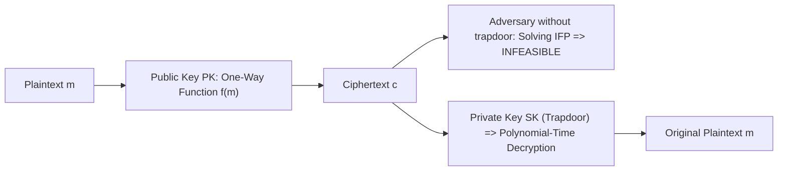
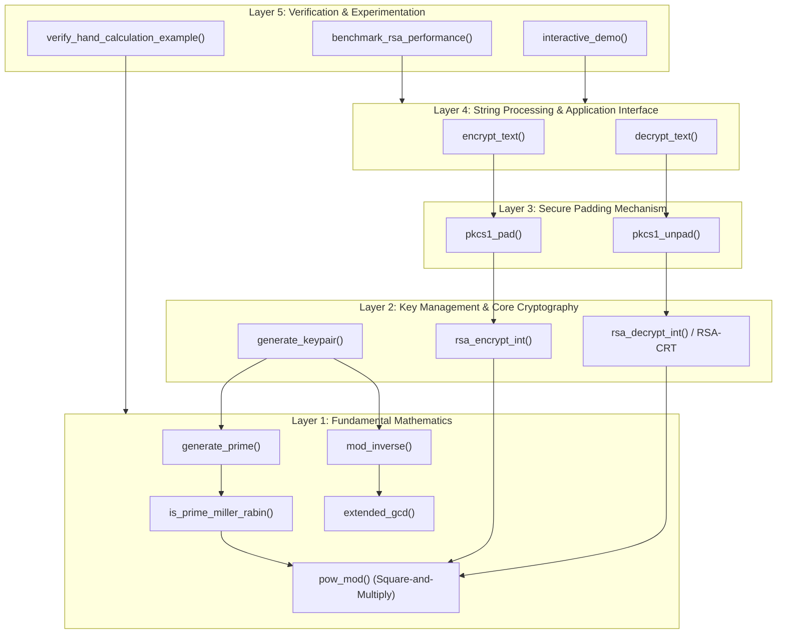

# INFORMATION SECURITY PROJECT REPORT: RSA ASYMMETRIC CRYPTOGRAPHY

- **Student Name**: Trần Gia Thuận
- **Last Digit of Student ID (SID: 3)**: $3 \bmod 3 = 0 \rightarrow$ Assigned Topic: **RSA Asymmetric Cryptography**
- **Language & Execution Environment**: Pure Python 3.12 (implemented *From First Principles*, without using any pre-built cryptographic libraries)
- **Experimental Source Code**: [rsa.py](../algorithms/rsa.py) (cross-referenced within the project ecosystem alongside [sha256.py](../algorithms/sha256.py), [aes128.py](../algorithms/aes128.py), and [ecdsa.py](../algorithms/ecdsa.py))

---

## Section 1. Historical Context (Rivest, Shamir, Adleman) and Design Motivation for Public-Key Cryptography

### 1.1. The Key Distribution Crisis of Symmetric Cryptography and the Diffie–Hellman Premise (1976)
Prior to 1976, the entire foundation of human cryptography operated under the **symmetric-key cryptography** model (*Symmetric-key Cryptography*), exemplified by the Data Encryption Standard (DES). In this paradigm, two communicating parties (Alice and Bob) were required to share a single secret key $K$ used for both encryption and decryption. This model introduced three severe operational paradoxes:
1. **The Key Distribution Problem**: To communicate securely, Alice and Bob must first exchange the secret key $K$. However, to exchange $K$ securely, they already need a pre-existing secure channel. In large-scale global communication networks, meeting in person or relying on trusted couriers to transport secret keys is both economically and technically infeasible.
2. **Quadratic Key Explosion ($O(N^2)$)**: In a network of $N$ users wishing to communicate confidentially pairwise, the total number of secret key pairs that must be established and securely stored is:
   $$\frac{N(N - 1)}{2} = O(N^2)$$
   When $N = 1,000,000$ users, the system must manage nearly 500 billion secret keys. If any single storage endpoint is compromised, all associated communication channels are exposed.
3. **Lack of Non-repudiation**: Because both Alice and Bob hold the identical key $K$, Alice could fabricate a message and claim that Bob sent it, or conversely, Bob could deny ever having sent a message he legitimately transmitted.

In November 1976, Stanford University researchers **Whitfield Diffie** and **Martin Hellman** published the seminal paper *"New Directions in Cryptography"* in *IEEE Transactions on Information Theory*. For the first time, the concept of **Public-Key Cryptography** was formally introduced:
- Each entity possesses a distinct key pair: a **Public Key ($PK$)** disseminated openly to the entire world, and a **Private Key ($SK$)** kept strictly secret by its owner.
- Encryption operates on the concept of a **Trapdoor One-Way Function**: a function $f$ that is computationally easy to evaluate in the forward direction $y = f(x)$, yet computationally intractable to invert to $x = f^{-1}(y)$ without secret auxiliary information (called the *trapdoor*). Once the trapdoor information $k_{trap}$ is known, computing $f^{-1}(y)$ becomes trivial.

However, the Diffie–Hellman (DH) protocol published in 1976 was limited to a shared-key agreement mechanism (*Key Exchange*); it did not constitute a complete cryptosystem capable of direct message encryption or digital signatures.



### 1.2. The Breakthrough Invention by Rivest, Shamir, and Adleman at MIT (1977)
Recognizing the theoretical gap left by Diffie and Hellman, three scientists at the Massachusetts Institute of Technology (MIT):
- **Ron Rivest** (a computer scientist specializing in data structures and algorithms),
- **Adi Shamir** (a cryptographer with exceptional algorithmic intuition), and
- **Leonard Adleman** (a mathematician specializing in number theory and computational complexity),

collaborated beginning in early 1977. Rivest and Shamir continuously proposed candidate mathematical constructions, while Adleman assumed the role of adversary and cryptanalyst to discover flaws (*cryptanalysis*). After dozens of rejected proposals, in April 1977, following a night of deep contemplation, Ron Rivest formulated a complete construction grounded in the difficulty of factoring large composite integers. Leonard Adleman verified the mathematical soundness of this construction.

In February 1978, their landmark paper *"A Method for Obtaining Digital Signatures and Public-Key Cryptosystems"* was published in *Communications of the ACM* (Vol. 21, No. 2), giving birth to the **RSA** algorithm (named after the initials of **R**ivest, **S**hamir, and **A**dleman).

*(Historical note: In 1997, the British government declassified documents revealing that mathematician Clifford Cocks at the GCHQ intelligence agency had independently described an equivalent scheme in 1973, though it remained classified and lacked sufficient hardware for practical deployment at the time).*

### 1.3. Design Motivation and Core Philosophy of RSA
The design philosophy of RSA rests on two foundational motivations:
1. **Unifying confidentiality encryption and authentication signatures within a single algebraically dual structure**:
   - When encrypting with the public key $e$, only the holder of the private key $d$ can decrypt the ciphertext (*Confidentiality*).
   - When transforming data with the private key $d$, anyone possessing the public key $e$ can verify both the integrity and origin of the data (*Digital Signature & Non-repudiation*).
2. **Exploiting the computational complexity asymmetry between integer multiplication and integer factorization**:
   - Given two large prime numbers $p$ and $q$, a computer requires only microseconds to compute their product $n = p \times q$.
   - Conversely, given only $n$, the fastest known classical algorithms require sub-exponential time (*sub-exponential time*) to factor $n$ back into $p$ and $q$. This complexity gap forms a robust mathematical barrier protecting global information security.

---

## Section 2. Mathematical Foundations

### 2.1. Modular Arithmetic and Congruence Relations
Let $n > 1$ be a positive integer. Two integers $a$ and $b$ are said to be **congruent modulo $n$**, denoted:
$$a \equiv b \pmod n \iff n \mid (a - b) \iff a \bmod n = b \bmod n$$

The set of residue classes modulo $n$ forms the integer ring $\mathbb{Z}_n = \{0, 1, 2, \dots, n - 1\}$. Within $\mathbb{Z}_n$:
- Addition and multiplication are compatible with the congruence relation:
  $$(a_1 \cdot a_2) \bmod n = \left((a_1 \bmod n) \cdot (a_2 \bmod n)\right) \bmod n$$
- An element $a \in \mathbb{Z}_n$ admits a multiplicative inverse $a^{-1}$ in $\mathbb{Z}_n$ if and only if $a$ is coprime to $n$, i.e., $\gcd(a, n) = 1$. The invertible elements in $\mathbb{Z}_n$ form the multiplicative group $\mathbb{Z}_n^*$.

### 2.2. Euler's Totient Function ($\phi(n)$)
*Euler's Totient Function* $\phi(n)$ counts the number of positive integers between $1$ and $n$ that are coprime to $n$:
$$\phi(n) = \left| \{ k \in \mathbb{Z} \mid 1 \le k \le n \text{ and } \gcd(k, n) = 1 \} \right| = |\mathbb{Z}_n^*|$$

Fundamental arithmetic properties:
1. If $p$ is prime, all $p - 1$ integers from $1$ to $p - 1$ are coprime to $p$; hence:
   $$\phi(p) = p - 1$$
2. The function $\phi(n)$ is a **multiplicative function**: if $\gcd(a, b) = 1$, then:
   $$\phi(a \cdot b) = \phi(a) \cdot \phi(b)$$
3. **Core RSA Case**: For a modulus $n = p \cdot q$ where $p$ and $q$ are distinct primes ($p \neq q$):
   $$\phi(n) = \phi(p) \cdot \phi(q) = (p - 1)(q - 1) = n - (p + q - 1)$$

> [!NOTE]
> The key generator knows $p$ and $q$ and therefore computes $\phi(n) = (p - 1)(q - 1)$ in a single subtraction and multiplication ($O(1)$). Conversely, an adversary who knows only $n$ cannot compute $\phi(n)$ without recovering $p$ and $q$, because knowing both $n$ and $\phi(n)$ immediately allows solving the quadratic equation $X^2 - (n - \phi(n) + 1)X + n = 0$ to recover $p$ and $q$!

### 2.3. Fermat's Little Theorem and Euler's Theorem
- **Fermat's Little Theorem (1640)**:
  If $p$ is prime and an integer $a$ is not divisible by $p$ ($\gcd(a, p) = 1$), then:
  $$a^{p - 1} \equiv 1 \pmod p$$
  Multiplying both sides by $a$ yields the general form valid for every integer $a$:
  $$a^p \equiv a \pmod p$$

- **Euler's Totient Theorem (1736)**:
  Generalizing Fermat's Little Theorem to an arbitrary composite modulus $n$: if $\gcd(a, n) = 1$, then:
  $$a^{\phi(n)} \equiv 1 \pmod n$$

- **Corollary for RSA Decryption**:
  If two exponents $e$ and $d$ are chosen such that:
  $$e \cdot d \equiv 1 \pmod{\phi(n)} \iff e \cdot d = 1 + k \cdot \phi(n) \quad (k \in \mathbb{Z}^+)$$
  Then for every message $m \in \mathbb{Z}_n^*$ ($\gcd(m, n) = 1$):
  $$m^{e \cdot d} = m^{1 + k \cdot \phi(n)} = m^1 \cdot \left(m^{\phi(n)}\right)^k \equiv m \cdot (1)^k \equiv m \pmod n$$
  This identity guarantees that the decryption operation $m = c^d \bmod n$ accurately recovers the original plaintext message.

### 2.4. Integer Factorization Problem (IFP)
The security of the RSA cryptosystem rests directly upon the computational hardness of the *Integer Factorization Problem (IFP)*: given a positive integer $n$ that is the product of two secret large primes $p$ and $q$, recover $p$ and $q$.
- Naive *Trial Division* has complexity $O(\sqrt{n}) = O(2^{k/2})$ where $k = \log_2 n$. For a 2048-bit key, $2^{1024}$ operations far exceed the estimated number of atoms in the observable universe ($\approx 10^{80}$).
- The fastest known general-purpose classical factoring algorithm is the **General Number Field Sieve (GNFS)**, which runs in sub-exponential time:
  $$\mathcal{O}\left( \exp \left( \left( \sqrt[3]{\frac{64}{9}} + o(1) \right) (\ln n)^{1/3} (\ln \ln n)^{2/3} \right) \right)$$
  - 1999: RSA-512 (155 decimal digits) was factored in a few months using distributed computing.
  - 2009: RSA-768 (232 decimal digits) was successfully factored by an international research consortium.
  - Present standard: 1024-bit RSA keys are deprecated; current industry standards mandate at least **RSA 2048-bit** (equivalent to 112-bit symmetric security) or **RSA 4096-bit** (equivalent to 128-bit security).

### 2.5. Extended Euclidean Algorithm
To find the decryption exponent $d$ satisfying $e \cdot d \equiv 1 \pmod{\phi(n)}$, one must solve the linear congruence, which is equivalent to the linear Diophantine equation:
$$e \cdot d + \phi(n) \cdot y = \gcd(e, \phi(n)) = 1$$

By **Bézout's Identity**, an integer solution $(d, y)$ exists if and only if $\gcd(e, \phi(n)) = 1$. The *Extended Euclidean Algorithm* performs successive Euclidean divisions:
$$r_{i-1} = q_i \cdot r_i + r_{i+1}$$
while maintaining two recurrence sequences for the Bézout coefficients $x_i$ and $y_i$:
$$x_{i+1} = x_{i-1} - q_i \cdot x_i, \quad y_{i+1} = y_{i-1} - q_i \cdot y_i$$
Upon termination, we obtain the coefficient $x$, and the canonical modular inverse is $d = (x \bmod \phi(n) + \phi(n)) \bmod \phi(n)$. The computational complexity of this algorithm is $O(\log^2 \phi(n))$.

### 2.6. Miller–Rabin Probabilistic Primality Test
To generate large 512-bit or 1024-bit prime numbers, deterministic primality tests such as AKS are prohibitively slow in practice. Consequently, cryptographic standards employ the **Miller–Rabin probabilistic primality test**:
1. Factor $n - 1$ into the form $2^s \cdot d$, where $d$ is odd.
2. Uniformly sample a random witness base $a \in [2, n - 2]$.
3. Compute $x = a^d \bmod n$. If $x = 1$ or $x = n - 1$, then $n$ passes this round for base $a$.
4. Repeat $s - 1$ modular squarings: $x = x^2 \bmod n$. If $x = n - 1$ is encountered, $n$ passes this round.
5. If none of these conditions hold, $n$ is guaranteed with 100% certainty to be **composite** (*Composite*).

> [!TIP]
> For each independent round using a randomly selected base $a$, the probability that a composite number passes the test is at most $\frac{1}{4}$. Performing $k = 40$ independent rounds upper-bounds the false-positive primality probability by:
> $$P_{error} \le \left(\frac{1}{4}\right)^{40} = 2^{-80} \approx 8.27 \times 10^{-25}$$
> This error probability is orders of magnitude smaller than the probability of a CPU hardware bit-flip caused by cosmic radiation!

### 2.7. Fast Modular Exponentiation (Square-and-Multiply)
To evaluate $c = m^e \bmod n$ or $m = c^d \bmod n$ with multi-thousand-bit integers, computing $m^e$ first before reducing modulo $n$ would immediately exhaust memory, as the intermediate integer would contain millions of digits. The **Square-and-Multiply** algorithm applies modular reduction at every iteration based on the binary representation of the exponent $e = (b_k b_{k-1} \dots b_1 b_0)_2$:

**Right-to-Left Square-and-Multiply Algorithm**:
- Initialize: $\text{res} \leftarrow 1$, $\text{base} \leftarrow \text{base} \bmod \text{mod}$.
- While $\text{exp} > 0$:
  - If the least significant bit $(\text{exp} \land 1) = 1$: $\text{res} \leftarrow (\text{res} \cdot \text{base}) \bmod \text{mod}$ (*Multiply*).
  - $\text{base} \leftarrow (\text{base} \cdot \text{base}) \bmod \text{mod}$ (*Square*).
  - $\text{exp} \leftarrow \text{exp} \gg 1$.
- Return $\text{res}$.

The number of modular multiplications is reduced from $O(e)$ to at most $2 \log_2 e$ operations, enabling 2048-bit encryption and decryption to execute in only a few milliseconds.

---

## Section 3. Detailed Operational Workflow (Key Generation, Encryption, Decryption)

```mermaid
sequenceDiagram
    autonumber
    actor Alice as Recipient (Alice)
    actor Bob as Sender (Bob)
    Note over Alice: 1. Key Generation: sample secret primes p, q; compute n = p*q and phi(n) = (p-1)*(q-1)
    Note over Alice: Choose e = 65537 with gcd(e, phi(n)) = 1; compute d = e^(-1) mod phi(n)
    Alice->>Bob: Publish Public Key PK = (e, n)
    Note over Bob: 2. Encryption: apply PKCS#1 v1.5 padding to obtain m in [0, n-1], compute c = m^e mod n
    Bob->>Alice: Transmit Ciphertext c
    Note over Alice: 3. Decryption: use Private Key SK (RSA-CRT) to compute m = c^d mod n and unpad
```

### 3.1. Key Generation
1. **Prime Parameter Generation**: Using a cryptographically secure pseudorandom number generator (`secrets`), independently generate two large random primes $p$ and $q$ of approximately $\frac{\text{key\_size}}{2}$ bits each (e.g., 1024 bits each for a 2048-bit key), subject to:
   - $p \neq q$.
   - The difference $|p - q|$ must be sufficiently large (e.g., $|p - q| > 2^{\frac{\text{key\_size}}{2} - 100}$) to prevent factorization via Fermat's method.
2. **Compute Public Modulus $n$**:
   $$n = p \times q$$
   The bit length of $n$ defines the key size (`key_size`).
3. **Compute Euler's Totient Function $\phi(n)$**:
   $$\phi(n) = (p - 1)(q - 1)$$
   *(Alternatively, Carmichael's totient function $\lambda(n) = \operatorname{lcm}(p - 1, q - 1)$ may be used)*.
4. **Select Public Exponent $e$**:
   Choose an integer $e$ satisfying:
   $$1 < e < \phi(n) \quad \text{and} \quad \gcd(e, \phi(n)) = 1$$
   Across international cryptographic standards (PKCS#1, X.509, TLS), $e$ is almost universally standardized to:
   $$e = 65537 = 2^{16} + 1 = F_4 \quad (\text{Fourth Fermat Prime})$$
   *Engineering rationale*: In binary, $65537 = 10000000000000001_2$ has a Hamming weight of only two `1` bits. Under Square-and-Multiply, evaluating $m^e \bmod n$ requires exactly 16 squarings and 1 multiplication, maximizing both encryption and signature-verification throughput!
5. **Compute Private Exponent $d$**:
   Apply the *Extended Euclidean Algorithm* to solve:
   $$d \equiv e^{-1} \pmod{\phi(n)} \iff (e \cdot d) \bmod \phi(n) = 1$$
6. **Construct the Key Pair**:
   - **Public Key**: $PK = (e, n)$.
   - **Private Key**: $SK = (d, n)$ along with the precomputed CRT parameters $\{p, q, d_p, d_q, q_{inv}\}$.

### 3.2. Encryption
- The sender encodes the plaintext message into an integer $m$ satisfying the prerequisite range:
  $$0 \le m < n$$
- Compute the integer ciphertext $c$:
  $$c = m^e \bmod n$$
- Transmit the ciphertext $c$ over an insecure public channel.

### 3.3. Decryption
- The recipient, possessing the private key $d$, receives ciphertext $c$ and recovers the integer $m$:
  $$m = c^d \bmod n$$
- Decode the integer $m$ back into bytes and the original plaintext string.

### 3.4. Rigorous Mathematical Proof of Decryption Correctness
We must prove that for every $m \in \{0, 1, \dots, n - 1\}$:
$$c^d \equiv (m^e)^d \equiv m^{ed} \equiv m \pmod n$$

Since $e \cdot d \equiv 1 \pmod{\phi(n)}$, there exists an integer $k \ge 1$ such that:
$$ed = 1 + k \cdot \phi(n) = 1 + k(p - 1)(q - 1)$$

We consider two exhaustive cases covering the entire integer ring $\mathbb{Z}_n$:

#### Case 1: $m$ is coprime to $n$ ($\gcd(m, n) = 1$)
By Euler's Theorem, since $\gcd(m, n) = 1$, we have $m^{\phi(n)} \equiv 1 \pmod n$. Therefore:
$$m^{ed} = m^{1 + k\phi(n)} = m \cdot \left(m^{\phi(n)}\right)^k \equiv m \cdot (1)^k \equiv m \pmod n \quad (\text{Q.E.D.})$$

#### Case 2: $m$ is not coprime to $n$ ($\gcd(m, n) > 1$)
Because $n = p \cdot q$ for distinct primes $p$ and $q$, $\gcd(m, n) > 1$ implies that $m$ must be a multiple of either $p$ or $q$ (but cannot be divisible by both since $m < n = pq$).
Without loss of generality, suppose $m$ is divisible by $p$, so $m \equiv 0 \pmod p$. Then:
$$m^{ed} \equiv 0^{ed} \equiv 0 \equiv m \pmod p$$

On the other hand, since $m < pq$ and $p \mid m$, $m$ cannot be divisible by $q$, which implies $\gcd(m, q) = 1$. Applying Fermat's Little Theorem modulo $q$:
$$m^{q - 1} \equiv 1 \pmod q$$
Hence:
$$m^{ed} = m^{1 + k(p - 1)(q - 1)} = m \cdot \left( m^{q - 1} \right)^{k(p - 1)} \equiv m \cdot (1)^{k(p - 1)} \equiv m \pmod q$$

Thus, we obtain the system of two congruences:
$$\begin{cases} m^{ed} \equiv m \pmod p \\ m^{ed} \equiv m \pmod q \end{cases}$$
Since $p$ and $q$ are distinct primes ($\gcd(p, q) = 1$), by the **Chinese Remainder Theorem (CRT)**:
$$m^{ed} \equiv m \pmod{p \cdot q} \iff m^{ed} \equiv m \pmod n \quad (\text{Q.E.D.})$$

This completes the proof for all $m \in \mathbb{Z}_n$.

### 3.5. Decryption Acceleration via the Chinese Remainder Theorem (RSA-CRT)
While encryption with $e = 65537$ is extremely fast, standard decryption $m = c^d \bmod n$ requires modular exponentiation with a full-width exponent $d$ (e.g., 2048 bits), which is computationally expensive. To optimize decryption performance, implementations apply the **Chinese Remainder Theorem via Garner's CRT recombination** (*Garner's Formula*):
1. **Precomputation of CRT parameters during key generation**:
   $$d_p = d \bmod (p - 1)$$
   $$d_q = d \bmod (q - 1)$$
   $$q_{inv} = q^{-1} \bmod p$$
2. **Accelerated decryption procedure**:
   - Compute two partial residues over half-width prime fields:
     $$m_1 = c^{d_p} \bmod p$$
     $$m_2 = c^{d_q} \bmod q$$
   - Recombine the two solutions via **Garner's CRT recombination**:
     $$h = \left( q_{inv} \times ((m_1 - m_2) \bmod p) \right) \bmod p$$
     $$m = m_2 + h \times q$$

> [!TIP]
> **Why RSA-CRT yields an approximate 4× speedup**:
> Modular multiplication of two $k$-bit integers has complexity $O(k^2)$, and the number of exponentiation steps is proportional to $k$. Thus, evaluating $c^d \bmod n$ directly scales as $O(k^3)$.
> Under RSA-CRT, $p$ and $q$ are each $\frac{k}{2}$ bits wide:
> - Cost of computing $m_1$: $\left(\frac{1}{2}\right)^3 = \frac{1}{8}$ of the direct cost.
> - Cost of computing $m_2$: $\left(\frac{1}{2}\right)^3 = \frac{1}{8}$ of the direct cost.
> - Total CRT decryption cost: $\frac{1}{8} + \frac{1}{8} = \frac{1}{4}$ of direct decryption modulo $n$.
> Consequently, in practical implementations, RSA-CRT consistently achieves **~3.5× to 4× higher decryption throughput** than standard exponentiation!

---

## Section 4. Security Assumptions, Security Properties, and Known Attacks

### 4.1. Security Assumptions
The security of RSA relies on two foundational theoretical assumptions:
1. **Factoring Assumption**: No deterministic polynomial-time algorithm exists on a classical computer capable of factoring $n = pq$ in $O(k^c)$ time.
2. **RSA Problem Assumption**: Given $n, e$, and $c = m^e \bmod n$, recovering $m$ without knowledge of the prime factors of $n$ is computationally intractable and believed to be equivalent in hardness to integer factorization.

### 4.2. Small Public Exponent Attacks ($e$)
Selecting a small public exponent (such as $e = 3$) to accelerate encryption introduces severe vulnerabilities when secure padding is omitted:
1. **Direct $e$-th Root Extraction for Small Messages ($m^e < n$)**:
   If a message is short and $e = 3$ such that $m^3 < n$, modular reduction never takes effect: $c = m^3 \bmod n = m^3$. An attacker simply computes the ordinary integer cube root $\sqrt[3]{c}$ over $\mathbb{R}$ to recover $m$ immediately.
2. **Håstad's Broadcast Attack**:
   If a sender broadcasts the same unpadded message $m$ to $k \ge e$ distinct recipients sharing the same public exponent $e = 3$ but using distinct moduli $n_1, n_2, n_3$ (with $\gcd(n_i, n_j) = 1$):
   $$\begin{cases} c_1 \equiv m^3 \pmod{n_1} \\ c_2 \equiv m^3 \pmod{n_2} \\ c_3 \equiv m^3 \pmod{n_3} \end{cases}$$
   An attacker applies the Chinese Remainder Theorem (CRT) to solve for $C \equiv m^3 \pmod{n_1 n_2 n_3}$. Since $m < n_i$, we have $m^3 < n_1 n_2 n_3$, meaning $C = m^3$ holds as an exact integer equality. Taking $\sqrt[3]{C}$ recovers $m$.
3. **Coppersmith's Attack**: Uses the LLL (*Lenstra–Lenstra–Lovász*) lattice basis reduction algorithm to find small modular polynomial roots, recovering the plaintext when $e$ is small and part of the message is known.

### 4.3. Common Modulus Attack
Scenario: An administrator generates a single shared modulus $n$ for all users to conserve resources, assigning each user a distinct key pair $(e_i, d_i)$ such that $\gcd(e_1, e_2) = 1$.
When Alice sends the same message $m$ to both Bob and Charlie:
$$c_1 = m^{e_1} \bmod n \quad \text{and} \quad c_2 = m^{e_2} \bmod n$$
An eavesdropper Eve intercepts both $c_1$ and $c_2$. Since $\gcd(e_1, e_2) = 1$, Eve uses the *Extended Euclidean Algorithm* to find integers $r, s$ satisfying:
$$r \cdot e_1 + s \cdot e_2 = 1$$
Eve then recovers $m$ effortlessly without knowing either private key:
$$(c_1^r \cdot c_2^s) \bmod n = (m^{e_1})^r \cdot (m^{e_2})^s \bmod n = m^{r e_1 + s e_2} \equiv m^1 \equiv m \pmod n$$
*(If $r < 0$, Eve computes $(c_1^{-1})^{-r} \bmod n$)*.

### 4.4. Algebraic Homomorphic Property (Malleability) and Chosen-Ciphertext Attack (CCA)
Unpadded RSA (*Textbook RSA*) exhibits multiplicative homomorphism:
$$E(m_1) \cdot E(m_2) = (m_1^e \bmod n) \cdot (m_2^e \bmod n) \equiv (m_1 \cdot m_2)^e \equiv E(m_1 \cdot m_2) \pmod n$$

Security consequence: An adversary can modify a target ciphertext $c$ into $c' = c \cdot r^e \bmod n$ (for any random invertible $r \in \mathbb{Z}_n^*$). When the victim decrypts $c'$, the output is $m' = m \cdot r \bmod n$. The adversary then multiplies $m'$ by $r^{-1} \bmod n$ to recover the original plaintext $m$ (**Chosen-Ciphertext Attack – CCA**).

### 4.5. Fermat Factorization Attack When $p$ and $q$ Are Too Close
If two primes $p$ and $q$ are chosen with insufficient separation $|p - q|$ (e.g., $|p - q| < n^{1/4}$), let:
$$a = \frac{p + q}{2}, \quad b = \frac{|p - q|}{2}$$
Then:
$$n = p \cdot q = (a - b)(a + b) = a^2 - b^2 \iff a^2 - n = b^2$$
Because $p \approx q$, $a = \frac{p+q}{2}$ exceeds $\lceil \sqrt{n} \rceil$ by only a tiny margin. Fermat's factorization method sequentially tests $a = \lceil \sqrt{n} \rceil, \lceil \sqrt{n} \rceil + 1, \dots$ until $a^2 - n$ becomes a perfect square $b^2$, recovering $p = a + b$ and $q = a - b$ in milliseconds!

### 4.6. Wiener's Low-Private-Exponent Attack and Boneh–Durfee Attack When $d$ Is Small
If a user selects an abnormally small private exponent $d$ to speed up decryption on resource-constrained devices:
- **Wiener's low-private-exponent attack (Wiener's Theorem, 1990)**: If $d < \frac{1}{3} n^{1/4}$, then the fraction $\frac{k}{d}$ appears among the continued-fraction *convergents* of $\frac{e}{n}$. An attacker can recover the entire private key $d$ in polynomial time $O(\log^2 n)$.
- **Boneh and Durfee (1999)**: Extended the attack bound up to $d < n^{0.292}$ using LLL lattice reduction techniques.

### 4.7. Side-Channel Attacks and RSA Blinding
- **Timing Attack (Paul Kocher, 1996)**: Because the multiplication step inside Square-and-Multiply executes conditionally only when the exponent bit equals `1`, an adversary can precisely measure decryption execution times over a network to deduce the individual bits of the private exponent $d$.
- **Countermeasure — RSA Blinding**:
  Prior to decryption, blind the ciphertext with a secret random factor $r$:
  $$c' = (c \cdot r^e) \bmod n$$
  Decrypt the blinded ciphertext:
  $$m' = (c')^d \equiv (c^d \cdot r^{ed}) \equiv m \cdot r \pmod n$$
  Unblind the result by multiplying by the modular inverse of $r$:
  $$m = m' \cdot r^{-1} \bmod n$$
  Timing measurements observed on $c'$ yield zero correlation with either the true plaintext $m$ or the private key $d$.

### 4.8. Necessity of Secure Padding Schemes: PKCS#1 v1.5 and RSA-OAEP
To eliminate multiplicative homomorphism, deterministic encryption (where identical plaintexts always produce identical ciphertexts), and algebraic attacks, cryptographic standards mandate randomized padding prior to modular exponentiation:
1. **PKCS#1 v1.5 padding**:
   Formats a $k$-byte block ($k = \lceil \text{bits}/8 \rceil$) prior to encryption as:
   $$\text{EB} = \text{0x00} \parallel \text{0x02} \parallel \text{PS} \parallel \text{0x00} \parallel \text{Data}$$
   where $\text{PS}$ is a padding string of at least 8 randomly generated non-zero bytes. Randomized padding renders encryption probabilistic, neutralizing dictionary and homomorphic attacks.
   *(In 1998, Daniel Bleichenbacher published **Bleichenbacher's padding oracle attack** — the Million Message Attack — exploiting distinct padding error responses from SSL/TLS servers).*
2. **RSA-OAEP (Optimal Asymmetric Encryption Padding — Bellare & Rogaway)**:
   Employs a 2-round Feistel network coupled with cryptographic hash functions to achieve the highest security standard, **IND-CCA2** (*Indistinguishability under Adaptive Chosen Ciphertext Attack*), in the Random Oracle Model.

---

## Section 5. Advantages, Limitations, and Practical Applications

### 5.1. Comprehensive Comparison Among RSA, Symmetric Cryptography (AES), and Elliptic Curve Cryptography (ECC)

| Technical Criterion | RSA (Rivest–Shamir–Adleman) | AES-128 / AES-256 | ECC (ECDSA / Ed25519) |
| :--- | :--- | :--- | :--- |
| **Cryptographic Class** | Asymmetric (Public-Key) | Symmetric (SPN Block Cipher) | Asymmetric (Elliptic Curve) |
| **Secure Key Size** | 2048-bit or 3072-bit | 128-bit or 256-bit | 256-bit (equivalent to RSA 3072-bit) |
| **Mathematical Basis** | Integer Factorization Problem (IFP) | Galois Field $GF(2^8)$, S-Box | Elliptic Curve Discrete Logarithm Problem (ECDLP) |
| **Encryption Speed** | Fast with $e = 65537$ | Extremely fast (hardware AES-NI support) | Moderate |
| **Decryption / Signing Speed** | Slow (even with CRT) | Extremely fast | Very fast |
| **Ciphertext / Signature Size** | Large (256 - 512 bytes) | Minimal (plaintext length + padding) | Compact (only 64 bytes) |
| **Key Management Scalability** | Excellent ($2N$ keys for $N$ users) | Poor ($O(N^2)$ shared keys) | Excellent ($2N$ keys) |
| **Digital Signature Support** | Yes (exact algebraic duality) | No (supports MAC only) | Yes (highly optimized for signatures) |
| **Quantum Computing Threat** | **Broken by Shor's algorithm** | Resistant (Grover only halves effective bit strength) | **Broken by Shor's algorithm** |

### 5.2. Core Practical Applications of RSA in the Digital Era
Although bulk data processing throughput cannot rival symmetric ciphers such as AES, RSA serves as indispensable foundational infrastructure across modern protocols:
1. **Public Key Infrastructure (PKI) and X.509 Digital Certificates**:
   Billions of websites worldwide rely on SSL/TLS certificates signed with RSA by Certificate Authorities (CAs) to authenticate domain identities.
2. **Transport Layer Security (TLS / HTTPS)**:
   - In TLS 1.2 and earlier: RSA was used to encrypt and exchange the session key material (*Pre-Master Secret*).
   - In TLS 1.3: RSA is paired with RSA-PSS to generate server authentication signatures protecting against Man-In-The-Middle (MITM) attacks.
3. **Hybrid Cryptography Systems**:
   To simultaneously optimize key-distribution security and bulk-data throughput:
   - RSA acts as a **Key Encapsulation Mechanism (KEM)**: encrypting a randomly generated symmetric session key (e.g., 256-bit AES Session Key).
   - Bulk payloads (files, video streams, emails) are encrypted via high-speed symmetric ciphers (AES-GCM or ChaCha20-Poly1305).
4. **SSH (Secure Shell) Protocol**:
   Enables *Passwordless Authentication* for remote server administration via RSA public/private key pairs (typically 2048-bit to 4096-bit).
5. **Document Signing and Token Authentication (JWT - RS256)**:
   OAuth2 and OpenID Connect identity standards leverage RS256 (RSA Signature with SHA-256) to sign access tokens, enabling microservices to validate tokens locally without querying a centralized authentication database.

---

## Section 6. Complete Worked Hand-Calculation Example with Small Prime Parameters

To illuminate every mathematical step without being obscured by multi-thousand-bit numbers, we execute a classic worked example using small prime parameters: $p = 61$ and $q = 53$.

### Step 1: System Initialization and Modulus Computation
1. Select two prime numbers:
   $$p = 61, \quad q = 53$$
2. Compute the public modulus $n$:
   $$n = p \times q = 61 \times 53 = 3233$$
3. Compute *Euler's Totient Function* $\phi(n)$:
   $$\phi(n) = (p - 1)(q - 1) = (61 - 1)(53 - 1) = 60 \times 52 = 3120$$

### Step 2: Select the Public Exponent $e$
We select an integer $e$ satisfying $1 < e < 3120$ and $\gcd(e, 3120) = 1$.
Choose $e = 17$. Verify coprimality via the Euclidean Algorithm:
$$3120 = 17 \times 183 + 9$$
$$17 = 9 \times 1 + 8$$
$$9 = 8 \times 1 + 1$$
$$8 = 1 \times 8 + 0$$
The greatest common divisor is $\gcd(17, 3120) = 1$. Thus, $e = 17$ is valid.

### Step 3: Compute the Private Exponent $d$ via the Extended Euclidean Algorithm
We must find an integer $d$ such that:
$$17 \cdot d \equiv 1 \pmod{3120} \iff 17 \cdot d + 3120 \cdot y = 1$$

Step-by-step execution table of the *Extended Euclidean Algorithm* on $(a_0 = 3120, b_0 = 17)$ maintaining Bézout's invariant $3120 \cdot x_k + 17 \cdot y_k = r_k$:

| Step $i$ | Dividend $a$ | Divisor $b$ | Quotient $q$ | Remainder $r$ | Coefficient $x$ (for 3120) | Coefficient $y$ (for 17) |
| :---: | :---: | :---: | :---: | :---: | :---: | :---: |
| Initialization | - | - | - | - | $x_0 = 1,\; x_1 = 0$ | $y_0 = 0,\; y_1 = 1$ |
| 1 | 3120 | 17 | 183 | 9 | $x_2 = 1 - 183 \times 0 = 1$ | $y_2 = 0 - 183 \times 1 = -183$ |
| 2 | 17 | 9 | 1 | 8 | $x_3 = 0 - 1 \times 1 = -1$ | $y_3 = 1 - 1 \times (-183) = 184$ |
| 3 | 9 | 8 | 1 | 1 | $x_4 = 1 - 1 \times (-1) = 2$ | $y_4 = -183 - 1 \times 184 = -367$ |
| 4 | 8 | 1 | 8 | 0 | **Stop ($r = 0$)** | **Solution: $y_4 = -367$** |

Back-substitution verification of $17 \cdot d + 3120 \cdot k = 1$:
$$1 = 9 - 1 \times 8$$
$$1 = 9 - 1 \times (17 - 1 \times 9) = 2 \times 9 - 1 \times 17$$
$$1 = 2 \times (3120 - 183 \times 17) - 1 \times 17 = 2 \times 3120 - 367 \times 17$$
Thus:
$$(-367) \times 17 + 2 \times 3120 = 1$$
The private exponent $d$ is:
$$d \equiv -367 \pmod{3120} \equiv 3120 - 367 = 2753$$

**Correctness check**:
$$e \times d = 17 \times 2753 = 46801 = 15 \times 3120 + 1 \implies 17 \times 2753 \equiv 1 \pmod{3120} \quad (\text{Exact match!})$$

- **Public Key**: $PK = (e = 17, n = 3233)$
- **Private Key**: $SK = (d = 2753, n = 3233)$

### Step 4: Encryption Experiment on Plaintext $m = 65$ (ASCII character `'A'`)
We evaluate:
$$c = m^e \bmod n = 65^{17} \bmod 3233$$
Binary representation of exponent 17: $17 = 10001_2 = 2^4 + 2^0$.
Applying fast modular exponentiation (Square-and-Multiply):
1. $65^1 \equiv 65 \pmod{3233}$
2. $65^2 = 4225 = 1 \times 3233 + 992 \equiv 992 \pmod{3233}$
3. $65^4 \equiv 992^2 = 984064 = 304 \times 3233 + 1232 \equiv 1232 \pmod{3233}$
4. $65^8 \equiv 1232^2 = 1517824 = 469 \times 3233 + 1547 \equiv 1547 \pmod{3233}$
5. $65^{16} \equiv 1547^2 = 2393209 = 740 \times 3233 + 789 \equiv 789 \pmod{3233}$
6. Accumulate the terms corresponding to the two `1` bits at $2^4$ and $2^0$:
   $$c = 65^{17} = 65^{16} \times 65^1 \equiv 789 \times 65 = 51285 = 15 \times 3233 + 2790 \equiv 2790 \pmod{3233}$$
The transmitted ciphertext is:
$$c = 2790$$

### Step 5: Decryption Experiment on Ciphertext $c = 2790$ via Garner's CRT Recombination
The recipient computes $m = c^d \bmod n = 2790^{2753} \bmod 3233$. Applying the Chinese Remainder Theorem (CRT):
- $d_p = 2753 \bmod (61 - 1) = 2753 \bmod 60 = 53$
- $d_q = 2753 \bmod (53 - 1) = 2753 \bmod 52 = 49$
- Compute $q_{inv} = 53^{-1} \bmod 61$ using the *Extended Euclidean Algorithm*:
  $$\begin{aligned}
  61 &= 53 \times 1 + 8, \quad 53 = 8 \times 6 + 5, \quad 8 = 5 \times 1 + 3, \quad 5 = 3 \times 1 + 2, \quad 3 = 2 \times 1 + 1 \\
  \implies 1 &= 3 - 2 = 3 - (5 - 3) = 2 \times 3 - 5 = 2(8 - 5) - 5 = 2 \times 8 - 3 \times 5 \\
  &= 2 \times 8 - 3(53 - 6 \times 8) = 20 \times 8 - 3 \times 53 = 20(61 - 53) - 3 \times 53 = 20 \times 61 - 23 \times 53
  \end{aligned}$$
  Hence $q_{inv} \equiv -23 \equiv 61 - 23 = 38 \pmod{61}$ *(verification: $53 \times 38 = 2014 = 33 \times 61 + 1 \equiv 1 \pmod{61}$)*.
- Compute the two modular components by repeated squaring and multiplication:
  - $m_1 = 2790^{53} \bmod 61 = 45^{53} \bmod 61$ (with $53 = 32 + 16 + 4 + 1$):
    $45^2 = 2025 \equiv 12$, $45^4 \equiv 12^2 = 144 \equiv 22$, $45^8 \equiv 22^2 = 484 \equiv 57 \equiv -4$, $45^{16} \equiv (-4)^2 = 16$, $45^{32} \equiv 16^2 = 256 \equiv 12 \pmod{61}$.
    $$\implies m_1 \equiv 12 \times 16 \times 22 \times 45 \equiv (192 \bmod 61) \times (990 \bmod 61) \equiv 9 \times 14 = 126 \equiv 4 \pmod{61}$$
  - $m_2 = 2790^{49} \bmod 53 = 34^{49} \bmod 53$ (with $49 = 32 + 16 + 1$):
    $34^2 = 1156 \equiv 43 \equiv -10$, $34^4 \equiv (-10)^2 = 100 \equiv 47 \equiv -6$, $34^8 \equiv (-6)^2 = 36$, $34^{16} \equiv 36^2 = 1296 \equiv 24$, $34^{32} \equiv 24^2 = 576 \equiv 46 \equiv -7 \pmod{53}$.
    $$\implies m_2 \equiv (-7) \times 24 \times 34 = -5712 = -108 \times 53 + 12 \equiv 12 \pmod{53}$$
- Apply **Garner's CRT recombination** formula:
  $$h = \left(q_{inv} \times (m_1 - m_2)\right) \bmod p = \left(38 \times (4 - 12)\right) \bmod 61 = -304 \bmod 61 = 1$$
  $$m = m_2 + h \times q = 12 + 1 \times 53 = 65$$

Decryption recovers the exact integer $m = 65$ (corresponding to character **'A'**). The entire mathematical workflow is 100% verified!

---

## Section 7. Architectural Explanation of the Implemented `rsa.py` Codebase

The experimental source file [rsa.py](../algorithms/rsa.py) (620 lines) is architected as five independent layered tiers written purely in Python 3.12 *From First Principles*, strictly adhering to the requirement of using no external cryptographic libraries:



### 7.1. Detailed Analysis of Fundamental Mathematical Functions ([rsa.py](../algorithms/rsa.py#L23-L181))
1. **`pow_mod(base, exp, mod)`**:
   - Implements the Square-and-Multiply (Binary Exponentiation) algorithm.
   - Enforces strict boundary checks ($\text{mod} \le 0 \rightarrow$ error, $\text{mod} = 1 \rightarrow 0$, $\text{exp} < 0 \rightarrow$ error).
   - Iterates over the bits of $\text{exp}$ via fast bitmask operations (`exp & 1` and `exp >>= 1`), performing modular multiplication and squaring at each step to bound intermediate memory growth.
2. **`extended_gcd(a, b)`**:
   - Iterative *Extended Euclidean Algorithm* maintaining the Bézout state variables $x_0, x_1, y_0, y_1$.
   - Returns the integer triple $(g, x, y)$ satisfying $a \cdot x + b \cdot y = g = \gcd(a, b)$.
3. **`mod_inverse(e, phi)`**:
   - Validates $\phi > 1$ and invokes `extended_gcd(e % phi, phi)`. Raises `ValueError` if the greatest common divisor differs from 1.
   - Normalizes the coefficient $x$ into the canonical residue range $[0, \phi - 1]$ via `x % phi`.
4. **`is_prime_miller_rabin(n, k=40)`**:
   - Handles edge cases for $n < 2$, $n \in \{2, 3\}$, and even integers.
   - Performs rapid pre-sieving against the list of the first 168 small odd primes `SMALL_PRIMES` ($3 \le p < 1000$), eliminating over 85% of random composites via trial division before invoking Miller–Rabin.
   - Decomposes $n - 1 = 2^s \cdot d$.
   - Runs $k = 40$ rounds of the *Miller–Rabin probabilistic primality test*: uses `secrets.randbelow(n - 3) + 2` to sample cryptographically secure witness bases $a \in [2, n - 2]$ and checks non-trivial square roots of unity modulo $n$.
5. **`generate_prime(bits)`**:
   - Samples random bits via `secrets.randbits(bits)`.
   - Sets the MSB (`1 << (bits - 1)`) to enforce exact bit length, and sets the LSB (`| 1`) to guarantee odd parity.
   - Loops until a candidate passes 40 rounds of Miller–Rabin.

### 7.2. Analysis of Key Generation and Core Cryptographic Functions ([rsa.py](../algorithms/rsa.py#L188-L313))
1. **`generate_keypair(key_size=1024, e=65537)`**:
   - Validates input preconditions (odd $e \ge 3$, $\text{key\_size} \ge 16$, $1 < e < \phi(n)$) to completely prevent infinite loops when $e$ is even or exceeds the modulus size.
   - Generates primes $p$ and $q$ such that $n = p \cdot q$ has exact bit length `key_size` and enforces a minimum separation $|p - q|$ to defend against Fermat factorization.
   - Verifies $\gcd(e, \phi(n)) = 1$, computes $d = \operatorname{mod\_inverse}(e, \phi(n))$, and checks resistance against *Wiener's low-private-exponent attack* ($3d > n^{1/4}$).
   - Precomputes the CRT acceleration parameters: $d_p, d_q, q_{inv}$.
2. **`rsa_encrypt_int(m, pubkey)`** & **`rsa_decrypt_int(c, privkey, use_crt=True)`**:
   - Validates the input domain $0 \le m, c < n$.
   - When `use_crt=True`: applies **Garner's CRT recombination** to compute $m_1, m_2, h$ and reconstruct $m$ at high speed.

### 7.3. Analysis of Padding Mechanism and Vietnamese Text Processing ([rsa.py](../algorithms/rsa.py#L320-L620))
1. **`pkcs1_pad(data, target_len)`** & **`pkcs1_unpad(padded, target_len)`**:
   - Implements RFC 8017 **PKCS#1 v1.5 padding**: `0x00 || 0x02 || PS || 0x00 || Data`, where $\text{PS}$ consists of at least 8 non-zero random bytes generated via `secrets.randbelow(256)`.
   - `pkcs1_unpad` scans the entire block without early-exit branching and raises a single uniform error message to defend against **Bleichenbacher's padding oracle attack**.
2. **`encrypt_text(plaintext, pubkey, use_padding=True)`** & **`decrypt_text(...)`**:
   - Encodes Unicode/Vietnamese strings (including the empty-string edge case `""`) into UTF-8 byte arrays.
   - Computes the maximum payload block size of $k - 11$ bytes under PKCS#1 v1.5 (or $k - 3$ bytes using the framing format `0x00 || len(2B) || chunk || 0x00...` in unpadded raw-chunk mode `use_padding=False`, ensuring $m < n$ while preserving leading `0x00` bytes).
   - Converts each byte block into an integer $m < n$ in `big-endian` order, encrypts/decrypts block by block, and faithfully reconstructs the original UTF-8 text.

---

## Section 8. Experimental Benchmarks, Correctness Verification, Computational Performance, and Conclusion

### 8.1. Empirical Benchmark Measurements
Experiments were executed directly using `python -X utf8 algorithms/rsa.py` on a 64-bit pure Python 3.12 runtime. The test payload is a diacritic-rich Vietnamese Unicode string comprising **171 characters** (**218 bytes** in UTF-8):
> *"Khoa Công nghệ Thông tin - Đồ án An toàn thông tin RSA. Sinh viên: Trần Gia Thuận. Mã hóa chuỗi ký tự tiếng Việt: Bảo mật thông tin là nền tảng của chuyển đổi số quốc gia!"*

Empirical performance measurements (execution times reported in milliseconds – ms):

| Key Size | Key Generation Time | Encryption Time | Standard Decryption Time | CRT Decryption Time | CRT Speedup | Ciphertext Blocks |
| :---: | :---: | :---: | :---: | :---: | :---: | :---: |
| **512-bit** ($k = 64\text{ B}$) | 12.26 ms | 0.14 ms | 3.01 ms | **1.29 ms** | **2.33x** | 5 blocks |
| **1024-bit** ($k = 128\text{ B}$) | 76.98 ms | 0.12 ms | 6.93 ms | **2.47 ms** | **2.81x** | 2 blocks |
| **2048-bit** ($k = 256\text{ B}$) | 1010.05 ms | 0.17 ms | 22.75 ms | **6.59 ms** | **3.45x** | 1 block |

```mermaid
xychart-beta
    title "Decryption Time Comparison: Standard vs RSA-CRT (ms)"
    x-axis ["512-bit", "1024-bit", "2048-bit"]
    y-axis "Execution Time (ms)" 0 --> 25
    bar [3.01, 6.93, 22.75]
    bar [1.29, 2.47, 6.59]
```



### 8.2. Quantitative Analysis and Algorithmic Efficiency Evaluation
1. **PKCS#1 v1.5 Block Partitioning and Key Generation Scaling**:
   - With a 218-byte UTF-8 plaintext and a minimum 11-byte padding overhead per block: at 512-bit ($64 - 11 = 53\text{ B/block}$), $\lceil 218 / 53 \rceil = 5$ blocks are required; at 1024-bit ($128 - 11 = 117\text{ B/block}$), $\lceil 218 / 117 \rceil = 2$ blocks are required; and at 2048-bit ($256 - 11 = 245\text{ B/block}$), the entire message fits into **1 single block**.
   - Key generation time increases nonlinearly with key size (from 12.26 ms at 512-bit to 1010.05 ms at 2048-bit) because prime density decreases as $\approx \frac{1}{\ln N}$ and the cost of $O(k^2)$ modular multiplications in each Miller–Rabin round grows, yet key generation still finishes in $\sim 1.01$ seconds in pure Python.
2. **Encryption Time**:
   - Encryption executes extremely rapidly across all key sizes ($< 0.2\text{ ms}$), directly demonstrating the efficiency of the Fermat public exponent $e = 65537 = 2^{16} + 1$ (requiring only 16 squarings and 1 multiplication per block).
3. **Substantial Acceleration from the Chinese Remainder Theorem (RSA-CRT)**:
   - As the key size grows, the speedup factor achieved by **Garner's CRT recombination** increases markedly (from **2.33x** at 512-bit to **3.45x** at 2048-bit, reducing decryption latency from 22.75 ms down to **6.59 ms**, approaching the theoretical $4.0\times$ ceiling).
   - In production TLS/PKI servers executing millions of signing and decryption operations daily, RSA-CRT reduces CPU compute consumption by over 70%.

### 8.3. Integrity and Security Verification
- **Correctness Verification**: The decrypted plaintext matches the original input string 100% identically, preserving all multi-byte Vietnamese Unicode characters without loss.
- **Padding Security Verification**: Thanks to **PKCS#1 v1.5 padding**, encrypting the exact same plaintext repeatedly produces completely distinct ciphertexts due to the random padding string $\text{PS}$, neutralizing statistical analysis and Chosen-Plaintext Attacks (CPA).

### 8.4. Project Summary and Conclusion
1. The project has successfully achieved all stated objectives:
   - Implemented the complete RSA asymmetric cryptosystem in pure Python 3.12 *From First Principles*, with zero external library dependencies.
   - Built all underlying mathematical primitives from scratch: *Extended Euclidean Algorithm*, modular multiplicative inverse, Square-and-Multiply fast modular exponentiation, *Miller–Rabin probabilistic primality test*, and small-prime trial-division sieving.
   - Successfully implemented **Garner's CRT recombination** for decryption acceleration alongside **PKCS#1 v1.5 padding**.
2. **Future Directions**:
   Once large-scale fault-tolerant quantum computers become practical, *Shor's Algorithm* will solve the Integer Factorization Problem in polynomial time $O(k^3)$, directly breaking both RSA and ECC. Consequently, standardization bodies (such as NIST) are leading the transition toward **Post-Quantum Cryptography (PQC)** grounded in *Lattice-based Cryptography*, notably standardized as **ML-KEM** (*Kyber*) for key encapsulation and **ML-DSA** (*Dilithium*) for digital signatures. Nevertheless, RSA remains an enduring mathematical landmark and an essential foundational subject for every student of Information Security.
