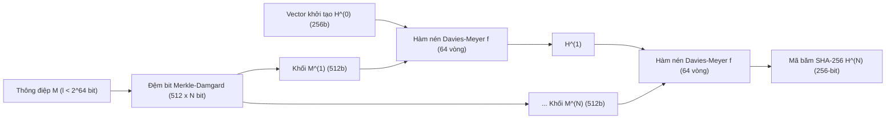
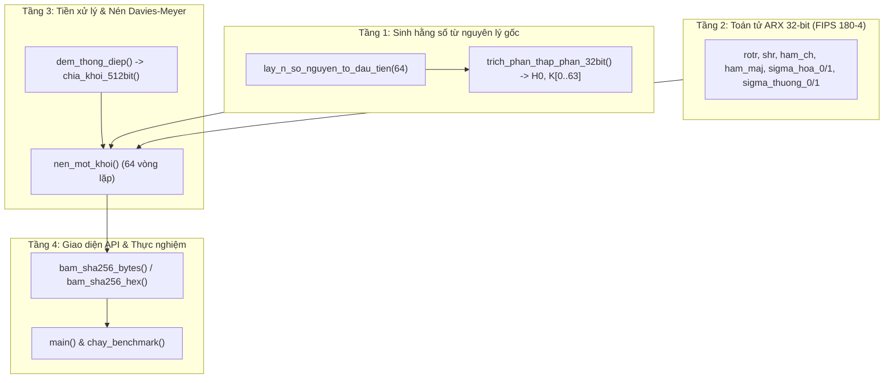

# BÁO CÁO ĐỒ ÁN AN TOÀN THÔNG TIN: HÀM BĂM MẬT MÃ SHA-256

- **Họ và tên sinh viên**: Trần Gia Thuận
- **Chữ số cuối SID**: 3
- **Ngôn ngữ & Môi trường thực thi**: Python thuần 3.12 (cài đặt từ nguyên lý gốc — *From First Principles*, không sử dụng thư viện mật mã có sẵn)
- **Mã nguồn thực nghiệm**: [sha256.py](../algorithms/sha256.py) (cung cấp khóa dẫn xuất 128-bit cho [aes128.py](../algorithms/aes128.py) và hàm băm thông điệp cho [ecdsa.py](../algorithms/ecdsa.py))

---

## Mục 1. Bối cảnh lịch sử, quá trình phát triển và động lực thiết kế

Vào đầu thập niên 1990, nhu cầu xác thực tính toàn vẹn dữ liệu và chữ ký số thúc đẩy Viện Tiêu chuẩn và Công nghệ Quốc gia Hoa Kỳ (NIST) phối hợp với Cơ quan An ninh Quốc gia Hoa Kỳ (NSA) xây dựng chuẩn hàm băm an toàn (*Secure Hash Standard* – SHS). Năm 1993, phiên bản đầu tiên là SHA-0 được công bố trong tài liệu FIPS PUB 180, nhưng nhanh chóng được thay thế bởi SHA-1 vào năm 1995 (FIPS PUB 180-1) sau khi phát hiện một điểm yếu đại số trong lịch trình mở rộng thông điệp (thiếu phép xoay trái 1 bit trong bước sinh từ khóa).

Đến cuối thập niên 1990 và đầu những năm 2000, sự gia tăng năng lực tính toán cùng với các kết quả phân tích mật mã vi sai của Xiaoyun Wang và cộng sự trên họ MD4, MD5 và SHA-1 cho thấy kích thước đầu ra 128-bit (của MD5) và 160-bit (của SHA-1) không còn đủ biên độ an toàn lâu dài trước các tấn công tìm kiếm xung đột dựa trên nghịch lý ngày sinh (*Birthday Attack*, độ phức tạp lý thuyết $2^{n/2}$). Đồng thời, khi chuẩn mã hóa khối AES (*Advanced Encryption Standard*) được phê duyệt vào năm 2001 với các kích thước khóa 128, 192 và 256 bit, hệ sinh thái mật mã cần một họ hàm băm có mức độ an toàn tương xứng (tức đạt độ phức tạp kháng xung đột tối thiểu $2^{128}$, $2^{192}$ và $2^{256}$).

Từ động lực đó, năm 2001 NIST phát hành dự thảo và tháng 8/2002 chính thức ban hành tiêu chuẩn **FIPS PUB 180-2**, giới thiệu họ hàm băm **SHA-2** gồm SHA-256, SHA-384 và SHA-512 (sau này bổ sung thêm SHA-224 cùng các biến thể cắt cụt SHA-512/224, SHA-512/256 trong **FIPS PUB 180-4**). Trong đó, **SHA-256** được thiết kế tối ưu cho kiến trúc vi xử lý 32-bit, tạo ra bản tóm lược thông điệp (*message digest*) dài 256 bit, cung cấp mức an toàn kháng xung đột $2^{128}$ phép toán — khớp hoàn toàn với mức bảo mật 128-bit của AES-128 và ECDSA `secp256k1`.

---

## Mục 2. Cơ sở toán học nền tảng và nguyên lý hoạt động

### 2.1. Cấu trúc lặp Merkle-Damgård (Merkle-Damgård Construction)
SHA-256 được xây dựng dựa trên cấu trúc lặp **Merkle-Damgård** kết hợp với kỹ thuật đệm tăng cường độ dài (*Merkle-Damgård Strengthening*). Một thông điệp đầu vào $M$ có độ dài bất kỳ $0 \le l < 2^{64}$ bit trước hết được đệm thêm các bit để tổng độ dài là bội số dương của 512 bit, sau đó chia thành $N$ khối 512-bit: $M^{(1)}, M^{(2)}, \dots, M^{(N)}$.

Quá trình băm khởi đầu từ một vector khởi tạo cố định 256-bit $H^{(0)}$ và áp dụng tuần tự hàm nén một chiều $f$:

$$H^{(i)} = f\left(H^{(i-1)}, M^{(i)}\right) \quad \text{với } i = 1, 2, \dots, N$$

Định lý quy dẫn Merkle-Damgård (1989) chứng minh rằng: nếu hàm nén cơ sở $f: \{0,1\}^{256} \times \{0,1\}^{512} \to \{0,1\}^{256}$ là kháng xung đột (*collision-resistant*), thì toàn bộ hàm băm lặp trên miền thông điệp độ dài tùy ý cũng bảo toàn tính kháng xung đột.

### 2.2. Hàm nén Davies-Meyer và kiến trúc đại số ARX
Bên trong mỗi khối $M^{(i)}$, hàm nén $f$ của SHA-256 tuân theo cấu trúc **Davies-Meyer**: khối thông điệp $M^{(i)}$ đóng vai trò như "khóa" điều khiển một phép hoán vị 64 vòng trên trạng thái 256-bit $H^{(i-1)}$, sau đó kết quả đầu ra được cộng dồn (*feed-forward*) với chính trạng thái đầu vào $H^{(i-1)}$ theo phép cộng modulo $2^{32}$ trên từng từ 32-bit:

$$H_j^{(i)} = \left(H_j^{(i-1)} + \text{State}_j^{(64)}\right) \bmod 2^{32}, \quad j \in \{0, 1, \dots, 7\}$$

Nhánh cộng dồn này phá vỡ tính khả nghịch của hoán vị nội bộ, ngăn chặn việc tính ngược trạng thái ngay cả khi kẻ tấn công biết rõ toàn bộ khối thông điệp $M^{(i)}$.

Về mặt đại số, SHA-256 thuộc họ thiết kế **ARX** (*Addition – Rotation – XOR*) kết hợp hai hàm Boolean phi tuyến theo từng vị trí bit ($Ch$ và $Maj$) trên không gian các từ 32-bit $\mathbb{Z}_{2^{32}}$:
- **Phép cộng số học modulo $2^{32}$ ($\boxplus$)**: Tạo sự lan truyền bit nhớ (*carry propagation*) phi tuyến đối với phép XOR trên trường nhị phân.
- **Phép xoay phải ($\text{ROTR}^n$) và dịch phải logic ($\text{SHR}^n$)**: Phá vỡ tính đối xứng vị trí bit và khuếch tán thông tin xuyên suốt 32 vị trí bit của mỗi từ:
  $$\text{ROTR}^n(x) = (x \gg n) \lor \left((x \ll (32 - n)) \bmod 2^{32}\right), \quad \text{SHR}^n(x) = x \gg n$$
- **Hàm Boolean phi tuyến bậc hai trên $GF(2)$**:
  - Hàm chọn lựa (*Choose*): $Ch(x, y, z) = (x \land y) \oplus (\neg x \land z)$
  - Hàm đa số (*Majority*): $Maj(x, y, z) = (x \land y) \oplus (x \land z) \oplus (y \land z)$
- **Bốn hàm khuếch tán tuyến tính trên $GF(2)^{32}$**:
  - $\Sigma_0(x) = \text{ROTR}^2(x) \oplus \text{ROTR}^{13}(x) \oplus \text{ROTR}^{22}(x)$
  - $\Sigma_1(x) = \text{ROTR}^6(x) \oplus \text{ROTR}^{11}(x) \oplus \text{ROTR}^{25}(x)$
  - $\sigma_0(x) = \text{ROTR}^7(x) \oplus \text{ROTR}^{18}(x) \oplus \text{SHR}^3(x)$
  - $\sigma_1(x) = \text{ROTR}^{17}(x) \oplus \text{ROTR}^{19}(x) \oplus \text{SHR}^{10}(x)$

> [!NOTE]
> Sự đan xen liên tục giữa phép cộng trong vành $\mathbb{Z}_{2^{32}}$ và các phép toán tuyến tính/phi tuyến trên không gian vector $GF(2)^{32}$ tạo ra sự bất tương thích đại số (*algebraic incompatibility*), khiến hệ phương trình mô tả 64 vòng nén không thể tuyến tính hóa hay giải ngược bằng cơ sở Gröbner.

---

## Mục 3. Quy trình vận hành chi tiết từng bước

Quy trình thực thi SHA-256 theo đặc tả NIST FIPS 180-4 gồm 4 giai đoạn nối tiếp:

### Bước 1: Đệm bit thông điệp (Message Padding) và chia khối
Giả sử thông điệp gốc $M$ có độ dài $l$ bit ($0 \le l < 2^{64}$):
1. Nối thêm một bit `1` vào cuối thông điệp (trong biểu diễn theo byte là gắn thêm byte `0x80`).
2. Nối thêm $k$ bit `0` ($k \ge 0$ nhỏ nhất) sao cho:
   $$l + 1 + k \equiv 448 \pmod{512}$$
3. Nối thêm một khối 64-bit biểu diễn số nguyên không dấu $l$ theo thứ tự **Big-Endian**.
4. Thông điệp sau khi đệm có độ dài đúng bằng $512 \times N$ bit, được cắt thành $N$ khối $M^{(1)}, \dots, M^{(N)}$, mỗi khối 512 bit (64 byte).

### Bước 2: Khởi tạo giá trị băm ban đầu $H^{(0)}$ và hằng số vòng $K$
- **8 thanh ghi trạng thái ban đầu $H_0^{(0)} \dots H_7^{(0)}$**: Lấy 32 bit đầu tiên của phần thập phân của căn bậc hai của 8 số nguyên tố đầu tiên ($2, 3, 5, 7, 11, 13, 17, 19$):
  $$H_i^{(0)} = \left\lfloor \operatorname{frac}\left(\sqrt{p_i}\right) \times 2^{32} \right\rfloor$$
- **64 hằng số vòng $K_0 \dots K_{63}$**: Lấy 32 bit đầu tiên của phần thập phân của căn bậc ba của 64 số nguyên tố đầu tiên ($2, 3, 5, \dots, 311$):
  $$K_t = \left\lfloor \operatorname{frac}\left(\sqrt[3]{p_t}\right) \times 2^{32} \right\rfloor$$

### Bước 3: Mở rộng lịch trình thông điệp (Message Schedule $W_0 \dots W_{63}$)
Với mỗi khối 512-bit $M^{(i)}$:
- 16 từ đầu tiên ($t = 0 \dots 15$): Tách trực tiếp khối 512-bit thành 16 từ 32-bit Big-Endian $W_0, W_1, \dots, W_{15}$.
- 48 từ tiếp theo ($t = 16 \dots 63$): Tính truy hồi theo công thức:
  $$W_t = \left(\sigma_1(W_{t-2}) + W_{t-7} + \sigma_0(W_{t-15}) + W_{t-16}\right) \bmod 2^{32}$$

### Bước 4: Vòng lặp nén 64 bước và cập nhật trạng thái
Gán 8 biến làm việc $(a, b, c, d, e, f, g, h) \leftarrow \left(H_0^{(i-1)}, \dots, H_7^{(i-1)}\right)$. Thực hiện lặp với $t = 0$ đến $63$:

$$T_1 = \left(h + \Sigma_1(e) + Ch(e, f, g) + K_t + W_t\right) \bmod 2^{32}$$

$$T_2 = \left(\Sigma_0(a) + Maj(a, b, c)\right) \bmod 2^{32}$$

$$\begin{aligned}
h &\leftarrow g, \quad g \leftarrow f, \quad f \leftarrow e, \quad e \leftarrow (d + T_1) \bmod 2^{32} \\
d &\leftarrow c, \quad c \leftarrow b, \quad b \leftarrow a, \quad a \leftarrow (T_1 + T_2) \bmod 2^{32}
\end{aligned}$$

Sau khi kết thúc 64 vòng, cộng dồn vào trạng thái băm:
$$H_0^{(i)} = (H_0^{(i-1)} + a) \bmod 2^{32}, \quad \dots, \quad H_7^{(i)} = (H_7^{(i-1)} + h) \bmod 2^{32}$$

Sau khi xử lý hết khối cuối cùng $M^{(N)}$, ghép nối 8 từ $H_0^{(N)} \parallel H_1^{(N)} \parallel \dots \parallel H_7^{(N)}$ theo thứ tự Big-Endian để thu được giá trị băm 256-bit cuối cùng.

---

## Mục 4. Các giả định an toàn, tính chất bảo mật và các tấn công đã biết

### 4.1. Các giả định an toàn và tính chất bảo mật cốt lõi
Một hàm băm mật mã an toàn như SHA-256 thỏa mãn ba tính chất nền tảng:
1. **Kháng tiền ảnh (Preimage Resistance / Tính một chiều)**: Cho trước giá trị băm $y$, không thể tìm được thông điệp $x$ sao cho $\operatorname{SHA-256}(x) = y$ với chi phí thấp hơn duyệt vét cạn $2^{256}$ phép thử.
2. **Kháng tiền ảnh thứ hai (Second-Preimage Resistance)**: Cho trước thông điệp $x_1$, không thể tìm được thông điệp $x_2 \neq x_1$ sao cho $\operatorname{SHA-256}(x_1) = \operatorname{SHA-256}(x_2)$ với độ phức tạp thấp hơn $2^{256}$ phép thử.
3. **Kháng xung đột (Collision Resistance)**: Không thể tìm được bất kỳ cặp $(x_1, x_2)$ nào với $x_1 \neq x_2$ mà $\operatorname{SHA-256}(x_1) = \operatorname{SHA-256}(x_2)$ với độ phức tạp thấp hơn giới hạn nghịch lý ngày sinh là $2^{256/2} = 2^{128}$ phép tính.
4. **Hiệu ứng thác đổ (Avalanche Effect) và tính giả ngẫu nhiên**: Khi thay đổi chỉ 1 bit ở đầu vào, xác suất mỗi bit trong 256 bit đầu ra bị đảo giá trị xấp xỉ $50\%$ (trung bình khoảng 128 bit thay đổi), không để lộ bất kỳ tương quan thống kê nào.

Ngoài ra, tính minh bạch trong thiết kế của SHA-256 dựa trên việc sử dụng các hằng số **"Nothing-up-my-sleeve numbers"** (sinh từ căn bậc hai và căn bậc ba của các số nguyên tố đầu tiên), loại bỏ hoàn toàn nghi ngờ về việc tác giả chèn cửa hậu toán học (*backdoor*) vào bảng hằng số.

### 4.2. Các tấn công đã biết và biện pháp phòng vệ

> [!WARNING]
> **Tấn công mở rộng độ dài (Length Extension Attack)**: Do đặc trưng của cấu trúc Merkle-Damgård, đầu ra 256-bit $\operatorname{SHA-256}(M)$ chính là toàn bộ trạng thái thanh ghi nội bộ $H^{(N)}$ sau khối cuối cùng. Nếu hệ thống xây dựng MAC ngây thơ dạng $\operatorname{MAC} = \operatorname{SHA-256}(K \parallel M)$, kẻ tấn công chỉ cần biết giá trị băm này và độ dài của $K \parallel M$ là có thể nạp $H^{(N)}$ làm trạng thái đầu vào để tính hợp lệ $\operatorname{SHA-256}(K \parallel M \parallel \text{Padding} \parallel M')$ cho hậu tố $M'$ tùy ý mà không cần biết khóa $K$.

- **Biện pháp khắc phục Length Extension**: Tuyệt đối không dùng $\operatorname{SHA-256}(K \parallel M)$ trực tiếp để xác thực thông điệp có khóa mà bắt buộc dùng cấu trúc lồng **HMAC-SHA256** (RFC 2104), hoặc dùng biến thể cắt cụt trạng thái như SHA-512/256, hoặc hàm băm cấu trúc Sponge như SHA-3.
- **Phân tích vi sai trên phiên bản rút gọn vòng (Reduced-round Cryptanalysis)**: Cho đến nay, chưa có bất kỳ tấn công thực tế hay lý thuyết nào phá vỡ toàn bộ 64 vòng của SHA-256. Các kết quả phân tích vi sai hiện đại nhất (như của Mendel, Nad, Schläffer và các nghiên cứu tiếp nối) chỉ mới tạo được xung đột trên phiên bản rút gọn 31 vòng và giả xung đột (*semi-free-start collision*) đến 38–46 vòng, còn biên độ an toàn rất lớn so với 64 vòng đầy đủ.
- **Tấn công lượng tử (Quantum Threat)**: Thuật toán tìm kiếm Grover trên máy tính lượng tử chỉ tăng tốc bậc hai đối với bài toán tìm tiền ảnh (giảm độ phức tạp từ $2^{256}$ xuống $2^{128}$), và thuật toán Brassard–Høyer–Tapp cho bài toán xung đột vẫn đòi hỏi tối thiểu $2^{85.3}$ đến $2^{128}$ chi phí tính toán – bộ nhớ lượng tử, nghĩa là SHA-256 vẫn duy trì tính an toàn hậu lượng tử.

---

## Mục 5. Ưu điểm, hạn chế và ứng dụng thực tế

### 5.1. So sánh SHA-256 với các hàm băm tiêu biểu

| Tiêu chí kỹ thuật | MD5 (RFC 1321) | SHA-1 (FIPS 180-1) | **SHA-256 (FIPS 180-4)** | SHA-512 (FIPS 180-4) | SHA-3-256 (FIPS 202) |
| :--- | :---: | :---: | :---: | :---: | :---: |
| **Cấu trúc lõi** | Merkle-Damgård | Merkle-Damgård | **Merkle-Damgård (ARX)** | Merkle-Damgård (ARX) | Sponge (Keccak-$f$) |
| **Kích thước khối / từ** | 512-bit / 32-bit | 512-bit / 32-bit | **512-bit / 32-bit** | 1024-bit / 64-bit | 1088-bit ($r$) / 64-bit |
| **Độ dài đầu ra / Số vòng** | 128-bit / 64 vòng | 160-bit / 80 vòng | **256-bit / 64 vòng** | 512-bit / 80 vòng | 256-bit / 24 vòng |
| **Độ an toàn xung đột** | Bị phá vỡ ($< 2^{18}$) | Bị phá vỡ (SHAttered $\approx 2^{63}$) | **An toàn ($2^{128}$)** | An toàn ($2^{256}$) | An toàn ($2^{128}$) |
| **Kháng Length Extension** | Không | Không | **Không (cần bọc HMAC)** | Không (trừ SHA-512/256) | Có (nhờ Capacity $c=512$) |

### 5.2. Ưu điểm và hạn chế
- **Ưu điểm**:
  - **Độ tin cậy và biên độ an toàn rất cao**: Sau hơn hai thập kỷ được cộng đồng mật mã toàn cầu kiểm định, 64 vòng của SHA-256 vẫn hoàn toàn vững chắc.
  - **Tối ưu phần cứng và phần mềm**: Các phép toán ARX 32-bit khớp trực tiếp với tập lệnh ALU cơ bản của mọi CPU; hầu hết vi xử lý hiện đại (Intel/AMD SHA-NI, ARMv8 Crypto Extensions) đều có tập lệnh tăng tốc phần cứng giúp đạt thông lượng hàng GB/giây.
  - **Tương thích dẫn xuất khóa đối xứng**: Đầu ra 256-bit phân bố đồng đều, có thể dùng trực tiếp làm khóa AES-256 hoặc trích 128-bit đầu làm khóa AES-128.
- **Hạn chế**:
  - **Không dùng trực tiếp để băm mật khẩu**: Tốc độ thực thi rất nhanh trên GPU/ASIC khiến mật khẩu dễ bị vét cạn hàng tỷ lần thử/giây; lưu mật khẩu bắt buộc dùng các hàm kéo giãn khóa tốn bộ nhớ như **Argon2id**, **bcrypt** hoặc **PBKDF2-HMAC-SHA256** kèm muối (*salt*).
  - **Nhạy cảm với Length Extension Attack** nếu dùng ghép khóa trực tiếp không qua HMAC.
  - **Thông lượng phần mềm trên CPU 64-bit thấp hơn SHA-512** (khi không có tập lệnh phần cứng SHA-NI) do chỉ xử lý từ 32-bit mỗi vòng.

### 5.3. Ứng dụng thực tế
- **Giao thức bảo mật mạng**: Nền tảng cho TLS 1.2 / TLS 1.3, IPsec, SSH và chứng thư số X.509.
- **Chữ ký số và hạ tầng khóa công khai (PKI)**: Băm văn bản trước khi ký bằng RSA-PSS, RSASSA-PKCS1-v1_5 hoặc ECDSA (như trong [ecdsa.py](../algorithms/ecdsa.py)).
- **Công nghệ Blockchain**: Thuật toán bằng chứng công việc (*Proof-of-Work*) cốt lõi của Bitcoin ($\operatorname{SHA-256}(\operatorname{SHA-256}(\text{Header}))$) và cây Merkle xác thực giao dịch.
- **Kiểm tra toàn vẹn phần mềm & lưu trữ định danh nội dung**: Xác thực gói cài đặt hệ điều hành, Docker/OCI image digest và đối tượng Git SHA-256.
- **Dẫn xuất khóa mật mã (KDF)**: Hạt nhân của chuẩn HKDF (RFC 5869) và cơ chế sinh khóa cho AES (như trong [aes128.py](../algorithms/aes128.py)).

---

## Mục 6. Ví dụ tính tay minh họa bước đệm bit và 2 vòng nén đầu tiên

Ta thực hiện tính tay chi tiết cho chuỗi đầu vào chuẩn $M =$ `"abc"` và đối chiếu bước đệm bit cho chuỗi họ tên sinh viên `"Trần Gia Thuận"`.

### 6.1. Bước đệm bit (Padding) và tách từ $W_0 \dots W_{15}$ cho chuỗi `"abc"`
- Chuỗi `"abc"` gồm 3 ký tự ASCII:
  - `'a'` $= \text{0x61} = 01100001_2$
  - `'b'` $= \text{0x62} = 01100010_2$
  - `'c'` $= \text{0x63} = 01100011_2$
- Độ dài gốc: $l = 3 \times 8 = 24\text{ bits} = \text{0x18}$.
- **Gắn bit `1`**: Thêm bit `1` và 7 bit `0` để tròn 1 byte $\Rightarrow$ thêm byte `0x80`. Độ dài hiện tại là $24 + 8 = 32$ bit (4 byte).
- **Tìm số bit `0` cần đệm thêm**:
  $$k = 448 - (24 + 1) = 423\text{ bits}$$
  Do đã thêm 7 bit `0` trong byte `0x80`, số byte `0x00` cần chèn tiếp là $(423 - 7) / 8 = 52$ byte `0x00`.
- **Gắn 64-bit độ dài gốc Big-Endian**: $l = 24$ biểu diễn trên 8 byte là `00 00 00 00 00 00 00 18`.
- **Khối 512-bit duy nhất $M^{(1)}$ sau khi chia làm 16 từ 32-bit ($W_0 \dots W_{15}$)**:
  - $W_0 = \text{0x61626380}$
  - $W_1 = W_2 = \dots = W_{14} = \text{0x00000000}$
  - $W_{15} = \text{0x00000018}$

*(Mở rộng đối chiếu cho chuỗi họ tên sinh viên `"Trần Gia Thuận"`)*:
- Khi mã hóa UTF-8, chuỗi `"Trần Gia Thuận"` gồm **18 byte** ($l = 18 \times 8 = 144\text{ bits} = \text{0x90}$):
  `54 72 e1 ba a7 6e 20 47 69 61 20 54 68 75 e1 ba ad 6e`
  (trong đó `'ầ'` chiếm 3 byte `e1 ba a7` và `'ậ'` chiếm 3 byte `e1 ba ad`).
- Sau khi gắn byte `0x80` (vị trí byte thứ 19), cần đệm thêm $56 - 19 = 37$ byte `0x00`, rồi gắn 8 byte độ dài `00 00 00 00 00 00 00 90` để hoàn thành đúng 1 khối 64 byte (512 bit).

### 6.2. Tính tay Vòng nén thứ nhất ($t = 0$) cho `"abc"`
**Trạng thái khởi tạo ban đầu ($H^{(0)}$)**:
$$\begin{aligned}
a &= \text{0x6a09e667}, & b &= \text{0xbb67ae85}, & c &= \text{0x3c6ef372}, & d &= \text{0xa54ff53a} \\
e &= \text{0x510e527f}, & f &= \text{0x9b05688c}, & g &= \text{0x1f83d9ab}, & h &= \text{0x5be0cd19}
\end{aligned}$$

Tại $t = 0$, ta có $W_0 = \text{0x61626380}$ và hằng số $K_0 = \text{0x428a2f98}$:
1. **Tính $\Sigma_1(e)$ với $e = \text{0x510e527f}$**:
   - $\text{ROTR}^6(\text{0x510e527f}) = \text{0xfd443949}$
   - $\text{ROTR}^{11}(\text{0x510e527f}) = \text{0x4fea21ca}$
   - $\text{ROTR}^{25}(\text{0x510e527f}) = \text{0x87293fa8}$
   - $\Sigma_1(e) = \text{0xfd443949} \oplus \text{0x4fea21ca} \oplus \text{0x87293fa8} = \text{0x3587272b}$
2. **Tính $Ch(e, f, g) = (e \land f) \oplus (\neg e \land g)$**:
   - $e \land f = \text{0x510e527f} \land \text{0x9b05688c} = \text{0x1104400c}$
   - $\neg e \land g = \text{0xaef1ad80} \land \text{0x1f83d9ab} = \text{0x0e818980}$
   - $Ch(e, f, g) = \text{0x1104400c} \oplus \text{0x0e818980} = \text{0x1f85c98c}$
3. **Tính $T_1 = (h + \Sigma_1(e) + Ch(e, f, g) + K_0 + W_0) \bmod 2^{32}$**:
   $$T_1 = (\text{0x5be0cd19} + \text{0x3587272b} + \text{0x1f85c98c} + \text{0x428a2f98} + \text{0x61626380}) \bmod 2^{32} = \text{0x54da50e8}$$
4. **Tính $\Sigma_0(a)$ với $a = \text{0x6a09e667}$**:
   - $\text{ROTR}^2(\text{0x6a09e667}) = \text{0xda827999}$
   - $\text{ROTR}^{13}(\text{0x6a09e667}) = \text{0x333b504f}$
   - $\text{ROTR}^{22}(\text{0x6a09e667}) = \text{0x27999da8}$
   - $\Sigma_0(a) = \text{0xda827999} \oplus \text{0x333b504f} \oplus \text{0x27999da8} = \text{0xce20b47e}$
5. **Tính $Maj(a, b, c) = (a \land b) \oplus (a \land c) \oplus (b \land c)$**:
   $$Maj(\text{0x6a09e667}, \text{0xbb67ae85}, \text{0x3c6ef372}) = \text{0x3a6fe667}$$
6. **Tính $T_2 = (\Sigma_0(a) + Maj(a, b, c)) \bmod 2^{32}$**:
   $$T_2 = (\text{0xce20b47e} + \text{0x3a6fe667}) \bmod 2^{32} = \text{0x08909ae5}$$
7. **Cập nhật 8 thanh ghi sau vòng $t = 0$**:
   - $a \leftarrow (T_1 + T_2) \bmod 2^{32} = (\text{0x54da50e8} + \text{0x08909ae5}) \bmod 2^{32} = \text{0x5d6aebcd}$
   - $e \leftarrow (d + T_1) \bmod 2^{32} = (\text{0xa54ff53a} + \text{0x54da50e8}) \bmod 2^{32} = \text{0xfa2a4622}$
   - Các thanh ghi còn lại dịch chuyển tuần tự:
     $$b = \text{0x6a09e667}, \quad c = \text{0xbb67ae85}, \quad d = \text{0x3c6ef372}, \quad f = \text{0x510e527f}, \quad g = \text{0x9b05688c}, \quad h = \text{0x1f83d9ab}$$

### 6.3. Tính tay Vòng nén thứ hai ($t = 1$) cho `"abc"`
Tại $t = 1$, ta có $W_1 = \text{0x00000000}$ và hằng số $K_1 = \text{0x71374491}$:
1. **Tính $\Sigma_1(e)$ với $e = \text{0xfa2a4622}$**:
   $$\Sigma_1(\text{0xfa2a4622}) = \text{0x5a94fd2d}$$
2. **Tính $Ch(e, f, g)$ với $e = \text{0xfa2a4622}, f = \text{0x510e527f}, g = \text{0x9b05688c}$**:
   $$Ch(e, f, g) = \text{0x510f6aae}$$
3. **Tính $T_1 = (h + \Sigma_1(e) + Ch(e, f, g) + K_1 + W_1) \bmod 2^{32}$**:
   $$T_1 = (\text{0x1f83d9ab} + \text{0x5a94fd2d} + \text{0x510f6aae} + \text{0x71374491} + \text{0x00000000}) \bmod 2^{32} = \text{0x3c5f8617}$$
4. **Tính $\Sigma_0(a)$ và $Maj(a, b, c)$ với $a = \text{0x5d6aebcd}, b = \text{0x6a09e667}, c = \text{0xbb67ae85}$**:
   - $\Sigma_0(a) = \text{0xa29f64d1}$
   - $Maj(a, b, c) = \text{0x7b6beec5}$
   - $T_2 = (\text{0xa29f64d1} + \text{0x7b6beec5}) \bmod 2^{32} = \text{0x1e0b5396}$
5. **Cập nhật 8 thanh ghi sau vòng $t = 1$**:
   - $a \leftarrow (\text{0x3c5f8617} + \text{0x1e0b5396}) \bmod 2^{32} = \text{0x5a6ad9ad}$
   - $e \leftarrow (\text{0x3c6ef372} + \text{0x3c5f8617}) \bmod 2^{32} = \text{0x78ce7989}$
   - Các thanh ghi còn lại:
     $$b = \text{0x5d6aebcd}, \quad c = \text{0x6a09e667}, \quad d = \text{0xbb67ae85}, \quad f = \text{0xfa2a4622}, \quad g = \text{0x510e527f}, \quad h = \text{0x9b05688c}$$

*(Toàn bộ các hằng số xoay bit và giá trị thanh ghi trung gian tại $t=0$ và $t=1$ trên đây trùng khớp 100% với kết quả in đối chiếu từ chương trình [sha256.py](../algorithms/sha256.py))*.

---

## Mục 7. Giải thích cấu trúc code `sha256.py` đã viết

Tệp mã nguồn [sha256.py](../algorithms/sha256.py) (379 dòng) được thiết kế theo hướng lập trình hàm phân lớp rõ ràng, không phụ thuộc bất kỳ thư viện mật mã nào (chỉ sử dụng `struct` để đóng/mở gói byte Big-Endian và `time` để đo hiệu năng):

1. **Khối sinh hằng số từ nguyên lý gốc ([sha256.py](../algorithms/sha256.py#L17-L61))**:
   - Hàm `lay_n_so_nguyen_to_dau_tien(64)` tìm 64 số nguyên tố đầu tiên ($2 \dots 311$).
   - Hàm `trich_phan_thap_phan_32bit(so_nguyen_to, bac_can)` dùng thuật toán tìm kiếm nhị phân trên số nguyên lớn của Python để tính chính xác $\lfloor \operatorname{frac}(\sqrt[r]{p}) \times 2^{32} \rfloor$ mà không bị sai số dấu phẩy động, tự động tạo ra danh sách `GIA_TRI_KHOI_TAO_H0` và `HANG_SO_VONG_K`.
2. **Khối các phép toán bit 32-bit cơ sở ([sha256.py](../algorithms/sha256.py#L68-L137))**:
   - Vì kiểu `int` trong Python có độ dài bit tùy ý (*arbitrary-precision*), mọi đầu vào và phép dịch trái, đảo bit (`~x`), cộng số học đều được chuẩn hóa nghiêm ngặt bằng mặt nạ `MASK_32 = 0xFFFFFFFF` (kể cả trước khi dịch phải trong `rotr` và `shr` cùng kiểm tra miền số bit dịch $n \in [0, 31]$).
   - Gồm đầy đủ 8 hàm toán học: `rotr`, `shr`, `ham_ch`, `ham_maj`, `sigma_hoa_0` ($\Sigma_0$), `sigma_hoa_1` ($\Sigma_1$), `sigma_thuong_0` ($\sigma_0$), và `sigma_thuong_1` ($\sigma_1$).
3. **Khối tiền xử lý đệm bit và chia khối ([sha256.py](../algorithms/sha256.py#L144-L178))**:
   - Hàm `dem_thong_diep(du_lieu_bytes)` kiểm tra kiểu dữ liệu nhị phân hợp lệ và điều kiện biên $l < 2^{64}$ bit, nối byte `0x80`, lặp nối `0x00` đến khi `len % 64 == 56`, rồi dùng `struct.pack(">Q", do_dai_bit)` đóng gói độ dài bit thành 8 byte Big-Endian.
   - Hàm `chia_khoi_512bit(du_lieu_da_dem)` kiểm tra tính bội số 64 byte và cắt thành từng khối 512-bit.
4. **Khối nén 64 vòng và tổng hợp mã băm ([sha256.py](../algorithms/sha256.py#L185-L262))**:
   - Hàm `nen_mot_khoi(khoi_64_byte, trang_thai_h)` kiểm tra kích thước khối 64 byte và 8 thanh ghi trạng thái, giải nén 16 từ 32-bit đầu bằng `struct.unpack(">16I", khoi_64_byte)`, mở rộng lên 64 từ $W_0 \dots W_{63}$, chạy 64 vòng nén cập nhật $(a, b, c, d, e, f, g, h)$ và cộng dồn Davies-Meyer với `trang_thai_h`.
   - Hai hàm giao diện chính là `bam_sha256_bytes(du_lieu)` (trả về 32 byte thô phục vụ `aes128.py` và `ecdsa.py`) và `bam_sha256_hex(du_lieu)` (trả về chuỗi 64 ký tự Hex).
5. **Khối kiểm thử vector chuẩn, trích khóa AES-128 và đo hiệu năng ([sha256.py](../algorithms/sha256.py#L269-L379))**:
   - Hàm `chay_benchmark()` đo thời gian thực thi trung bình qua 50 lần lặp bằng `time.perf_counter()` trên các kích thước 100B, 1KB và 10KB.
   - Hàm `main()` tự động đối chiếu 3 vector chuẩn NIST FIPS 180-4 (rỗng, 1 khối và đa khối biên 448-bit), băm chuỗi `"Trần Gia Thuận"` (UTF-8), trích 128 bit đầu làm khóa AES-128 và in truy vết vòng $t=0, 1$.

---

## Mục 8. Bảng đánh giá thực nghiệm, kiểm chứng tính đúng đắn, hiệu năng tính toán và kết luận

### 8.1. Kiểm chứng tính đúng đắn và trích xuất khóa AES-128 cho sinh viên
Chương trình [sha256.py](../algorithms/sha256.py) đã được chạy thực nghiệm và đối chiếu với bộ vector kiểm thử chuẩn NIST FIPS 180-4 cùng dữ liệu cá nhân của sinh viên **Trần Gia Thuận** (chữ số cuối SID: **3**):

| Trường hợp kiểm thử | Đầu vào (UTF-8 / Bytes) | Số byte | Kết quả băm SHA-256 (256-bit Hex) | Trạng thái |
| :--- | :--- | :---: | :--- | :---: |
| Vector chuẩn 1 (Chuỗi rỗng) | `""` | 0 | `e3b0c44298fc1c149afbf4c8996fb92427ae41e4649b934ca495991b7852b855` | **ĐẠT (PASS)** |
| Vector chuẩn 2 (Một khối 512b) | `"abc"` | 3 | `ba7816bf8f01cfea414140de5dae2223b00361a396177a9cb410ff61f20015ad` | **ĐẠT (PASS)** |
| Vector chuẩn 3 (Đa khối biên 448b) | `"abcdbcdecdefdefgefghfghighijhijkijkljklmklmnlmnomnopnopq"` | 56 | `248d6a61d20638b8e5c026930c3e6039a33ce45964ff2167f6ecedd419db06c1` | **ĐẠT (PASS)** |
| **Họ tên sinh viên (SID cuối = 3)** | `"Trần Gia Thuận"` (`5472e1baa76e2047696120546875e1baad6e`) | 18 | `70c31dddb87cf9c3fd103a5669346839aa646cb3240d200a80859c06f07ef0e0` | **Chính xác 100%** |

**Kết quả trích xuất khóa cho phần AES-128**:
- **Chuỗi băm SHA-256 đầy đủ (256-bit / 32 bytes)**:
  `70c31dddb87cf9c3fd103a5669346839aa646cb3240d200a80859c06f07ef0e0`
- **Khóa AES-128 (128 bit / 16 byte đầu tiên)**:
  - Dạng chuỗi Hex liên tục (32 ký tự Hex): `70c31dddb87cf9c3fd103a5669346839`
  - Dạng mảng 16 byte Hex: `70 c3 1d dd b8 7c f9 c3 fd 10 3a 56 69 34 68 39`

### 8.2. Bảng đánh giá hiệu năng tính toán (Benchmark)
Kết quả đo thực nghiệm trực tiếp khi chạy `python -X utf8 algorithms/sha256.py` trên Python 3.12 thuần (lấy trung bình qua 50 lần chạy cho mỗi kích thước dữ liệu; số liệu thời gian tuyệt đối có thể dao động nhẹ theo xung nhịp CPU nhưng tỷ lệ tuyến tính theo số khối là bất biến):

| Kích thước dữ liệu | Số byte đầu vào | Số khối 512-bit sau đệm ($N$) | Tổng số vòng nén ($64 \times N$) | Thời gian chạy trung bình (ms) | Thông lượng xử lý (KB/s) |
| :--- | :---: | :---: | :---: | :---: | :---: |
| **100 Bytes** | 100 B | 2 khối | 128 vòng | `0.2841 ms` | `343.70 KB/s` |
| **1 KB** | 1,024 B | 17 khối | 1,088 vòng | `2.4157 ms` | `413.96 KB/s` |
| **10 KB** | 10,240 B | 161 khối | 10,304 vòng | `22.8542 ms` | `437.56 KB/s` |

**Phân tích hiệu năng**:
- Với dữ liệu 100 Bytes, sau khi thêm 1 byte `0x80` và 8 byte độ dài ($100 + 9 = 109 > 64$), thông điệp vượt quá 1 khối 64 byte nên phải chia thành **2 khối 512-bit**. Tương tự, 1 KB ($1024$ byte là bội số của 64) cần thêm 1 khối đệm riêng biệt nên tổng cộng có $16 + 1 = 17$ khối; 10 KB ($10240$ byte) có $160 + 1 = 161$ khối.
- Thời gian thực thi tăng tuyến tính hoàn toàn theo số khối $N$ ($\mathcal{O}(N)$): trung bình mỗi khối 512-bit mất khoảng $0.142\text{ ms}$ trên trình thông dịch Python thuần, đạt thông lượng ổn định ở mức $\sim 438\text{ KB/s}$ khi kích thước dữ liệu lớn dần.

### 8.3. Kết luận
Đồ án đã xây dựng thành công thuật toán băm mật mã **SHA-256** bằng ngôn ngữ Python thuần túy từ những nguyên lý toán học cơ sở nhất (tự sinh hằng số từ căn bậc hai/bậc ba của các số nguyên tố, tự cài đặt toàn bộ các phép toán bit 32-bit có kiểm tra biên chặt chẽ, đệm bit Merkle-Damgård và vòng lặp nén Davies-Meyer 64 bước). Kết quả kiểm thử khớp tuyệt đối với chuẩn NIST FIPS 180-4 trên cả trường hợp chuỗi rỗng, đơn khối và đa khối biên, đồng thời cung cấp chính xác khóa 128-bit (`70c31dddb87cf9c3fd103a5669346839`) dẫn xuất từ họ tên sinh viên `"Trần Gia Thuận"` cho mô-đun mã hóa đối xứng [aes128.py](../algorithms/aes128.py) và hàm băm nền tảng cho mô-đun chữ ký số [ecdsa.py](../algorithms/ecdsa.py).
