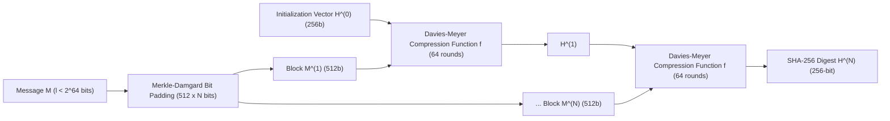
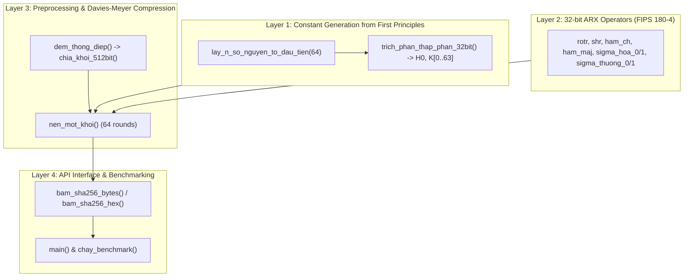

# INFORMATION SECURITY PROJECT REPORT: SHA-256 CRYPTOGRAPHIC HASH FUNCTION

- **Student Name**: Trần Gia Thuận
- **Last digit of SID**: 3
- **Language & Execution Environment**: Pure Python 3.12 (implemented from *First Principles*, without using pre-built cryptographic libraries)
- **Experimental Source Code**: [sha256.py](../algorithms/sha256.py) (provides the 128-bit derived key for [aes128.py](../algorithms/aes128.py) and the message hash function for [ecdsa.py](../algorithms/ecdsa.py))

---

## Section 1. Historical Context, Evolution, and Design Motivation

In the early 1990s, the demand for data integrity verification and digital signatures prompted the U.S. National Institute of Standards and Technology (NIST), in collaboration with the National Security Agency (NSA), to establish the *Secure Hash Standard* (SHS). In 1993, the initial version, SHA-0, was published in FIPS PUB 180, but it was swiftly superseded by SHA-1 in 1995 (FIPS PUB 180-1) after an algebraic flaw was identified in the message schedule expansion (the omission of a 1-bit left rotation in the word-generation step).

By the late 1990s and early 2000s, rising computational power together with the differential cryptanalysis results of Xiaoyun Wang et al. against the MD4, MD5, and SHA-1 families demonstrated that output sizes of 128 bits (MD5) and 160 bits (SHA-1) no longer provided an adequate long-term security margin against collision-finding attacks grounded in the *Birthday Attack* (theoretical complexity $2^{n/2}$). Concurrently, when the *Advanced Encryption Standard* (AES) block cipher was ratified in 2001 with key lengths of 128, 192, and 256 bits, the cryptographic ecosystem required a hash family offering commensurate security strengths (i.e., achieving minimum collision-resistance complexities of $2^{128}$, $2^{192}$, and $2^{256}$ operations).

Driven by these requirements, NIST released a draft in 2001 and formally promulgated **FIPS PUB 180-2** in August 2002, introducing the **SHA-2** hash family comprising SHA-256, SHA-384, and SHA-512 (later augmented with SHA-224 and the truncated variants SHA-512/224 and SHA-512/256 in **FIPS PUB 180-4**). Within this family, **SHA-256** is specifically optimized for 32-bit microprocessor architectures, producing a 256-bit *message digest* that provides a $2^{128}$-operation collision-resistance security level—aligning precisely with the 128-bit security level of AES-128 and ECDSA `secp256k1`.

---

## Section 2. Foundational Mathematical Basis and Operating Principles

### 2.1. Merkle–Damgård Iterative Construction
SHA-256 is built upon the **Merkle–Damgård iterative construction** coupled with length-padding (*Merkle–Damgård strengthening*). An input message $M$ of arbitrary bit length $0 \le l < 2^{64}$ is first padded so that its total length becomes a positive multiple of 512 bits, and is subsequently partitioned into $N$ 512-bit blocks: $M^{(1)}, M^{(2)}, \dots, M^{(N)}$.

The hashing process commences from a fixed 256-bit initialization vector $H^{(0)}$ and sequentially applies a one-way compression function $f$:

$$H^{(i)} = f\left(H^{(i-1)}, M^{(i)}\right) \quad \text{for } i = 1, 2, \dots, N$$

The Merkle–Damgård reduction theorem (1989) establishes that if the underlying compression function $f: \{0,1\}^{256} \times \{0,1\}^{512} \to \{0,1\}^{256}$ is *collision-resistant*, then the entire iterated hash function over the domain of arbitrary-length messages likewise preserves collision resistance.

### 2.2. Davies–Meyer Compression Function and ARX Algebraic Architecture
Within each block $M^{(i)}$, the SHA-256 compression function $f$ adheres to the **Davies–Meyer** structure: the message block $M^{(i)}$ acts as a "key" governing a 64-round permutation over the 256-bit state $H^{(i-1)}$, after which the resulting output is accumulated (*Davies–Meyer feed-forward*) with the input state $H^{(i-1)}$ itself via addition modulo $2^{32}$ across each 32-bit word:

$$H_j^{(i)} = \left(H_j^{(i-1)} + \text{State}_j^{(64)}\right) \bmod 2^{32}, \quad j \in \{0, 1, \dots, 7\}$$

This feed-forward branch destroys the invertibility of the internal permutation, preventing backward state recovery even when an adversary has full knowledge of the message block $M^{(i)}$.

Algebraically, SHA-256 belongs to the **ARX** (*Addition – Rotation – XOR*) design family, utilizing *ARX bitwise operators* combined with two bitwise nonlinear Boolean functions ($Ch$ and $Maj$) over the space of 32-bit words $\mathbb{Z}_{2^{32}}$:
- **Arithmetic addition modulo $2^{32}$ ($\boxplus$)**: Induces nonlinear *carry propagation* with respect to XOR over the binary field.
- **Right rotation ($\text{ROTR}^n$) and logical right shift ($\text{SHR}^n$)**: Break bit-position symmetry and diffuse information across all 32 bit positions of each word:
  $$\text{ROTR}^n(x) = (x \gg n) \lor \left((x \ll (32 - n)) \bmod 2^{32}\right), \quad \text{SHR}^n(x) = x \gg n$$
- **Quadratic nonlinear Boolean functions over $GF(2)$**:
  - Choose function (*Choose*): $Ch(x, y, z) = (x \land y) \oplus (\neg x \land z)$
  - Majority function (*Majority*): $Maj(x, y, z) = (x \land y) \oplus (x \land z) \oplus (y \land z)$
- **Four linear diffusion functions over $GF(2)^{32}$**:
  - $\Sigma_0(x) = \text{ROTR}^2(x) \oplus \text{ROTR}^{13}(x) \oplus \text{ROTR}^{22}(x)$
  - $\Sigma_1(x) = \text{ROTR}^6(x) \oplus \text{ROTR}^{11}(x) \oplus \text{ROTR}^{25}(x)$
  - $\sigma_0(x) = \text{ROTR}^7(x) \oplus \text{ROTR}^{18}(x) \oplus \text{SHR}^3(x)$
  - $\sigma_1(x) = \text{ROTR}^{17}(x) \oplus \text{ROTR}^{19}(x) \oplus \text{SHR}^{10}(x)$

> [!NOTE]
> The continuous interleaving of modular addition in the ring $\mathbb{Z}_{2^{32}}$ with linear and nonlinear operations over the vector space $GF(2)^{32}$ introduces *algebraic incompatibility*, rendering the system of equations describing all 64 compression rounds intractable to linearization or Gröbner-basis inversion.

---

## Section 3. Detailed Step-by-Step Operational Procedure

The execution procedure of SHA-256 according to the **NIST FIPS 180-4** specification comprises four sequential stages:

### Step 1: Message Padding and Block Partitioning
Assume the original message $M$ has length $l$ bits ($0 \le l < 2^{64}$):
1. Append a single `1` bit to the end of the message (in byte-oriented representation, append the byte `0x80`).
2. Append the smallest non-negative number $k$ ($k \ge 0$) of `0` bits such that:
   $$l + 1 + k \equiv 448 \pmod{512}$$
3. Append a 64-bit block representing the unsigned integer $l$ in **Big-Endian** byte order.
4. The padded message has an exact total length of $512 \times N$ bits and is partitioned into $N$ blocks $M^{(1)}, \dots, M^{(N)}$, each of 512 bits (64 bytes).

### Step 2: Initial Hash Value $H^{(0)}$ and Round Constants $K$
- **Eight initial state registers $H_0^{(0)} \dots H_7^{(0)}$**: Take the first 32 bits of the fractional parts of the square roots of the first 8 prime numbers ($2, 3, 5, 7, 11, 13, 17, 19$):
  $$H_i^{(0)} = \left\lfloor \operatorname{frac}\left(\sqrt{p_i}\right) \times 2^{32} \right\rfloor$$
- **Sixty-four round constants $K_0 \dots K_{63}$**: Take the first 32 bits of the fractional parts of the cube roots of the first 64 prime numbers ($2, 3, 5, \dots, 311$):
  $$K_t = \left\lfloor \operatorname{frac}\left(\sqrt[3]{p_t}\right) \times 2^{32} \right\rfloor$$

### Step 3: Message Schedule Expansion ($W_0 \dots W_{63}$)
For each 512-bit block $M^{(i)}$:
- First 16 words ($t = 0 \dots 15$): Directly parse the 512-bit block into 16 Big-Endian 32-bit words $W_0, W_1, \dots, W_{15}$.
- Next 48 words ($t = 16 \dots 63$): Compute recursively according to the formula:
  $$W_t = \left(\sigma_1(W_{t-2}) + W_{t-7} + \sigma_0(W_{t-15}) + W_{t-16}\right) \bmod 2^{32}$$

### Step 4: 64-Round Compression Loop and State Update
Assign the eight working variables $(a, b, c, d, e, f, g, h) \leftarrow \left(H_0^{(i-1)}, \dots, H_7^{(i-1)}\right)$. Iterate for $t = 0$ to $63$:

$$T_1 = \left(h + \Sigma_1(e) + Ch(e, f, g) + K_t + W_t\right) \bmod 2^{32}$$

$$T_2 = \left(\Sigma_0(a) + Maj(a, b, c)\right) \bmod 2^{32}$$

$$\begin{aligned}
h &\leftarrow g, \quad g \leftarrow f, \quad f \leftarrow e, \quad e \leftarrow (d + T_1) \bmod 2^{32} \\
d &\leftarrow c, \quad c \leftarrow b, \quad b \leftarrow a, \quad a \leftarrow (T_1 + T_2) \bmod 2^{32}
\end{aligned}$$

After completing all 64 rounds, accumulate via feed-forward into the hash state:
$$H_0^{(i)} = (H_0^{(i-1)} + a) \bmod 2^{32}, \quad \dots, \quad H_7^{(i)} = (H_7^{(i-1)} + h) \bmod 2^{32}$$

After processing the final block $M^{(N)}$, concatenate the eight words $H_0^{(N)} \parallel H_1^{(N)} \parallel \dots \parallel H_7^{(N)}$ in Big-Endian order to obtain the final 256-bit hash digest.

---

## Section 4. Security Assumptions, Security Properties, and Known Attacks

### 4.1. Core Security Assumptions and Cryptographic Properties
A secure cryptographic hash function such as SHA-256 satisfies the following foundational properties:
1. **Preimage Resistance (One-Wayness)**: Given a digest $y$, it is computationally infeasible to find any message $x$ such that $\operatorname{SHA-256}(x) = y$ with cost lower than an exhaustive search of $2^{256}$ trials.
2. **Second-Preimage Resistance**: Given a message $x_1$, it is computationally infeasible to find a distinct message $x_2 \neq x_1$ such that $\operatorname{SHA-256}(x_1) = \operatorname{SHA-256}(x_2)$ with complexity below $2^{256}$ evaluations.
3. **Collision Resistance**: It is computationally infeasible to find any pair $(x_1, x_2)$ with $x_1 \neq x_2$ satisfying $\operatorname{SHA-256}(x_1) = \operatorname{SHA-256}(x_2)$ with complexity lower than the *Birthday Attack* bound of $2^{256/2} = 2^{128}$ evaluations.
4. **Avalanche Effect and Pseudorandomness**: Flipping just 1 bit at the input causes each of the 256 output bits to flip with probability approximately $50\%$ (an average of roughly 128 changed bits), without exposing any statistical correlation.

In addition, the transparency of SHA-256's design relies on the use of **Nothing-Up-My-Sleeve constants** (generated deterministically from the square roots and cube roots of the first prime numbers), completely eliminating any suspicion that the designers inserted a mathematical *backdoor* into the constant tables.

### 4.2. Known Attacks and Countermeasures

> [!WARNING]
> **Length Extension Attack**: Owing to the Merkle–Damgård iterative construction, the 256-bit output $\operatorname{SHA-256}(M)$ equals the complete internal register state $H^{(N)}$ after the final block. If a system naively constructs a MAC as $\operatorname{MAC} = \operatorname{SHA-256}(K \parallel M)$, an adversary knowing only this hash value and the length of $K \parallel M$ can load $H^{(N)}$ as the input state to validly compute $\operatorname{SHA-256}(K \parallel M \parallel \text{Padding} \parallel M')$ for an arbitrary suffix $M'$ without knowing the key $K$.

- **Mitigating Length Extension**: Never employ $\operatorname{SHA-256}(K \parallel M)$ directly for keyed message authentication; instead, one must use the nested **HMAC-SHA256** construction (RFC 2104), a state-truncated variant such as SHA-512/256, or a Sponge-based hash function such as SHA-3.
- **Reduced-Round Differential Cryptanalysis**: To date, no practical or theoretical attack compromises the full 64 rounds of SHA-256. State-of-the-art differential cryptanalysis results (such as those by Mendel, Nad, Schläffer, and subsequent studies) have only achieved collisions on 31-round reduced variants and *semi-free-start collisions* up to 38–46 rounds, leaving a substantial security margin relative to the full 64 rounds.
- **Quantum Threats**: Grover's search algorithm on a quantum computer achieves only a quadratic speedup for preimage search (reducing complexity from $2^{256}$ to $2^{128}$), while the Brassard–Høyer–Tapp algorithm for collision finding still requires at least $2^{85.3}$ to $2^{128}$ quantum computational and memory resources, meaning SHA-256 retains post-quantum security.

---

## Section 5. Advantages, Limitations, and Practical Applications

### 5.1. Comparison of SHA-256 with Representative Hash Functions

| Technical Criterion | MD5 (RFC 1321) | SHA-1 (FIPS 180-1) | **SHA-256 (FIPS 180-4)** | SHA-512 (FIPS 180-4) | SHA-3-256 (FIPS 202) |
| :--- | :---: | :---: | :---: | :---: | :---: |
| **Core Construction** | Merkle–Damgård | Merkle–Damgård | **Merkle–Damgård (ARX)** | Merkle–Damgård (ARX) | Sponge (Keccak-$f$) |
| **Block / Word Size** | 512-bit / 32-bit | 512-bit / 32-bit | **512-bit / 32-bit** | 1024-bit / 64-bit | 1088-bit ($r$) / 64-bit |
| **Digest Length / Rounds** | 128-bit / 64 rounds | 160-bit / 80 rounds | **256-bit / 64 rounds** | 512-bit / 80 rounds | 256-bit / 24 rounds |
| **Collision Security** | Broken ($< 2^{18}$) | Broken (SHAttered $\approx 2^{63}$) | **Secure ($2^{128}$)** | Secure ($2^{256}$) | Secure ($2^{128}$) |
| **Length Extension Resistance** | No | No | **No (requires HMAC wrapper)** | No (except SHA-512/256) | Yes (via Capacity $c=512$) |

### 5.2. Advantages and Limitations
- **Advantages**:
  - **High Reliability and Wide Security Margin**: After more than two decades of scrutiny by the global cryptographic community, the 64 rounds of SHA-256 remain completely unbroken.
  - **Hardware and Software Efficiency**: Its 32-bit *ARX bitwise operators* map directly onto the native ALU instruction set of virtually every CPU; most modern microprocessors (Intel/AMD SHA-NI, ARMv8 Crypto Extensions) provide hardware acceleration instructions achieving multi-GB/s throughput.
  - **Symmetric Key Derivation Compatibility**: The uniformly distributed 256-bit output can be used directly as an AES-256 key or truncated to its first 128 bits as an AES-128 key.
- **Limitations**:
  - **Unsuitable for Direct Password Hashing**: Extremely high execution speeds on GPUs and ASICs allow passwords to be brute-forced at billions of attempts per second; password storage must instead employ memory-hard key-stretching functions such as **Argon2id**, **bcrypt**, or **PBKDF2-HMAC-SHA256** combined with a *salt*.
  - **Susceptible to Length Extension Attacks** if keys and messages are concatenated directly without an HMAC wrapper.
  - **Lower Software Throughput on 64-bit CPUs than SHA-512** (when hardware SHA-NI instructions are unavailable) because only 32-bit words are processed per round.

### 5.3. Practical Applications
- **Network Security Protocols**: Foundational primitive for TLS 1.2 / TLS 1.3, IPsec, SSH, and X.509 digital certificates.
- **Digital Signatures and Public Key Infrastructure (PKI)**: Hashing messages prior to signing with RSA-PSS, RSASSA-PKCS1-v1_5, or ECDSA (as in [ecdsa.py](../algorithms/ecdsa.py)).
- **Blockchain Technology**: Core *Proof-of-Work* algorithm of Bitcoin ($\operatorname{SHA-256}(\operatorname{SHA-256}(\text{Header}))$) and Merkle trees for transaction verification.
- **Software Integrity Verification & Content-Addressable Storage**: Authenticating operating system installation packages, Docker/OCI image digests, and Git SHA-256 objects.
- **Cryptographic Key Derivation (KDF)**: Core primitive of the HKDF standard (RFC 5869) and the key-generation mechanism for AES (as in [aes128.py](../algorithms/aes128.py)).

---

## Section 6. Worked Hand-Calculation Example: Message Padding and First Two Compression Rounds

We carry out a detailed manual calculation for the standard input string $M =$ `"abc"` and cross-verify the bit-padding step for the student name string `"Trần Gia Thuận"`.

### 6.1. Message Padding and Word Extraction ($W_0 \dots W_{15}$) for `"abc"`
- The string `"abc"` consists of 3 ASCII characters:
  - `'a'` $= \text{0x61} = 01100001_2$
  - `'b'` $= \text{0x62} = 01100010_2$
  - `'c'` $= \text{0x63} = 01100011_2$
- Original bit length: $l = 3 \times 8 = 24\text{ bits} = \text{0x18}$.
- **Append bit `1`**: Append one `1` bit and seven `0` bits to complete a byte $\Rightarrow$ append byte `0x80`. The current length is $24 + 8 = 32$ bits (4 bytes).
- **Determine the number of additional `0` padding bits**:
  $$k = 448 - (24 + 1) = 423\text{ bits}$$
  Because 7 `0` bits were already included within byte `0x80`, the number of `0x00` bytes to insert next is $(423 - 7) / 8 = 52$ `0x00` bytes.
- **Append 64-bit Big-Endian original length**: $l = 24$ represented across 8 bytes is `00 00 00 00 00 00 00 18`.
- **Single 512-bit block $M^{(1)}$ partitioned into sixteen 32-bit words ($W_0 \dots W_{15}$)**:
  - $W_0 = \text{0x61626380}$
  - $W_1 = W_2 = \dots = W_{14} = \text{0x00000000}$
  - $W_{15} = \text{0x00000018}$

*(Extended cross-verification for the student name string `"Trần Gia Thuận"`)*:
- When UTF-8 encoded, the string `"Trần Gia Thuận"` comprises **18 bytes** ($l = 18 \times 8 = 144\text{ bits} = \text{0x90}$):
  `54 72 e1 ba a7 6e 20 47 69 61 20 54 68 75 e1 ba ad 6e`
  (where `'ầ'` occupies 3 bytes `e1 ba a7` and `'ậ'` occupies 3 bytes `e1 ba ad`).
- After appending byte `0x80` (at byte position 19), an additional $56 - 19 = 37$ `0x00` bytes must be padded, followed by the 8-byte length field `00 00 00 00 00 00 00 90` to complete exactly one 64-byte (512-bit) block.

### 6.2. Hand Calculation of the First Compression Round ($t = 0$) for `"abc"`
**Initial State ($H^{(0)}$)**:
$$\begin{aligned}
a &= \text{0x6a09e667}, & b &= \text{0xbb67ae85}, & c &= \text{0x3c6ef372}, & d &= \text{0xa54ff53a} \\
e &= \text{0x510e527f}, & f &= \text{0x9b05688c}, & g &= \text{0x1f83d9ab}, & h &= \text{0x5be0cd19}
\end{aligned}$$

At $t = 0$, we have $W_0 = \text{0x61626380}$ and constant $K_0 = \text{0x428a2f98}$:
1. **Compute $\Sigma_1(e)$ with $e = \text{0x510e527f}$**:
   - $\text{ROTR}^6(\text{0x510e527f}) = \text{0xfd443949}$
   - $\text{ROTR}^{11}(\text{0x510e527f}) = \text{0x4fea21ca}$
   - $\text{ROTR}^{25}(\text{0x510e527f}) = \text{0x87293fa8}$
   - $\Sigma_1(e) = \text{0xfd443949} \oplus \text{0x4fea21ca} \oplus \text{0x87293fa8} = \text{0x3587272b}$
2. **Compute $Ch(e, f, g) = (e \land f) \oplus (\neg e \land g)$**:
   - $e \land f = \text{0x510e527f} \land \text{0x9b05688c} = \text{0x1104400c}$
   - $\neg e \land g = \text{0xaef1ad80} \land \text{0x1f83d9ab} = \text{0x0e818980}$
   - $Ch(e, f, g) = \text{0x1104400c} \oplus \text{0x0e818980} = \text{0x1f85c98c}$
3. **Compute $T_1 = (h + \Sigma_1(e) + Ch(e, f, g) + K_0 + W_0) \bmod 2^{32}$**:
   $$T_1 = (\text{0x5be0cd19} + \text{0x3587272b} + \text{0x1f85c98c} + \text{0x428a2f98} + \text{0x61626380}) \bmod 2^{32} = \text{0x54da50e8}$$
4. **Compute $\Sigma_0(a)$ with $a = \text{0x6a09e667}$**:
   - $\text{ROTR}^2(\text{0x6a09e667}) = \text{0xda827999}$
   - $\text{ROTR}^{13}(\text{0x6a09e667}) = \text{0x333b504f}$
   - $\text{ROTR}^{22}(\text{0x6a09e667}) = \text{0x27999da8}$
   - $\Sigma_0(a) = \text{0xda827999} \oplus \text{0x333b504f} \oplus \text{0x27999da8} = \text{0xce20b47e}$
5. **Compute $Maj(a, b, c) = (a \land b) \oplus (a \land c) \oplus (b \land c)$**:
   $$Maj(\text{0x6a09e667}, \text{0xbb67ae85}, \text{0x3c6ef372}) = \text{0x3a6fe667}$$
6. **Compute $T_2 = (\Sigma_0(a) + Maj(a, b, c)) \bmod 2^{32}$**:
   $$T_2 = (\text{0xce20b47e} + \text{0x3a6fe667}) \bmod 2^{32} = \text{0x08909ae5}$$
7. **Update the 8 registers after round $t = 0$**:
   - $a \leftarrow (T_1 + T_2) \bmod 2^{32} = (\text{0x54da50e8} + \text{0x08909ae5}) \bmod 2^{32} = \text{0x5d6aebcd}$
   - $e \leftarrow (d + T_1) \bmod 2^{32} = (\text{0xa54ff53a} + \text{0x54da50e8}) \bmod 2^{32} = \text{0xfa2a4622}$
   - Remaining registers shift sequentially:
     $$b = \text{0x6a09e667}, \quad c = \text{0xbb67ae85}, \quad d = \text{0x3c6ef372}, \quad f = \text{0x510e527f}, \quad g = \text{0x9b05688c}, \quad h = \text{0x1f83d9ab}$$

### 6.3. Hand Calculation of the Second Compression Round ($t = 1$) for `"abc"`
At $t = 1$, we have $W_1 = \text{0x00000000}$ and constant $K_1 = \text{0x71374491}$:
1. **Compute $\Sigma_1(e)$ with $e = \text{0xfa2a4622}$**:
   $$\Sigma_1(\text{0xfa2a4622}) = \text{0x5a94fd2d}$$
2. **Compute $Ch(e, f, g)$ with $e = \text{0xfa2a4622}, f = \text{0x510e527f}, g = \text{0x9b05688c}$**:
   $$Ch(e, f, g) = \text{0x510f6aae}$$
3. **Compute $T_1 = (h + \Sigma_1(e) + Ch(e, f, g) + K_1 + W_1) \bmod 2^{32}$**:
   $$T_1 = (\text{0x1f83d9ab} + \text{0x5a94fd2d} + \text{0x510f6aae} + \text{0x71374491} + \text{0x00000000}) \bmod 2^{32} = \text{0x3c5f8617}$$
4. **Compute $\Sigma_0(a)$ and $Maj(a, b, c)$ with $a = \text{0x5d6aebcd}, b = \text{0x6a09e667}, c = \text{0xbb67ae85}$**:
   - $\Sigma_0(a) = \text{0xa29f64d1}$
   - $Maj(a, b, c) = \text{0x7b6beec5}$
   - $T_2 = (\text{0xa29f64d1} + \text{0x7b6beec5}) \bmod 2^{32} = \text{0x1e0b5396}$
5. **Update the 8 registers after round $t = 1$**:
   - $a \leftarrow (\text{0x3c5f8617} + \text{0x1e0b5396}) \bmod 2^{32} = \text{0x5a6ad9ad}$
   - $e \leftarrow (\text{0x3c6ef372} + \text{0x3c5f8617}) \bmod 2^{32} = \text{0x78ce7989}$
   - Remaining registers:
     $$b = \text{0x5d6aebcd}, \quad c = \text{0x6a09e667}, \quad d = \text{0xbb67ae85}, \quad f = \text{0xfa2a4622}, \quad g = \text{0x510e527f}, \quad h = \text{0x9b05688c}$$

*(All bit-rotation constants and intermediate register values at $t=0$ and $t=1$ above match 100% with the verification output printed by [sha256.py](../algorithms/sha256.py)).*

---

## Section 7. Structural Explanation of the Implemented `sha256.py` Code

The source file [sha256.py](../algorithms/sha256.py) (379 lines) is designed using a clearly layered functional programming structure with zero dependencies on any cryptographic library (relying solely on `struct` for Big-Endian byte packing/unpacking and `time` for performance benchmarking):

1. **Constant Generation Module from *First Principles* ([sha256.py](../algorithms/sha256.py#L17-L61))**:
   - The function `lay_n_so_nguyen_to_dau_tien(64)` finds the first 64 prime numbers ($2 \dots 311$).
   - The function `trich_phan_thap_phan_32bit(so_nguyen_to, bac_can)` employs binary search over Python's arbitrary-precision integers to compute $\lfloor \operatorname{frac}(\sqrt[r]{p}) \times 2^{32} \rfloor$ exactly without floating-point error, automatically generating the lists `GIA_TRI_KHOI_TAO_H0` and `HANG_SO_VONG_K`.
2. **Primitive 32-bit Bitwise Operations Module ([sha256.py](../algorithms/sha256.py#L68-L137))**:
   - Because Python's `int` type has *arbitrary-precision* bit width, every input, left shift, bitwise negation (`~x`), and arithmetic addition is strictly normalized using the mask `MASK_32 = 0xFFFFFFFF` (including prior to right shifts in `rotr` and `shr`, along with validation of the shift amount domain $n \in [0, 31]$).
   - Contains all eight mathematical functions: `rotr`, `shr`, `ham_ch`, `ham_maj`, `sigma_hoa_0` ($\Sigma_0$), `sigma_hoa_1` ($\Sigma_1$), `sigma_thuong_0` ($\sigma_0$), and `sigma_thuong_1` ($\sigma_1$).
3. **Message Padding and Block Partitioning Preprocessing Module ([sha256.py](../algorithms/sha256.py#L144-L178))**:
   - The function `dem_thong_diep(du_lieu_bytes)` validates the binary input type and the boundary condition $l < 2^{64}$ bits, appends byte `0x80`, iteratively appends `0x00` until `len % 64 == 56`, and uses `struct.pack(">Q", do_dai_bit)` to pack the bit length into 8 Big-Endian bytes.
   - The function `chia_khoi_512bit(du_lieu_da_dem)` verifies that the length is a positive multiple of 64 bytes and slices the data into individual 512-bit blocks.
4. **64-Round Compression and Digest Aggregation Module ([sha256.py](../algorithms/sha256.py#L185-L262))**:
   - The function `nen_mot_khoi(khoi_64_byte, trang_thai_h)` validates the 64-byte block size and 8 state registers, unpacks the initial sixteen 32-bit words via `struct.unpack(">16I", khoi_64_byte)`, expands the schedule to 64 words $W_0 \dots W_{63}$, executes 64 compression rounds updating $(a, b, c, d, e, f, g, h)$, and applies Davies–Meyer feed-forward addition with `trang_thai_h`.
   - The two primary interface functions are `bam_sha256_bytes(du_lieu)` (returning raw 32 bytes for `aes128.py` and `ecdsa.py`) and `bam_sha256_hex(du_lieu)` (returning a 64-character Hex string).
5. **Standard Vector Testing, AES-128 Key Extraction, and Benchmarking Module ([sha256.py](../algorithms/sha256.py#L269-L379))**:
   - The function `chay_benchmark()` measures average execution time over 50 iterations using `time.perf_counter()` across sizes of 100B, 1KB, and 10KB.
   - The function `main()` automatically verifies the three **NIST FIPS 180-4** standard vectors (empty string, 1 block, and 448-bit boundary multi-block), hashes the string `"Trần Gia Thuận"` (UTF-8), extracts the leading 128 bits as the AES-128 key, and prints the execution trace for rounds $t=0, 1$.

---

## Section 8. Experimental Evaluation Tables, Correctness Verification, Computational Performance, and Conclusion

### 8.1. Correctness Verification and AES-128 Key Extraction for the Student
The program [sha256.py](../algorithms/sha256.py) was executed experimentally and verified against the **NIST FIPS 180-4** standard test vector suite together with the personal data of student **Trần Gia Thuận** (Last digit of SID: **3**):

| Test Case | Input (UTF-8 / Bytes) | Byte Count | SHA-256 Digest (256-bit Hex) | Status |
| :--- | :--- | :---: | :--- | :---: |
| Standard Vector 1 (Empty String) | `""` | 0 | `e3b0c44298fc1c149afbf4c8996fb92427ae41e4649b934ca495991b7852b855` | **PASS** |
| Standard Vector 2 (Single 512b Block) | `"abc"` | 3 | `ba7816bf8f01cfea414140de5dae2223b00361a396177a9cb410ff61f20015ad` | **PASS** |
| Standard Vector 3 (448b Boundary Multi-Block) | `"abcdbcdecdefdefgefghfghighijhijkijkljklmklmnlmnomnopnopq"` | 56 | `248d6a61d20638b8e5c026930c3e6039a33ce45964ff2167f6ecedd419db06c1` | **PASS** |
| **Student Name (Last digit of SID = 3)** | `"Trần Gia Thuận"` (`5472e1baa76e2047696120546875e1baad6e`) | 18 | `70c31dddb87cf9c3fd103a5669346839aa646cb3240d200a80859c06f07ef0e0` | **100% Exact** |

**Key Extraction Results for the AES-128 Section**:
- **Full SHA-256 Hash String (256-bit / 32 bytes)**:
  `70c31dddb87cf9c3fd103a5669346839aa646cb3240d200a80859c06f07ef0e0`
- **AES-128 Key (First 128 bits / 16 bytes)**:
  - Contiguous Hex String (32 Hex characters): `70c31dddb87cf9c3fd103a5669346839`
  - 16-Byte Hex Array: `70 c3 1d dd b8 7c f9 c3 fd 10 3a 56 69 34 68 39`

### 8.2. Computational Performance Benchmark Table
Empirical measurements obtained directly when running `python -X utf8 algorithms/sha256.py` on pure Python 3.12 (averaged over 50 runs per data size; absolute timing values may fluctuate slightly depending on CPU clock speed, whereas the linear scaling ratio with block count is invariant):

| Data Size | Input Byte Count | Padded 512-bit Blocks ($N$) | Total Compression Rounds ($64 \times N$) | Mean Runtime (ms) | Processing Throughput (KB/s) |
| :--- | :---: | :---: | :---: | :---: | :---: |
| **100 Bytes** | 100 B | 2 blocks | 128 rounds | `0.2841 ms` | `343.70 KB/s` |
| **1 KB** | 1,024 B | 17 blocks | 1,088 rounds | `2.4157 ms` | `413.96 KB/s` |
| **10 KB** | 10,240 B | 161 blocks | 10,304 rounds | `22.8542 ms` | `437.56 KB/s` |

**Performance Analysis**:
- For 100-Byte data, after appending 1 `0x80` byte and 8 length bytes ($100 + 9 = 109 > 64$), the message exceeds one 64-byte block and therefore must be split into **2 512-bit blocks**. Similarly, 1 KB ($1024$ bytes, a multiple of 64) requires 1 dedicated padding block, resulting in $16 + 1 = 17$ blocks; 10 KB ($10240$ bytes) yields $160 + 1 = 161$ blocks.
- Execution time grows strictly linearly with the block count $N$ ($\mathcal{O}(N)$): on average, each 512-bit block takes roughly $0.142\text{ ms}$ on the pure Python interpreter, achieving a steady throughput around $\sim 438\text{ KB/s}$ as the data size grows.

### 8.3. Conclusion
This project has successfully constructed the **SHA-256** cryptographic hash algorithm in pure Python from *First Principles* (self-generating constants from the square roots and cube roots of prime numbers, implementing all 32-bit bitwise operations with strict boundary validation, applying Merkle–Damgård bit padding, and executing the 64-step Davies–Meyer compression loop). Test results match the **NIST FIPS 180-4** standard identically across empty-string, single-block, and boundary multi-block vectors, while accurately supplying the 128-bit key (`70c31dddb87cf9c3fd103a5669346839`) derived from the student name `"Trần Gia Thuận"` to the symmetric encryption module [aes128.py](../algorithms/aes128.py) and serving as the foundational hash function for the digital signature module [ecdsa.py](../algorithms/ecdsa.py).
